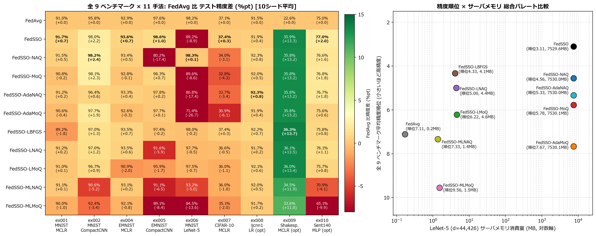

# FedSSO × 慣性付準ニュートン法（MoQ ファミリー）比較実験プロジェクト

論文 *"FedSSO: A Federated Server-Side Second-Order Optimization Algorithm"* (Ma et al., 2022) のサーバ側 2 次最適化手法（`FedSSO` / `FedSSO-LBFGS`）に対し、慣性付準ニュートン法ファミリー 8 手法（`NAQ`, `MoQ`, `AdaNAQ`, `AdaMoQ`, `LNAQ`, `LMoQ`, `MLNAQ`, `MLMoQ`）および `FedAvg` の **全 11 アルゴリズム** を **10 種類の乱数シード（`42`〜`51`）** で体系的に実装・比較した検証リポジトリです。

原論文に掲載されている **全ベンチマーク（MNIST, EMNIST, CIFAR-10, LIBSVM `ijcnn1`, Shakespeare, Sent140 + GloVe）および局所ステップ数 $\tau$・Non-IID 度 $\beta$・慣性係数 $\mu$・履歴数 $m$・曲率クリッピングアブレーション** を `ex001`〜`ex011` として網羅的に実装・評価しています。

---

## プロジェクト構成

```text
fedsso_moq/
├── ex001/                  # MNIST MCLR（強凸, d=7,850, 200r, 11手法×10シード）
├── ex002/                  # MNIST CompactCNN（非凸, d=6,230, 200r, 11手法×10シード）
├── ex003/                  # 200r統一解析（3A 慣性感度, 3B 履歴数m, 3C 曲率クリップ, 3D スケーリング）
├── ex004/                  # EMNIST Digits MCLR（28万枚強凸, d=7,850, 200r）
├── ex005/                  # EMNIST Digits CompactCNN（28万枚非凸, d=6,230, 200r）
├── ex006/                  # MNIST LeNet-5（大規模非凸, d=44,426, 400r, in-place BFGS）
├── ex007/                  # CIFAR-10 MCLR（カラー画像, d=30,730, N=10, 50r）
├── ex008/                  # LIBSVM ijcnn1 BinaryLR（表形式, d=46, N=3, 50r, same/opt）
├── ex009/                  # Shakespeare 次文字予測 MCLR（疎テキスト, d=16,965, N=10, 200r, same/opt）
├── ex010/                  # Sent140 + GloVe Twitter 27B 200d MLP（自然言語, d=15,010, N=10, 200r, same/opt）
├── ex011/                  # 局所ステップ数 τ∈{1..50}（11A）＆ Non-IID度 β 耐性（11B, 計1,100試行）
│   └── (各実験とも model.py / utils.py / ex{n:03}.ipynb を格納)
├── report/
│   ├── report.md           # 全11実験統合レポート
│   ├── ex001.md 〜 ex011.md# 各実験の詳細レポート・考察
│   └── img/                # 全実験の学習曲線・箱ひげ図・パレート図・横断比較図
├── requirements.txt        # 実行環境の Python パッケージ一覧 (pip freeze)
├── LICENSE                 # MIT License
└── .gitignore              # datasets/, venv/, ref/ 等を除外
```

---

## 全実験サマリー（全 9 ベンチマーク × 11 手法・10 シード平均精度）

詳細な数値・通信効率・サーバメモリ/計算時間比較・考察は [統合レポート (report/report.md)](./report/report.md) および各実験レポートを参照してください。

| 実験 | データセット / モデル ($d$) | `FedAvg` | `FedSSO` | `FedSSO-NAQ` | `FedSSO-MoQ` | `FedSSO-AdaNAQ` | `FedSSO-LBFGS` | `FedSSO-LNAQ` | `FedSSO-LMoQ` | 個別レポート |
| :---: | :--- | :---: | :---: | :---: | :---: | :---: | :---: | :---: | :---: | :--- |
| `ex001` | MNIST MCLR (7,850) | 0.9099 | **0.9170** | 0.9145 | 0.9077 | 0.9116 | 0.8922 | 0.9116 | 0.9105 | [ex001.md](./report/ex001.md) |
| `ex002` | MNIST CompactCNN (6,230) | 0.9577 | 0.9800 | **0.9818** | 0.9807 | 0.9641 | 0.9703 | 0.9698 | 0.9669 | [ex002.md](./report/ex002.md) |
| `ex004` | EMNIST MCLR (7,850) | 0.9286 | **0.9357** | 0.9340 | 0.9281 | 0.9328 | 0.9353 | 0.9347 | 0.9089 | [ex004.md](./report/ex004.md) |
| `ex005` | EMNIST CompactCNN (6,230) | 0.9755 | **0.9859** | 0.8015 | 0.9827 | 0.9776 | 0.9740 | 0.9161 | 0.9586 | [ex005.md](./report/ex005.md) |
| `ex006` | MNIST LeNet-5 (44,426, 400r) | 0.9816 | 0.8924 | **0.9827** | 0.8958 | 0.8081 | 0.9797 | 0.9769 | 0.9749 | [ex006.md](./report/ex006.md) |
| `ex007` | CIFAR-10 MCLR (30,730, 50r) | 0.3708 | **0.3736** | 0.3402 | 0.3278 | 0.3366 | **0.3736** | 0.3663 | 0.3603 | [ex007.md](./report/ex007.md) |
| `ex008` | ijcnn1 BinaryLR (46, opt) | 0.9153 | 0.9195 | 0.9229 | 0.9201 | **0.9233** | 0.9225 | 0.9171 | 0.9210 | [ex008.md](./report/ex008.md) |
| `ex009` | Shakespeare MCLR (16,965, opt) | 0.2261 | 0.3593 | 0.3579 | 0.3582 | 0.3583 | **0.3628** | 0.3606 | 0.3600 | [ex009.md](./report/ex009.md) |
| `ex010` | Sent140 GloVe MLP (15,010, opt) | 0.7499 | **0.7700** | 0.7663 | 0.7684 | 0.7674 | 0.7584 | 0.7614 | 0.7575 | [ex010.md](./report/ex010.md) |

- **感度分析・アブレーション (`ex003`)**: $\mu, \mu_{\max} \in [0.1, 0.9]$、履歴数 $m \in \{1,2,4,8,16,32\}$、正定値保証クリッピング有無、理論スケーリング ($d \le 10^6$) を 200 ラウンド統一検証 → [ex003.md](./report/ex003.md)
- **局所ステップ $\tau$・Non-IID 度 $\beta$ 耐性 (`ex011`)**: $\tau \in \{1, 10, 20, 30, 40, 50\}$ および $\beta \in \{0.05, 0.2, 1.0, \mathrm{IID}\}$ 全 11 手法 × 10 シード → [ex011.md](./report/ex011.md)



---

## 主な実装特徴と実験の再現・カスタマイズ方法

### 1. GPU 並列クライアント SGD と省メモリ In-Place BFGS
- `torch.bmm`（MCLR・BinaryLR・MLP）および `groups=N` グループ化畳み込み（CompactCNN・LeNet-5）で全クライアントの局所 SGD を一括並列化し、逐次ループとの最大絶対誤差が単精度丸め誤差以下であることを全実験で検証しています。
- 大規模モデル（`LeNet-5` `7.53 GB` 等）では `H.addmm_(U, V)` による完全 in-place rank-2 BFGS 更新を適用しています。

### 2. シード値・アルゴリズム別の履歴保存と絞り込みグラフ描画
各実験ノートブックの末尾セル（`# ここを変更して特定のシード値・アルゴリズムのグラフを表示`）では、保存済みのシード別・ラウンド別 CSV（`datasets/ex*_history.csv`, `datasets/ex*_logs/*.csv`）から任意のアルゴリズム・シード値だけを指定して即座に再描画できます。

- `SELECTED_SEEDS = None`（全シード対象）のとき、`PLOT_MEAN_ONLY = "auto"` および `TABLE_MEAN_ONLY = "auto"` により**自動的に全シード平均の曲線・表のみ**を出力します。
- `SELECTED_SEEDS = [42, 46]` のように特定シードを指定すると、各シードの個別曲線・シード別表が出力されます（`PLOT_MEAN_ONLY = True` / `False` で明示指定も可能）。

---

## 環境構築と実行手順

```bash
python -m venv venv
# Windows (PowerShell)
.\venv\Scripts\Activate.ps1
pip install -r requirements.txt
```

各実験は `ex001/ex001.ipynb` 〜 `ex011/ex011.ipynb` を順方向（または末尾フィルタセルのみ）で実行できます。

---

## ライセンス

本プロジェクトは [MIT License](./LICENSE) のもとで公開されています。
