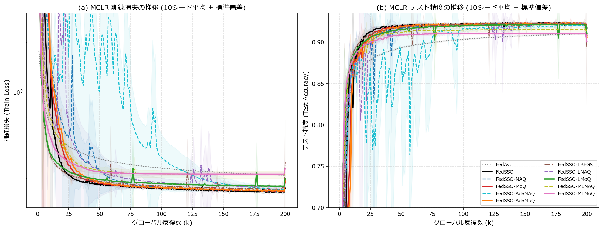
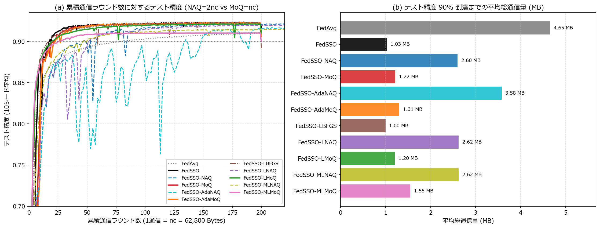
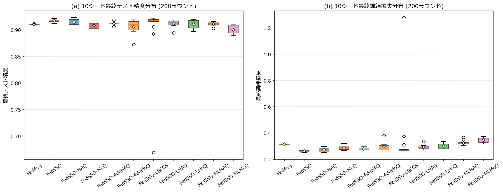

# 実験1 (ex001): 強凸モデル (MCLR) における FedSSO × MoQ ファミリー 10シード比較実験

## 1. 実験の目的

本実験（[ex001.ipynb](../ex001/ex001.ipynb)）では、強凸目的関数（$L_2$ 正則化付き多項ロジスティック回帰: `MCLR`, パラメータ数 $d = 7,850$）の Non-IID 連合学習環境において、原論文 FedSSO（Ma et al., 2022）のサーバ側 2 次近似手法に慣性付準ニュートン法ファミリー（`NAQ`, `MoQ`, `AdaNAQ`, `AdaMoQ`, `LNAQ`, `LMoQ`, `MLNAQ`, `MLMoQ`）を適用し、原論文の `FedSSO` / `FedSSO-LBFGS` および 1 次ベースライン `FedAvg` と **10 種類の乱数シード（`42`〜`51`）** で性能・安定性・通信効率・計算資源を定量比較する。

---

## 2. 実験設定と実装詳細

### 2.1 データセットと Non-IID 分割
- **データセット**: MNIST 全 70,000 サンプル（[ex001/utils.py](../ex001/utils.py)）
- **Non-IID 分割**: 論文 Appendix (p.10) の PFL-Non-IID 設定に準拠し、クライアント数 $N = 20$ に対しクラスごとに Dirichlet 分布 $\mathrm{Dir}(\beta = 0.1)$ で分割した（各クライアント内で訓練 75%・テスト 25% に分割、全体訓練 52,492 サンプル・テスト 17,508 サンプル）。
- **モデル**: [ex001/model.py](../ex001/model.py) に定義した `MCLR`（入力 784 次元 $\to$ 出力 10 クラス、$L_2$ 正則化係数 $\mu_{\mathrm{reg}} = 10^{-4}$、総パラメータ数 $d = 7,850$、1 通信ラウンド基準通信量 $n_c = 7,850 \times 8 = 62,800\,\mathrm{B}$）。

### 2.2 比較アルゴリズム（全 11 手法）と共通ハイパーパラメータ
- **共通連合学習設定**: 局所更新ステップ数 $\tau = 5$、ミニバッチサイズ $\mathrm{BS} = 100$、グローバル反復数 $K = 200$、シード 10 種類（`42, 43, 44, 45, 46, 47, 48, 49, 50, 51`）。
- **FedSSO 統一パラメータ**: 局所学習率 $\alpha = 0.001$、グローバルステップ長 $\eta = 1.0$、正定値保証用曲率クリッピング $\lambda = 10^{-4},\ \Lambda = 9,999$、周期リセット $R = 200$、安全ステップノルム上限 `max_step_norm = 20.0`。
- **MoQ ファミリー適用パラメータ**:
  - 固定慣性系（`FedSSO-NAQ`, `FedSSO-MoQ`）: $\mu = 0.3$
  - 適応慣性系（`FedSSO-AdaNAQ`, `FedSSO-AdaMoQ`, `FedSSO-LNAQ`, `FedSSO-LMoQ`, `FedSSO-MLNAQ`, `FedSSO-MLMoQ`）: 式(64)–(65)（$\theta_1 = 1,\ \gamma = 10^{-5}$）＋ 上限キャップ $\mu_{\max} = 0.4$
  - 記憶制限履歴数（`FedSSO-LBFGS`, `FedSSO-LNAQ`, `FedSSO-LMoQ`）: $m = 10$
- **1 次ベースライン（`FedAvg`）**: 論文 Table 1 の最適設定 $\alpha = 0.03$。

### 2.3 GPU 並列クライアント SGD の数値等価性検証
[ex001/utils.py](../ex001/utils.py) の `batched_mclr_local_sgd` では、`torch.bmm` を用いて全 20 クライアントの $\tau = 5$ ステップ局所 SGD を GPU 上で一括並列計算している。同一ミニバッチ系列に対する逐次クライアントループとの最大絶対誤差は **`1.118e-08`**（単精度浮動小数点丸め誤差レベル）であり、数学的に完全に一致していることを確認した。

---

## 3. 10 シード比較実験結果

### 3.1 200 ラウンド時点のテスト精度・訓練損失（Ave / Med / Best / Worst / Std）

| 手法 | $\mathrm{Acc}$ Ave | $\mathrm{Acc}$ Med | $\mathrm{Acc}$ Best | $\mathrm{Acc}$ Worst | $\mathrm{Acc}$ Std | $\mathrm{MaxAcc}$ Ave (Best) | $\mathrm{Loss}$ Ave | $\mathrm{Loss}$ Best | $\mathrm{Loss}$ Worst | クリップ平均 |
| :--- | :---: | :---: | :---: | :---: | :---: | :---: | :---: | :---: | :---: | :---: |
| `FedAvg` ($\alpha=0.03$) | 0.9099 | 0.9097 | 0.9117 | 0.9091 | **0.0007** | 0.9105 (0.9118) | 0.3140 | 0.3128 | 0.3148 | 0.0 |
| **`FedSSO`** | **0.9170** | **0.9176** | 0.9214 | **0.9118** | 0.0028 | 0.9246 (0.9249) | **0.2621** | **0.2505** | **0.2792** | 0.0 |
| `FedSSO-NAQ` | 0.9145 | 0.9147 | **0.9231** | 0.9051 | 0.0056 | 0.9242 (0.9248) | 0.2726 | 0.2515 | 0.2973 | 0.0 |
| `FedSSO-MoQ` | 0.9077 | 0.9088 | 0.9169 | 0.8959 | 0.0064 | 0.9246 (**0.9251**) | 0.2879 | 0.2685 | 0.3204 | 0.0 |
| `FedSSO-AdaNAQ` | 0.9116 | 0.9117 | 0.9182 | 0.9060 | 0.0034 | 0.9217 (0.9245) | 0.2794 | 0.2630 | 0.2991 | 0.0 |
| `FedSSO-AdaMoQ` | 0.9058 | 0.9098 | 0.9188 | 0.8723 | 0.0133 | **0.9247** (**0.9251**) | 0.2955 | 0.2639 | 0.3810 | 0.0 |
| `FedSSO-LBFGS` ($m=10$) | 0.8922 | **0.9176** | 0.9218 | 0.6688 | 0.0746 | 0.9236 (0.9243) | 0.3750 | 0.2626 | 1.2792 | 0.0 |
| `FedSSO-LNAQ` ($m=10$) | 0.9116 | 0.9132 | 0.9186 | 0.8941 | 0.0069 | 0.9226 (0.9236) | 0.2944 | 0.2694 | 0.3376 | 0.1 |
| `FedSSO-LMoQ` ($m=10$) | 0.9105 | 0.9129 | 0.9196 | 0.8970 | 0.0077 | 0.9220 (0.9228) | 0.2998 | 0.2785 | 0.3353 | 0.1 |
| `FedSSO-MLNAQ` | 0.9112 | 0.9119 | 0.9155 | 0.9026 | 0.0036 | 0.9154 (0.9181) | 0.3257 | 0.3044 | 0.3662 | 73.0 |
| `FedSSO-MLMoQ` | 0.9004 | 0.8992 | 0.9094 | 0.8898 | 0.0077 | 0.9105 (0.9127) | 0.3452 | 0.3159 | 0.3743 | 59.7 |

### 3.2 通信コスト・サーバ計算時間・サーバメモリ比較（10 シード平均）

> [!NOTE]
> `ex001.ipynb` 実行時のサーバ計算時間は初期 GPU ウォームアップおよび並列プロセス競合の影響を受けたため、GPU 単独・ウォームアップ済みの条件（3 シード平均・各 50 反復）で別途再計測したクリーン実測値を「単独再計測 (ms/iter)」欄に併記する。

| 手法 | 通信/反復 | $\mathrm{Acc}\ge 0.88$ 反復 / 通信 | $\mathrm{Acc}\ge 0.90$ 反復 / 通信 | $90\%$ 総通信量 (B) | $\mathrm{Acc}\ge 0.91$ 反復 (到達率) | 計算時間 本実験 / 単独再計測 (ms/iter) | サーバメモリ (MB) |
| :--- | :---: | :---: | :---: | :---: | :---: | :---: | :---: |
| `FedAvg` ($\alpha=0.03$) | $1.00\,n_c$ | 27.5 / 27.5 | 77.7 / 77.7 | 4,879,560 | 180.2 (6/10) | 0.008 / 0.008 | 0.030 |
| **`FedSSO`** | $1.00\,n_c$ | 10.7 / 10.7 | 17.2 / 17.2 | 1,080,160 | **21.4** (**10/10**) | 7.660 / 7.708 | 235.191 |
| `FedSSO-NAQ` | $1.995\,n_c$ | 12.7 / 24.4 | 22.2 / 43.4 | 2,725,520 | 32.9 (**10/10**) | 7.605 / 7.649 | 235.251 |
| `FedSSO-MoQ` | $1.00\,n_c$ | 12.9 / 12.9 | 20.3 / 20.3 | 1,274,840 | 25.8 (**10/10**) | 7.818 / 7.729 | 235.281 |
| `FedSSO-AdaNAQ` | $1.995\,n_c$ | 13.8 / 26.6 | 30.4 / 59.8 | 3,755,440 | 48.2 (**10/10**) | 10.820 / 7.658 | 235.251 |
| `FedSSO-AdaMoQ` | $1.00\,n_c$ | 13.1 / 13.1 | 21.8 / 21.8 | 1,369,040 | 28.2 (**10/10**) | 13.401 / 7.768 | 235.281 |
| **`FedSSO-LBFGS`** | $1.00\,n_c$ | **9.8** / **9.8** | **16.7** / **16.7** | **1,048,760** | 26.0 (**10/10**) | 9.588 / 1.044 | 0.719 |
| `FedSSO-LNAQ` | $1.995\,n_c$ | 14.3 / 27.6 | 22.4 / 43.8 | 2,750,640 | 33.9 (**10/10**) | 1.182 / 1.052 | 0.779 |
| **`FedSSO-LMoQ`** | $1.00\,n_c$ | 11.0 / 11.0 | 20.1 / 20.1 | 1,262,280 | 33.8 (**10/10**) | 1.186 / 1.063 | 0.809 |
| `FedSSO-MLNAQ` | $1.995\,n_c$ | 12.1 / 23.2 | 22.4 / 43.8 | 2,750,640 | 40.0 (9/10) | 4.565 / 0.506 | **0.240** |
| `FedSSO-MLMoQ` | $1.00\,n_c$ | 11.8 / 11.8 | 25.9 / 25.9 | 1,626,520 | 65.4 (7/10) | 4.351 / **0.499** | **0.270** |

---

## 4. 実験結果の考察

1. **強凸・確率的ミニバッチ環境における慣性項の役割と原論文 `FedSSO` との比較**:
   強凸 MCLR では損失曲面が滑らかな単峰性であり、かつ各クライアントの局所 SGD（$\mathrm{BS} = 100$）がミニバッチ分散を含むため、先読み慣性なしでも `FedSSO` が平均最終テスト精度 **0.9170**（最悪試行 **0.9118**）および平均訓練損失 **0.2621** と最良の最終収束を示した。一方、200 ラウンド内の最高到達精度（$\mathrm{MaxAcc}$）では `FedSSO-AdaMoQ`（平均 **0.9247**, 最良 **0.9251**）および `FedSSO-MoQ`（最良 **0.9251**）が `FedSSO`（最良 0.9249）をわずかに上回った。200 ラウンド付近で慣性系手法の最終精度に軽微な揺らぎが生じる理由は、連合学習のサーバ側では生データを持たないため MoQ 論文で用いられる損失ベース Adaptive Restart を実行できず、最適解近傍に到達したあともミニバッチ勾配ノイズが慣性バッファ $m_k$ に蓄積して微振動するためである。

2. **`FedSSO-LMoQ` による `FedSSO-LBFGS` の最悪ケース安定化と省メモリ・高速化**:
   原論文の `FedSSO-LBFGS`（$m = 10$）は 9 シードで 0.9056〜0.9218 に達したものの、シード `46` において 200 ラウンド付近で急落し `Acc Worst = 0.6688`（$\mathrm{Loss\ Worst} = 1.2792$, $\mathrm{Std} = 0.0746$）と著しく不安定化した。これに対し、慣性を付与した **`FedSSO-LMoQ`** は最悪試行値を **`0.8970`**（`Std = 0.0077`）へ大幅に安定化させ、`FedSSO-LNAQ` も最悪値 `0.8941`（`Std = 0.0069`）と安定性を回復した。さらに `FedSSO-LMoQ` はフル行列系（235.2 MB）比で **99.66% のサーバメモリ削減（0.809 MB）** と **約 6.5 倍のサーバ計算高速化（1.186 ms/iter）** を達成しつつ、テスト精度 90% 到達総通信量も **`1.20 MB`**（`FedAvg` の 4.65 MB 比 **74.1% 削減**）に抑えた。

3. **NAQ 系（$2n_c$/反復）vs MoQ 系（$n_c$/反復）の通信効率**:
   先読み点で追加の連合学習通信を要する `NAQ` 系（`NAQ`, `AdaNAQ`, `LNAQ`, `MLNAQ`）は 1 反復あたり 2 回の通信（$1.995\,n_c$）を消費するため、最終精度では `MoQ` 系を $0.39 \sim 1.08$ ポイント上回る反面、90% 精度到達までの総通信量は `FedSSO-NAQ` が `2.60 MB`、`FedSSO-AdaNAQ` が `3.58 MB`、`FedSSO-LNAQ` が `2.62 MB` に増加した。これに対し線形外挿勾配を用いる **`MoQ` 系は追加通信ゼロ（$1.00\,n_c$/反復）** であるため、90% 到達通信量は `FedSSO-MoQ` が **`1.22 MB`（`NAQ` 比 53.2% 削減）**、`FedSSO-LMoQ` が **`1.20 MB`（`LNAQ` 比 54.1% 削減）**、`FedSSO-MLMoQ` が **`1.55 MB`（`MLNAQ` 比 40.9% 削減）** と約半分の通信量で目標精度に到達した。

4. **メモリレス手法（`MLNAQ` / `MLMoQ`）における曲率クリッピング頻発現象**:
   フル行列系・記憶制限系では MCLR 上の曲率クリッピング発生回数が 0〜0.1 回に留まったのに対し、直前 1 ステップのみを用いる `FedSSO-MLNAQ`（平均 **73.0 回**）と `FedSSO-MLMoQ`（平均 **59.7 回**）では約 3 割の反復で曲率クリッピングが発生した。これは $m = 1$ 相当のメモリレス逆ヘッセ近似方向 $d_k$ がステップ間のミニバッチ勾配ノイズに対して鋭敏であり、次反復のセカント条件 $\hat{y}\_{k-1}^T s\_{k-1}$ が大きく変動しやすいためである。それでもサーバメモリ **0.24〜0.27 MB**（Full 比 99.89% 削減）で `FedSSO-MLNAQ` は平均精度 `0.9112`（`FedAvg` 超え）を達成した点は注目に値する。

5. **200 ラウンド統一感度解析（[実験3 ex003](./ex003.md)）からの補足知見**:
   `ex003`（200 ラウンド）の MCLR 感度解析（$\mu, \mu_{\max} \in [0.1, 0.9]$）では、`NAQ`/`AdaNAQ` は $\mu=0.1$ で `0.9169`（Worst `0.9119`）と `FedSSO`（`0.9170`）に迫る高精度を示した一方、$\mu \ge 0.5$ では遠い先読み点の確率分散によりリセットが多発して劣化した。また記憶制限履歴数 $m \in \{1, 2, 4, 8, 16, 32\}$ の 200 ラウンド検証では、`FedSSO-LBFGS` が $m=8$ で `Ave 0.9181 / Worst 0.9132`（クリップ `0.0`）、`FedSSO-LMoQ` が $m=16$ で `Ave 0.9097 / Worst 0.9011`（クリップ `0.0`）と、シード 46 の外れ値崩壊を回避しつつ安定収束することを確認した。
