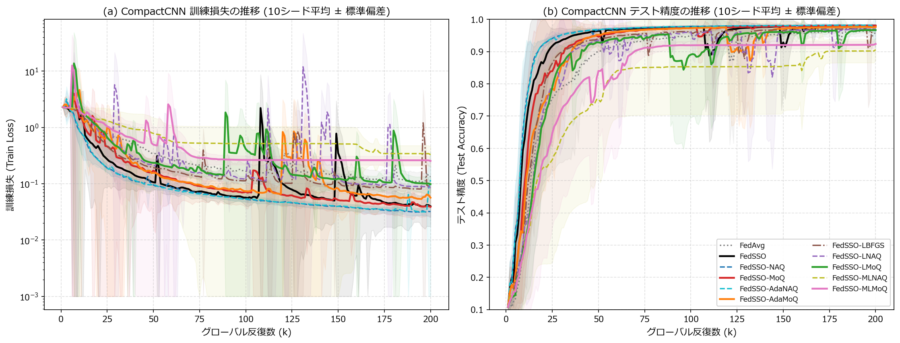
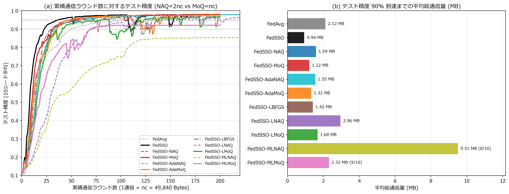
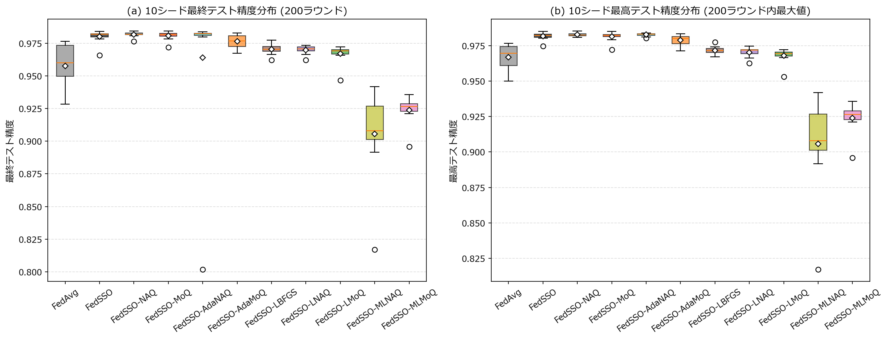

# 実験2 (ex002): 非凸 CNN モデル (CompactCNN) における FedSSO × MoQ ファミリー 10シード比較実験

## 1. 実験の目的

本実験（[ex002.ipynb](../ex002/ex002.ipynb)）では、非凸目的関数である畳み込みニューラルネットワーク（[ex002/model.py](../ex002/model.py): `CompactCNN`, 総パラメータ数 $d = 6,230$）の Non-IID 連合学習環境において、原論文 FedSSO（Ma et al., 2022）のサーバ側 2 次近似に慣性付準ニュートン法ファミリー（`NAQ`, `MoQ`, `AdaNAQ`, `AdaMoQ`, `LNAQ`, `LMoQ`, `MLNAQ`, `MLMoQ`）を適用し、`FedSSO` / `FedSSO-LBFGS` / `FedAvg` との性能・ロバスト性・通信効率・メモリ消費を **10 種類の乱数シード（`42`〜`51`）** で比較検証する。

---

## 2. 実験設定と実装詳細

### 2.1 データセットとモデル構造
- **データセット・Non-IID 分割**: MNIST 全 70,000 サンプルを 2D 画像（$1 \times 28 \times 28$）のまま、クライアント数 $N = 20$ に対しクラスごとに $\mathrm{Dir}(\beta = 0.1)$ で分割した（訓練 52,492 サンプル・テスト 17,508 サンプル、[ex002/utils.py](../ex002/utils.py)）。
- **モデル（`CompactCNN`）**: `Conv2d(1, 6, kernel_size=5) -> ReLU -> MaxPool2d(2) -> Conv2d(6, 12, kernel_size=5) -> ReLU -> MaxPool2d(2) -> Linear(192, 10)`、総パラメータ数 $d = 6,230$（1 通信ラウンド基準通信量 $n_c = 6,230 \times 8 = 49,840\,\mathrm{B}$）。

### 2.2 比較アルゴリズム（全 11 手法）と共通ハイパーパラメータ
- **共通連合学習設定**: 局所更新ステップ数 $\tau = 5$、ミニバッチサイズ $\mathrm{BS} = 100$、グローバル反復数 $K = 200$、乱数シード 10 種類（`42, 43, 44, 45, 46, 47, 48, 49, 50, 51`）。
- **FedSSO 統一パラメータ**: 局所学習率 $\alpha = 0.07$、グローバルステップ長 $\eta = 0.3$、正定値保証用曲率クリッピング $\lambda = 10^{-4},\ \Lambda = 9,999$、周期リセット $R = 200$、安全ステップノルム上限 `max_step_norm = 15.0`。
- **MoQ ファミリー適用パラメータ**:
  - 固定慣性系（`FedSSO-NAQ`, `FedSSO-MoQ`）: $\mu = 0.25$
  - 適応慣性系（`FedSSO-AdaNAQ`, `FedSSO-AdaMoQ`, `FedSSO-LNAQ`, `FedSSO-LMoQ`, `FedSSO-MLNAQ`, `FedSSO-MLMoQ`）: 式(64)–(65)（$\theta_1 = 1,\ \gamma = 10^{-5}$）＋ 上限キャップ $\mu_{\max} = 0.30$
  - 記憶制限履歴数（`FedSSO-LBFGS`, `FedSSO-LNAQ`, `FedSSO-LMoQ`）: $m = 10$
- **1 次ベースライン（`FedAvg`）**: 論文 Table 1 相当の最適設定 $\alpha = 0.3$。

### 2.3 GPU 並列 CNN 局所 SGD の数値等価性検証
[ex002/model.py](../ex002/model.py) の `batched_cnn_local_sgd` では、`F.conv2d(..., groups=N)`・`torch.bmm`・`torch.autograd.grad` を組み合わせることで全 20 クライアントの独立した順伝播・逆伝播・$\tau = 5$ ステップ局所更新を GPU 上で完全並列化した。同一ミニバッチ系列に対する逐次クライアント `nn.Module` ループとのパラメータ最大絶対誤差は **`2.980e-08`** であり、高精度に一致することを確認した。

---

## 3. 10 シード比較実験結果

### 3.1 200 ラウンド時点のテスト精度・訓練損失（Ave / Med / Best / Worst / Std）

| 手法 | $\mathrm{Acc}$ Ave | $\mathrm{Acc}$ Med | $\mathrm{Acc}$ Best | $\mathrm{Acc}$ Worst | $\mathrm{Acc}$ Std | $\mathrm{MaxAcc}$ Ave (Best) | $\mathrm{Loss}$ Ave | $\mathrm{Loss}$ Best | $\mathrm{Loss}$ Worst | クリップ / リセット平均 |
| :--- | :---: | :---: | :---: | :---: | :---: | :---: | :---: | :---: | :---: | :---: |
| `FedAvg` ($\alpha=0.3$) | 0.9577 | 0.9601 | 0.9765 | 0.9284 | 0.0168 | 0.9668 (0.9765) | 0.1352 | 0.0657 | 0.3059 | 0.0 / 0.0 |
| `FedSSO` | 0.9800 | 0.9820 | 0.9842 | 0.9660 | 0.0050 | 0.9817 (0.9850) | 0.0398 | **0.0214** | 0.1003 | 1.3 / 1.7 |
| **`FedSSO-NAQ`** | **0.9818** | 0.9821 | **0.9844** | **0.9765** | **0.0020** | **0.9828** (**0.9853**) | **0.0320** | 0.0236 | **0.0463** | **1.0** / 1.3 |
| **`FedSSO-MoQ`** | 0.9807 | 0.9816 | 0.9843 | 0.9720 | 0.0033 | 0.9813 (0.9850) | 0.0390 | 0.0221 | 0.0728 | 1.7 / 1.7 |
| `FedSSO-AdaNAQ` | 0.9641 | **0.9822** | 0.9838 | 0.8016 | 0.0541 | 0.9827 (0.9840) | 0.1166 | 0.0251 | 0.8783 | **0.9** / 1.4 |
| `FedSSO-AdaMoQ` | 0.9766 | 0.9769 | 0.9830 | 0.9672 | 0.0050 | 0.9788 (0.9833) | 0.0566 | 0.0285 | 0.0861 | 1.9 / 2.3 |
| `FedSSO-LBFGS` ($m=10$) | 0.9703 | 0.9704 | 0.9775 | 0.9622 | 0.0040 | 0.9717 (0.9775) | 0.0837 | 0.0603 | 0.1173 | 13.7 / 1.8 |
| `FedSSO-LNAQ` ($m=10$) | 0.9698 | 0.9706 | 0.9735 | 0.9621 | 0.0032 | 0.9702 (0.9746) | 0.0873 | 0.0757 | 0.1075 | 17.7 / 1.8 |
| `FedSSO-LMoQ` ($m=10$) | 0.9669 | 0.9691 | 0.9721 | 0.9468 | 0.0070 | 0.9679 (0.9721) | 0.0986 | 0.0753 | 0.1857 | 15.8 / 2.3 |
| `FedSSO-MLNAQ` | 0.9057 | 0.9080 | 0.9419 | 0.8171 | 0.0334 | 0.9057 (0.9419) | 0.3286 | 0.1877 | 0.6614 | 153.2 / 1.1 |
| `FedSSO-MLMoQ` | 0.9239 | 0.9264 | 0.9358 | 0.8959 | 0.0102 | 0.9240 (0.9358) | 0.2543 | 0.2130 | 0.3646 | 125.2 / 1.1 |

### 3.2 通信コスト・目標精度到達速度・サーバ計算資源（10 シード平均）

| 手法 | 通信/反復 | $\mathrm{Acc}\ge 0.90$ 反復 / 通信 | $90\%$ 総通信量 (B) | $\mathrm{Acc}\ge 0.95$ 反復 / 通信 | $\mathrm{Acc}\ge 0.97$ 反復 (到達率) | サーバ計算時間 (ms/iter) | サーバメモリ (MB) |
| :--- | :---: | :---: | :---: | :---: | :---: | :---: | :---: |
| `FedAvg` ($\alpha=0.3$) | $1.00\,n_c$ | 44.5 / 44.5 | 2,217,880 | 97.5 / 97.5 | 142.3 (4/10) | 0.009 | 0.024 |
| **`FedSSO`** | $1.00\,n_c$ | 19.7 / **19.7** | **981,848** | 34.5 / **34.5** | 61.7 (**10/10**) | 5.004 | 148.155 |
| `FedSSO-NAQ` | $1.995\,n_c$ | 17.2 / 33.4 | 1,664,656 | **29.3** / 57.6 | 54.1 (**10/10**) | 5.055 | 148.202 |
| `FedSSO-MoQ` | $1.00\,n_c$ | 25.6 / 25.6 | 1,275,904 | 43.1 / 43.1 | 78.4 (**10/10**) | 5.315 | 148.226 |
| `FedSSO-AdaNAQ` | $1.995\,n_c$ | **16.8** / 32.6 | 1,624,784 | **29.3** / 57.6 | **53.4** (**10/10**) | 5.069 | 148.202 |
| `FedSSO-AdaMoQ` | $1.00\,n_c$ | 27.8 / 27.8 | 1,385,552 | 44.5 / 44.5 | 84.0 (**10/10**) | 5.220 | 148.226 |
| `FedSSO-LBFGS` | $1.00\,n_c$ | 29.8 / 29.8 | 1,485,232 | 61.7 / 61.7 | 156.4 (7/10) | 1.515 | 0.570 |
| `FedSSO-LNAQ` | $1.995\,n_c$ | 31.6 / 62.2 | 3,100,048 | 69.3 / 137.6 | 159.3 (6/10) | 1.287 | 0.618 |
| `FedSSO-LMoQ` | $1.00\,n_c$ | 35.3 / 35.3 | 1,759,352 | 76.2 / 76.2 | 178.5 (4/10) | 1.218 | 0.642 |
| `FedSSO-MLNAQ` | $1.995\,n_c$ | 100.5 / 200.0 (8/10) | 9,968,000 | — (0/10) | — (0/10) | **0.786** | **0.190** |
| `FedSSO-MLMoQ` | $1.00\,n_c$ | 48.8 / 48.8 (9/10) | 2,431,084 | — (0/10) | — (0/10) | 0.809 | **0.214** |

---

## 4. 実験結果の考察

1. **非凸 CNN において `FedSSO-NAQ` / `FedSSO-MoQ` が原論文 `FedSSO` を上回る性能を達成**:
   強凸 MCLR と異なり非凸 `CompactCNN` では、先読み慣性を導入した **`FedSSO-NAQ`** が 200 ラウンド平均精度 **0.9818**・最良 **0.9844**・最悪 **0.9765**・標準偏差 **0.0020**・平均訓練損失 **0.0320** と、全項目で原論文 `FedSSO`（平均 0.9800, 最悪 0.9660, Std 0.0050, Loss 0.0398）を上回り全 11 手法中の最高性能を記録した。また追加通信ゼロの **`FedSSO-MoQ`** も平均精度 **0.9807**・最悪 **0.9720**・標準偏差 **0.0033** で `FedSSO` を上回った。Nesterov 型の先読み曲率評価（NAQ）およびサーバ側外挿勾配（MoQ）が、CNN の非凸損失曲面における鞍点・平坦領域の通過と曲率情報の安定化に寄与したと考えられる。

2. **シード間ばらつきの劇的な改善と `FedSSO-AdaNAQ` の終盤スパイク現象**:
   `FedAvg` がシード依存で `0.9284`〜`0.9765`（`Std = 0.0168`）と大きくばらつくのに対し、`FedSSO-NAQ` は最悪シードでも **`0.9765`**（`FedAvg` の最良値と同等）を維持し、標準偏差を `FedSSO` 比で **60% 低減（0.0050 $\to$ 0.0020）** した。一方、`FedSSO-AdaNAQ` は 10 シード中 9 シードで `0.9800`〜`0.9838` に収束し中央値 **`0.9822`**（全手法最高）かつ 97% 到達平均 **`53.4` 反復** を達成したものの、シード `46` のみ終盤で一時的な精度急落（`MaxAcc = 0.9832` $\to$ `FinalAcc = 0.8016`）を生じた。これは `AdaNAQ` の初期 $\mu_k$ が上限 `0.30` 付近で大きく推移し、クライアントデータを持たないため損失ベース Adaptive Restart を行えない状況で局所的非凸ノイズと共振したためであり、固定 $\mu = 0.25$ を用いる `FedSSO-NAQ` の優位性を示す結果となった。

3. **非凸問題における L-BFGS 系・メモリレス（ML）系のトレードオフ**:
   記憶制限系（$m = 10$）の `FedSSO-LBFGS`（0.9703）・`FedSSO-LNAQ`（0.9698）・`FedSSO-LMoQ`（0.9669）は、フル行列系（148.2 MB）比で **99.6% のメモリ削減（0.57〜0.64 MB）** と **約 3.3〜4.1 倍のサーバ計算高速化（1.22〜1.52 ms/iter）** を達成しつつ、なお `FedAvg`（0.9577）を +0.9〜+1.3 ポイント上回る高精度・低分散（`Std = 0.0032`〜`0.0070`）を維持した。一方、履歴 $m = 1$ 相当のメモリレス手法は非凸 CNN の曲率変動に対してクリッピングが頻発（`MLNAQ` 153.2 回、`MLMoQ` 125.2 回）し精度が 0.9057〜0.9239 に留まった。注目すべき点として、メモリレス領域では **`FedSSO-MLMoQ`**（0.9239, 90% 総通信量 `2.32 MB`）が `FedSSO-MLNAQ`（0.9057, `9.51 MB`）に対し **+1.82 ポイント高精度・約 1/4 の総通信量** で明確に優れており、強ノイズ環境におけるサーバ側外挿勾配の安定化効果が確認された。
