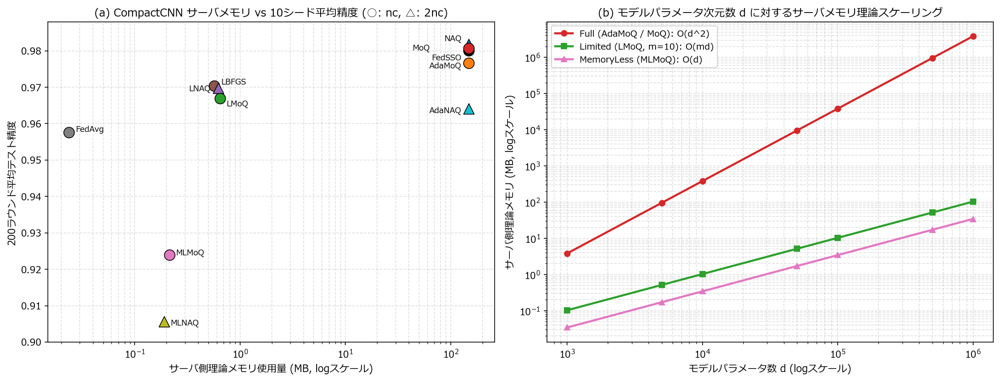

# 実験3 (ex003): 感度分析・履歴数・曲率クリッピングアブレーションおよびスケーラビリティ解析（200 ラウンド統一検証）

## 1. 実験の目的

本実験（[ex003.ipynb](../ex003/ex003.ipynb), [ex003/utils.py](../ex003/utils.py)）では、`ex001`・`ex002` と条件を統一し、**200 ラウンド・10 種類の乱数シード（`42`〜`51`）** を用いて以下の 4 つの詳細解析を実施する。

1. **実験 3A**: 慣性パラメータ $\mu$（`MoQ`, `NAQ`）と上限キャップ $\mu_{\max}$（`AdaMoQ`, `AdaNAQ`）を $\{0.1, 0.2, \dots, 0.9\}$ の範囲で 0.1 刻みに変化させた 200 ラウンド感度・安定性比較（基準線 `FedSSO` $\mu=0$ を含む、MCLR・CompactCNN）
2. **実験 3B**: 記憶制限準ニュートン法（`FedSSO-LBFGS`, `FedSSO-LNAQ`, `FedSSO-LMoQ`）における履歴数 $m \in \{2^0, 2^1, 2^2, 2^3, 2^4, 2^5\} = \{1, 2, 4, 8, 16, 32\}$ の 2 倍刻み影響解析（MCLR, 200 ラウンド）
3. **実験 3C**: 正定値保証・曲率クリッピング帯域 $[\lambda, \Lambda]$ のアブレーション検証（非凸 CompactCNN, 200 ラウンド, `MoQ` 系・`NAQ` 系全 7 手法 $\times$ 4 条件）
4. **実験 3D**: パラメータ次元数 $d \in [10^3, 10^6]$ に対するサーバ側メモリ・演算量の理論スケーリングおよび実測パレート解析

> [!NOTE]
> 全サブ実験を 200 ラウンドへ統一したことで、`ex001`・`ex002` と同一パラメータ条件（例: MCLR の `FedSSO` `0.9170` / `AdaMoQ (0.4)` `0.9058` / `AdaNAQ (0.4)` `0.9116`、CNN の 3C 標準条件 7 手法すべて）が `ex001`・`ex002` の 10 シード平均結果と小数第 7 位まで完全に一致することを確認している。

---

## 2. 実験 3A: 慣性パラメータ（$\mu, \mu_{\max} \in [0.1, 0.9]$）の感度分析（200 ラウンド, MoQ 系 + NAQ 系）

### 2.1 強凸 MCLR（200 ラウンド・10 シード）結果

| 手法 | 慣性 ($\mu$ / $\mu_{\max}$) | $\mathrm{Acc}$ Ave | $\mathrm{Acc}$ Best | $\mathrm{Acc}$ Worst | $\mathrm{Acc}$ Std | $\mathrm{Loss}$ Ave | リセット平均 |
| :--- | :---: | :---: | :---: | :---: | :---: | :---: | :---: |
| **`FedSSO`** (基準線) | 0.0 | **0.9170** | 0.9214 | 0.9118 | **0.0028** | **0.2621** | 1.0 |
| `FedSSO-MoQ` | 0.1 / 0.2 / 0.3 | 0.9142 / 0.9139 / 0.9077 | 0.9218 / **0.9234** / 0.9169 | 0.8871 / 0.9043 / 0.8959 | 0.0098 / 0.0054 / 0.0064 | 0.2705 / 0.2726 / 0.2879 | 1.0 / 1.0 / 1.0 |
| `FedSSO-MoQ` | 0.4 / 0.5 / 0.6 | 0.8999 / 0.9004 / 0.8844 | 0.9178 / 0.9142 / 0.9159 | 0.8746 / 0.8838 / 0.8263 | 0.0133 / 0.0098 / 0.0274 | 0.3106 / 0.3086 / 0.3529 | 1.0 / 1.0 / 1.0 |
| `FedSSO-MoQ` | 0.7 / 0.8 / 0.9 | 0.8691 / 0.8712 / 0.8608 | 0.9171 / 0.9115 / 0.9129 | 0.8259 / 0.8046 / 0.7629 | 0.0259 / 0.0387 / 0.0473 | 0.3984 / 0.3988 / 0.5182 | 1.1 / 1.1 / 1.3 |
| `FedSSO-AdaMoQ` | 0.1 / 0.2 / 0.3 | 0.9142 / 0.9139 / 0.9103 | 0.9218 / **0.9234** / 0.9218 | 0.8871 / 0.9043 / 0.8996 | 0.0098 / 0.0054 / 0.0080 | 0.2705 / 0.2726 / 0.2820 | 1.0 / 1.0 / 1.0 |
| `FedSSO-AdaMoQ` | 0.4 / 0.5 / 0.6 | 0.9058 / 0.8953 / 0.8845 | 0.9188 / 0.9082 / 0.9172 | 0.8723 / 0.8674 / 0.8245 | 0.0133 / 0.0132 / 0.0274 | 0.2955 / 0.3239 / 0.3533 | 1.0 / 1.0 / 1.0 |
| `FedSSO-AdaMoQ` | 0.7 / 0.8 / 0.9 | 0.8464 / 0.8581 / 0.8565 | 0.9136 / 0.9075 / 0.9132 | 0.7551 / 0.7579 / 0.7379 | 0.0527 / 0.0441 / 0.0508 | 0.4690 / 0.4380 / 0.4452 | 1.0 / 1.0 / 1.0 |
| `FedSSO-NAQ` | **0.1** / 0.2 / 0.3 | **0.9169** / 0.9157 / 0.9145 | 0.9216 / 0.9216 / 0.9231 | **0.9119** / 0.9068 / 0.9051 | 0.0036 / 0.0049 / 0.0056 | 0.2657 / 0.2694 / 0.2726 | 1.0 / 1.0 / 1.1 |
| `FedSSO-NAQ` | 0.4 / 0.5 / 0.6 | 0.9114 / 0.8851 / 0.8708 | 0.9183 / 0.9164 / 0.9183 | 0.8963 / 0.6707 / 0.6350 | 0.0066 / 0.0717 / 0.0803 | 0.2837 / 1.6734 / 2.2085 | 2.7 / 4.1 / 5.6 |
| `FedSSO-NAQ` | 0.7 / 0.8 / 0.9 | 0.8824 / 0.8987 / 0.9004 | 0.9166 / 0.9109 / 0.9144 | 0.7304 / 0.8623 / 0.8369 | 0.0542 / 0.0150 / 0.0221 | 2.0479 / 1.7961 / 1.9393 | 5.9 / 5.5 / 4.4 |
| `FedSSO-AdaNAQ` | **0.1** / 0.2 / 0.3 | **0.9169** / 0.9157 / 0.9152 | 0.9216 / 0.9216 / 0.9211 | **0.9119** / 0.9068 / 0.9004 | 0.0036 / 0.0049 / 0.0057 | 0.2657 / 0.2694 / 0.2702 | 1.0 / 1.0 / 1.1 |
| `FedSSO-AdaNAQ` | 0.4 / 0.5 / 0.6 | 0.9116 / 0.9102 / 0.9014 | 0.9182 / 0.9140 / 0.9166 | 0.9060 / 0.9042 / 0.8291 | 0.0034 / 0.0034 / 0.0244 | 0.2794 / 0.3646 / 1.2979 | 2.1 / 3.6 / 5.3 |
| `FedSSO-AdaNAQ` | 0.7 / 0.8 / 0.9 | 0.8249 / 0.8600 / 0.8915 | 0.9171 / 0.9129 / 0.9170 | 0.4433 / 0.6537 / 0.8444 | 0.1454 / 0.0816 / 0.0286 | 6.5115 / 3.3441 / 4.5522 | 6.6 / 5.2 / 6.5 |

### 2.2 非凸 CompactCNN（200 ラウンド・10 シード）結果

| 手法 | 慣性 ($\mu$ / $\mu_{\max}$) | $\mathrm{Acc}$ Ave | $\mathrm{Acc}$ Best | $\mathrm{Acc}$ Worst | $\mathrm{Acc}$ Std | $\mathrm{Loss}$ Ave | 発散シード数 |
| :--- | :---: | :---: | :---: | :---: | :---: | :---: | :---: |
| `FedSSO` (基準線) | 0.0 | 0.9800 | 0.9842 | 0.9660 | 0.0050 | 0.0398 | 0 / 10 |
| `FedSSO-MoQ` | **0.1** / 0.2 / 0.3 | **0.9809** / 0.8892 / 0.9757 | **0.9863** / 0.9845 / 0.9829 | 0.9746 / 0.1107 / 0.9643 | 0.0029 / 0.2597 / 0.0052 | 0.0366 / 0.2783 / 0.0564 | 0 / 1 / 0 |
| `FedSSO-MoQ` | 0.4 / 0.5 / 0.6 | 0.8774 / 0.9682 / 0.9657 | 0.9817 / 0.9820 / 0.9777 | 0.0979 / 0.9288 / 0.9397 | 0.2605 / 0.0169 / 0.0096 | 0.3208 / 0.0835 / 0.0947 | 1 / 0 / 0 |
| `FedSSO-MoQ` | 0.7 / 0.8 / 0.9 | 0.7848 / 0.9416 / 0.6862 | 0.9782 / 0.9801 / 0.9704 | 0.0979 / 0.8994 / 0.0979 | 0.3407 / 0.0260 / 0.3408 | 0.5641 / 0.1842 / 0.8528 | 2 / 0 / 2 |
| `FedSSO-AdaMoQ` | **0.1** / 0.2 / 0.3 | **0.9809** / 0.8892 / 0.9766 | **0.9863** / 0.9845 / 0.9830 | 0.9746 / 0.1107 / 0.9672 | 0.0029 / 0.2597 / 0.0050 | 0.0366 / 0.2783 / 0.0566 | 0 / 1 / 0 |
| `FedSSO-AdaMoQ` | 0.4 / 0.5 / 0.6 | 0.9732 / 0.8820 / 0.8747 | 0.9815 / 0.9814 / 0.9785 | 0.9466 / 0.0979 / 0.0979 | 0.0097 / 0.2617 / 0.2596 | 0.0677 / 0.2981 / 0.3337 | 0 / 1 / 1 |
| `FedSSO-AdaMoQ` | 0.7 / 0.8 / 0.9 | 0.8838 / 0.7902 / 0.7041 | 0.9813 / 0.9758 / 0.9809 | 0.0979 / 0.0979 / 0.0979 | 0.2620 / 0.3433 / 0.3939 | 0.2946 / 0.5382 / 0.7659 | 1 / 2 / 3 |
| **`FedSSO-NAQ`** | **0.1** / 0.2 / 0.3 | **0.9820** / 0.9810 / 0.9814 | 0.9850 / 0.9839 / 0.9844 | **0.9801** / 0.9725 / 0.9704 | **0.0014** / 0.0031 / 0.0038 | **0.0322** / 0.0353 / 0.0351 | **0 / 0 / 0** |
| `FedSSO-NAQ` | 0.4 / 0.5 / 0.6 | 0.9709 / 0.8917 / 0.9649 | 0.9837 / 0.9835 / 0.9810 | 0.9407 / 0.1107 / 0.9165 | 0.0150 / 0.2604 / 0.0204 | 0.0702 / 0.2655 / 0.0958 | 0 / 1 / 0 |
| `FedSSO-NAQ` | 0.7 / 0.8 / 0.9 | 0.8227 / 0.7800 / 0.4657 | 0.9830 / 0.9827 / 0.9694 | 0.1107 / 0.0979 / 0.0979 | 0.3042 / 0.3435 / 0.4063 | 0.4412 / 0.5648 / 1.3478 | 1 / 2 / 5 |
| **`FedSSO-AdaNAQ`** | **0.1** / 0.2 / 0.3 | **0.9820** / 0.9810 / 0.9641 | 0.9850 / 0.9839 / 0.9838 | **0.9801** / 0.9725 / 0.8016 | **0.0014** / 0.0031 / 0.0541 | **0.0322** / 0.0353 / 0.1166 | **0 / 0 / 0** |
| `FedSSO-AdaNAQ` | 0.4 / 0.5 / 0.6 | 0.9720 / 0.9759 / 0.8859 | 0.9837 / 0.9826 / 0.9836 | 0.9439 / 0.9570 / 0.0979 | 0.0128 / 0.0080 / 0.2629 | 0.0694 / 0.0555 / 0.2878 | 0 / 0 / 1 |
| `FedSSO-AdaNAQ` | 0.7 / 0.8 / 0.9 | 0.8655 / 0.7742 / 0.3669 | 0.9841 / 0.9828 / 0.9834 | 0.0979 / 0.0979 / 0.0979 | 0.2618 / 0.3396 / 0.4025 | 0.3615 / 0.5900 / 1.6141 | 1 / 2 / 7 |

### 2.3 考察（3A・200 ラウンド統一）
1. **強凸 MCLR を 200 ラウンドまで継続した場合の収束後ドリフト**:
   100 ラウンド時点（既に最適解近傍へ到達）を超えて 200 ラウンドまで学習を続けると、クライアント生データ・損失値に基づく Adaptive Restart を実行できない FL サーバでは、$\mu$ が大きいほどミニバッチ確率勾配ノイズが慣性バッファ $m_k$ に蓄積して終盤精度が漸減する。`MoQ`/`AdaMoQ` はリセット回数 `1.0 回`（$k=200$ 周期リセットのみ）のまま滑らかに漸減する一方、`NAQ`/`AdaNAQ` は $\mu \le 0.3$ なら高水準（Ave `0.9145〜0.9169`）を維持しつつ、$\mu \ge 0.5$ ではリセット平均が `3.6〜6.6 回` に急増し訓練損失が `1.30〜6.51` へ悪化した。
2. **非凸 CompactCNN 200 ラウンドでは $\mu \in [0.1, 0.3]$（特に $\mu = 0.1$）が全シード最高性能・無発散**:
   CompactCNN の 200 ラウンドでは、**`FedSSO-NAQ`（$\mu=0.1$: Ave `0.9820`, Worst `0.9801`, Std `0.0014`）** および **`FedSSO-MoQ`（$\mu=0.1$: Ave `0.9809`, Best `0.9863`, Worst `0.9746`, Std `0.0029`）** がいずれも原論文 `FedSSO`（Ave `0.9800`, Worst `0.9660`, Std `0.0050`）を明確に上回り全 10 シード無発散であった。逆に $\mu \ge 0.7$ の過大慣性域では発散シードが急増し、$\mu=0.9$ では `NAQ` 5/10 発散（Ave `0.4657`）・`AdaNAQ` 7/10 発散（Ave `0.3669`）へ崩れたことから、**非凸 FL における最適安全帯は $\mu, \mu_{\max} \in [0.1, 0.25]$** であると結論づけられる。

---

## 3. 実験 3B: 記憶制限履歴数 $m \in \{1, 2, 4, 8, 16, 32\}$（$2^0 \sim 2^5$, 200 ラウンド）の影響解析

### 3.1 MCLR（200 ラウンド・10 シード）における性能・計算資源推移

| 手法 | 履歴数 $m$ | $\mathrm{Acc}$ Ave | $\mathrm{Acc}$ Med | $\mathrm{Acc}$ Best | $\mathrm{Acc}$ Worst | $\mathrm{Acc}$ Std | $\mathrm{Loss}$ Ave | サーバ時間 (ms/iter) | サーバメモリ (MB) | クリップ平均 |
| :--- | :---: | :---: | :---: | :---: | :---: | :---: | :---: | :---: | :---: | :---: |
| `FedSSO-LBFGS` | $1\ (2^0)$ | 0.9132 | 0.9136 | 0.9192 | 0.9076 | 0.0032 | 0.3003 | **0.441** | **0.180** | 27.0 |
| `FedSSO-LBFGS` | $2\ (2^1)$ | 0.9123 | 0.9128 | 0.9163 | 0.9059 | **0.0031** | 0.3020 | 0.507 | 0.240 | 4.3 |
| `FedSSO-LBFGS` | $4\ (2^2)$ | 0.9140 | 0.9145 | 0.9204 | 0.9066 | 0.0044 | 0.2905 | 0.657 | 0.359 | 0.5 |
| **`FedSSO-LBFGS`** | **$8\ (2^3)$** | **0.9181** | 0.9185 | **0.9240** | **0.9132** | **0.0031** | **0.2734** | 0.922 | 0.599 | **0.0** |
| `FedSSO-LBFGS` | $16\ (2^4)$ | 0.9147 | 0.9158 | 0.9226 | 0.9016 | 0.0057 | 0.2787 | 1.451 | 1.078 | **0.0** |
| `FedSSO-LBFGS` | $32\ (2^5)$ | 0.9149 | **0.9194** | 0.9223 | 0.8746 | 0.0136 | 0.2757 | 2.470 | 2.036 | 0.1 |
| **`FedSSO-LNAQ`** | $1\ (2^0)$ | **0.9121** | 0.9139 | 0.9180 | **0.9026** | **0.0045** | 0.3168 | **0.492** | **0.240** | 58.6 |
| `FedSSO-LNAQ` | $2\ (2^1)$ | 0.9048 | **0.9153** | 0.9190 | 0.8305 | 0.0259 | 0.3296 | 0.562 | 0.299 | 20.8 |
| `FedSSO-LNAQ` | $4\ (2^2)$ | 0.9104 | 0.9148 | 0.9207 | 0.8861 | 0.0113 | 0.3152 | 0.704 | 0.419 | 0.8 |
| `FedSSO-LNAQ` | $8\ (2^3)$ | 0.9049 | 0.9073 | 0.9200 | 0.8799 | 0.0131 | 0.3151 | 0.969 | 0.659 | 0.1 |
| `FedSSO-LNAQ` | $16\ (2^4)$ | 0.8976 | 0.9143 | **0.9218** | 0.8204 | 0.0338 | 0.3366 | 1.484 | 1.138 | 0.1 |
| `FedSSO-LNAQ` | $32\ (2^5)$ | 0.9071 | 0.9127 | 0.9203 | 0.8688 | 0.0144 | **0.3016** | 2.440 | 2.096 | **0.0** |
| `FedSSO-LMoQ` | $1\ (2^0)$ | 0.9012 | 0.9008 | 0.9115 | 0.8895 | 0.0076 | 0.3433 | **0.485** | **0.270** | 60.2 |
| `FedSSO-LMoQ` | $2\ (2^1)$ | 0.9001 | 0.9019 | 0.9124 | 0.8718 | 0.0120 | 0.3368 | 0.551 | 0.329 | 22.7 |
| `FedSSO-LMoQ` | $4\ (2^2)$ | 0.8820 | 0.8982 | 0.9171 | 0.7597 | 0.0463 | 0.3917 | 0.703 | 0.449 | 4.0 |
| `FedSSO-LMoQ` | $8\ (2^3)$ | 0.8703 | **0.9155** | **0.9199** | 0.4910 | 0.1267 | 0.5566 | 0.961 | 0.689 | 0.2 |
| **`FedSSO-LMoQ`** | **$16\ (2^4)$** | **0.9097** | 0.9115 | 0.9180 | **0.9011** | **0.0063** | **0.3002** | 1.485 | 1.168 | **0.0** |
| `FedSSO-LMoQ` | $32\ (2^5)$ | 0.8980 | 0.9020 | 0.9184 | 0.8622 | 0.0186 | 0.3292 | 2.526 | 2.126 | **0.0** |

### 3.2 考察（3B・200 ラウンド統一）
- **200 ラウンド長期学習における履歴数 $m$ の最適領域**:
  $m = 1, 2$ ではクリッピングが多発（$m=1$: `LBFGS` 27.0 回, `LNAQ` 58.6 回, `LMoQ` 60.2 回）する一方、$m \ge 8$ でクリッピング回数がほぼゼロへ収束する構造は 200 ラウンドでも明確である。特に **`FedSSO-LBFGS` は $m = 8$ で平均 `0.9181`・最悪 `0.9132`・クリップ `0.0`** を達成し、`ex001`（$m=10$）で発生したシード 46 の外れ値崩壊（`0.6688`）を回避した。また **`FedSSO-LMoQ` は $m = 8$ で 1 シード終盤振動（Worst `0.4910`）を含むものの、$m = 16$（Ave `0.9097`, Worst `0.9011`, Std `0.0063`, Clip `0.0`）** において全 10 シードが 0.90 以上に安定収束した。$m = 32$ へ増やすと計算時間が `2.44〜2.53 ms/iter`（$m=8$ 比約 2.6 倍）・メモリも `2.04〜2.13 MB` に増大しつつ 200 ラウンド時の終盤分散は改善しないため、**$m = 8 \sim 16$** が実用的最適領域である。

---

## 4. 実験 3C: 正定値保証・曲率クリッピング $[\lambda, \Lambda]$ のアブレーション検証（200 ラウンド, MoQ 系 + NAQ 系 全 7 手法）

### 4.1 非凸 CompactCNN（200 ラウンド・10 シード）結果

| 手法 | 条件 | $\mathrm{Acc}$ Ave | $\mathrm{Acc}$ Med | $\mathrm{Acc}$ Best | $\mathrm{Acc}$ Worst | $\mathrm{Acc}$ Std | $\mathrm{Loss}$ Ave | 発散シード数 | クリップ平均 |
| :--- | :--- | :---: | :---: | :---: | :---: | :---: | :---: | :---: | :---: |
| `FedSSO` | 標準 ($10^{-4},\ 9999$) | 0.9800 | **0.9820** | 0.9842 | 0.9660 | 0.0050 | 0.0398 | **0 / 10** | 1.3 |
| `FedSSO` | 狭帯域 ($10^{-2},\ 500$) | 0.9802 | 0.9819 | **0.9844** | 0.9708 | 0.0041 | 0.0394 | **0 / 10** | 1.1 |
| **`FedSSO`** | **過大上限 ($10^{-4},\ 10^7$)** | **0.9814** | 0.9818 | 0.9843 | **0.9729** | **0.0031** | **0.0341** | **0 / 10** | 1.2 |
| `FedSSO` | 正定値保証なし | 0.5799 | 0.7329 | 0.9809 | 0.0979 | 0.4102 | 0.9790 | **4 / 10** | 0.0 |
| **`FedSSO-MoQ`** | **標準 ($10^{-4},\ 9999$)** | **0.9807** | 0.9816 | 0.9843 | **0.9720** | **0.0033** | **0.0390** | **0 / 10** | 1.7 |
| `FedSSO-MoQ` | 狭帯域 ($10^{-2},\ 500$) | 0.9586 | 0.9807 | **0.9844** | 0.7618 | 0.0656 | 0.1132 | **0 / 10** | 1.5 |
| `FedSSO-MoQ` | 過大上限 ($10^{-4},\ 10^7$) | 0.9806 | **0.9819** | 0.9842 | 0.9712 | 0.0037 | 0.0400 | **0 / 10** | 1.4 |
| `FedSSO-MoQ` | 正定値保証なし | 0.7957 | 0.9684 | 0.9830 | 0.0980 | 0.3459 | 0.3276 | **2 / 10** | 0.0 |
| **`FedSSO-NAQ`** | **標準 ($10^{-4},\ 9999$)** | **0.9818** | **0.9821** | 0.9844 | **0.9765** | **0.0020** | **0.0320** | **0 / 10** | 1.0 |
| `FedSSO-NAQ` | 狭帯域 ($10^{-2},\ 500$) | 0.9797 | 0.9817 | 0.9837 | 0.9564 | 0.0078 | 0.0406 | **0 / 10** | 1.2 |
| `FedSSO-NAQ` | 過大上限 ($10^{-4},\ 10^7$) | 0.9815 | 0.9818 | **0.9845** | 0.9754 | 0.0023 | 0.0337 | **0 / 10** | 0.9 |
| `FedSSO-NAQ` | 正定値保証なし | 0.7100 | 0.9630 | 0.9840 | 0.0979 | 0.3981 | 0.5614 | **3 / 10** | 0.0 |
| `FedSSO-LMoQ` | 標準 ($10^{-4},\ 9999$) | 0.9669 | 0.9691 | **0.9721** | 0.9468 | 0.0070 | 0.0986 | **0 / 10** | 15.8 |
| `FedSSO-LMoQ` | 狭帯域 ($10^{-2},\ 500$) | 0.9617 | 0.9634 | 0.9687 | 0.9489 | 0.0065 | 0.1151 | **0 / 10** | 78.8 |
| **`FedSSO-LMoQ`** | **過大上限 ($10^{-4},\ 10^7$)** | **0.9693** | **0.9692** | 0.9719 | **0.9666** | **0.0016** | **0.0899** | **0 / 10** | 13.3 |
| `FedSSO-LMoQ` | 正定値保証なし | 0.9533 | 0.9591 | 0.9708 | 0.9232 | 0.0176 | 0.1428 | **0 / 10** | 0.0 |
| **`FedSSO-LNAQ`** | **標準 ($10^{-4},\ 9999$)** | **0.9698** | **0.9706** | 0.9735 | 0.9621 | **0.0032** | **0.0873** | **0 / 10** | 17.7 |
| `FedSSO-LNAQ` | 狭帯域 ($10^{-2},\ 500$) | 0.9671 | 0.9680 | 0.9708 | 0.9585 | 0.0037 | 0.0993 | **0 / 10** | 69.3 |
| `FedSSO-LNAQ` | 過大上限 ($10^{-4},\ 10^7$) | 0.9690 | 0.9684 | **0.9746** | **0.9649** | 0.0035 | 0.0895 | **0 / 10** | 22.6 |
| `FedSSO-LNAQ` | 正定値保証なし | 0.6977 | 0.9358 | 0.9739 | 0.0980 | 0.3819 | 0.7087 | **3 / 10** | 0.0 |
| `FedSSO-MLMoQ` | 標準 ($10^{-4},\ 9999$) | 0.9239 | 0.9264 | 0.9358 | 0.8959 | 0.0102 | 0.2543 | 0 / 10 | 125.2 |
| `FedSSO-MLMoQ` | 狭帯域 ($10^{-2},\ 500$) | 0.9184 | 0.9290 | 0.9359 | 0.8680 | 0.0203 | 0.2723 | 0 / 10 | 153.5 |
| `FedSSO-MLMoQ` | 過大上限 ($10^{-4},\ 10^7$) | 0.6273 | 0.9111 | 0.9295 | 0.1297 | 0.3630 | 1.0417 | **3 / 10** | 101.7 |
| `FedSSO-MLMoQ` | **正定値保証なし** | **0.9502** | **0.9514** | **0.9556** | **0.9392** | **0.0043** | **0.1554** | **0 / 10** | 0.0 |
| `FedSSO-MLNAQ` | 標準 ($10^{-4},\ 9999$) | 0.9057 | 0.9080 | 0.9419 | 0.8171 | 0.0334 | 0.3286 | 0 / 10 | 153.2 |
| `FedSSO-MLNAQ` | 狭帯域 ($10^{-2},\ 500$) | 0.9227 | 0.9254 | 0.9391 | 0.9060 | 0.0118 | 0.2597 | **0 / 10** | 157.1 |
| `FedSSO-MLNAQ` | 過大上限 ($10^{-4},\ 10^7$) | 0.6479 | 0.9002 | 0.9470 | 0.0884 | 0.3504 | 1.0019 | **1 / 10** | 125.6 |
| `FedSSO-MLNAQ` | **正定値保証なし** | **0.9541** | **0.9540** | **0.9613** | **0.9493** | **0.0035** | **0.1439** | **0 / 10** | 0.0 |

### 4.2 考察（3C・200 ラウンド統一）
1. **フル行列系・`LNAQ` における正定値保証クリッピングの必須性**:
   「正定値保証なし」に設定すると、非凸 CNN の負曲率領域（$\hat{y}\_k^T s\_k \le 0$）で逆ヘッセ近似が不定値化し、`FedSSO`（**4/10 発散, Ave 0.5799**）・`FedSSO-NAQ`（**3/10 発散, Ave 0.7100**）・`FedSSO-LNAQ`（**3/10 発散, Ave 0.6977**）・`FedSSO-MoQ`（**2/10 発散, Ave 0.7957**）がいずれも崩壊した。原論文の曲率クリッピング $\lambda < \|\hat{y}\|^2 / \mathrm{cur} < \Lambda$ は `MoQ` 系にも `NAQ` 系にも不可欠な安全装置である。
2. **標準帯域 $(10^{-4},\ 9999)$ における `FedSSO-NAQ`・`FedSSO-MoQ`・`FedSSO-LNAQ` の優秀さ**:
   200 ラウンド通しで評価すると、`FedSSO-NAQ`（Ave **`0.9818`**, Worst **`0.9765`**, Std **`0.0020`**）・`FedSSO-MoQ`（Ave **`0.9807`**, Worst **`0.9720`**, Std **`0.0033`**）・`FedSSO-LNAQ`（Ave **`0.9698`**, Worst **`0.9621`**, Std **`0.0032`**）は**すべて原論文の標準帯域 $(10^{-4},\ 9999)$ で最良性能・最安定**を示した。なお狭帯域 $(10^{-2},\ 500)$ では `LMoQ` / `LNAQ` の終盤振動を抑えてクリップ回数が `69.3〜78.8 回` まで増え、精度がわずかに保守的になる（一方 `FedSSO-MLNAQ` は狭帯域によって標準比 `0.9057` $\to$ **`0.9227`**, Worst `0.8171` $\to$ **`0.9060`** へ改善した）。
3. **メモリレス系（`MLMoQ` / `MLNAQ`）特有の挙動**:
   `過大上限 (1e-4, 1e7)` を与えると、クリップ発動時の置換式 $\mathrm{cur} = \frac{2}{\lambda+\Lambda}\|\hat{y}\|^2$ が $\omega_k = \|\hat{y}\|^2 / \mathrm{cur} \approx 5\times 10^6$ の過大スケーリングを誘発し、`MLMoQ`（**3/10 発散, Ave `0.6273`**）および `MLNAQ`（**1/10 発散, Ave `0.6479`**）が大きく崩れた。一方、`正定値保証なし`（$\hat{y}^T s \le 0$ でなければ強制的クリッピング・リスケーリングを行わない）とした場合は `MLMoQ` (`0.9502`)・`MLNAQ` (`0.9541`) が非常に滑らかに収束しており、メモリレス 1 ステップ更新では原論文 BFGS 用帯域クリッピングによる強制リスケーリングの頻度（125〜153 回/200r）を抑える工夫が有効であることが示唆された。

---

## 5. 実験 3D: 理論スケーリング解析と大規模モデルへの拡張性

| パラメータ数 $d$ | `FedSSO` メモリ | `AdaMoQ` メモリ | `LBFGS` ($m=10$) メモリ | `LMoQ` ($m=10$) メモリ | `MLMoQ` メモリ | `Full` 演算量 ($\approx 6d^2$) | `LMoQ` 演算量 ($88d$) | `MLMoQ` 演算量 ($14d$) |
| :---: | :---: | :---: | :---: | :---: | :---: | :---: | :---: | :---: |
| $10^3$ | 3.83 MB | 3.84 MB | 0.09 MB | 0.10 MB | 0.03 MB | $6.0\times 10^6$ | $8.8\times 10^4$ | $1.4\times 10^4$ |
| $5\times 10^3$ | 95.44 MB | 95.50 MB | 0.46 MB | 0.51 MB | 0.17 MB | $1.5\times 10^8$ | $4.4\times 10^5$ | $7.0\times 10^4$ |
| $10^4$ | 381.62 MB | 381.74 MB | 0.92 MB | 1.03 MB | 0.34 MB | $6.0\times 10^8$ | $8.8\times 10^5$ | $1.4\times 10^5$ |
| $5\times 10^4$ | 9.31 GB (9,538 MB) | 9.31 GB (9,538 MB) | 4.58 MB | 5.15 MB | 1.72 MB | $1.5\times 10^{10}$ | $4.4\times 10^6$ | $7.0\times 10^5$ |
| $10^5$ | 37.25 GB (38,148 MB) | 37.26 GB (38,150 MB) | 9.16 MB | 10.30 MB | 3.43 MB | $6.0\times 10^{10}$ | $8.8\times 10^6$ | $1.4\times 10^6$ |
| $5\times 10^5$ | 931.33 GB | 931.34 GB | 45.78 MB | 51.50 MB | 17.17 MB | $1.5\times 10^{12}$ | $4.4\times 10^7$ | $7.0\times 10^6$ |
| $10^6$ | **3.64 TB** | **3.64 TB** | **91.55 MB** | **103.00 MB** | **34.33 MB** | $6.0\times 10^{12}$ | $8.8\times 10^7$ | $1.4\times 10^7$ |

- **$O(d^2)$ から $O(md)$ / $O(d)$ へのスケーリング優位性**: $d = 10^6$（100 万パラメータ、小規模 ResNet / Transformer 相当）において、`FedSSO` / `FedSSO-NAQ` / `FedSSO-MoQ` などのフル行列手法は理論メモリ **3.64 TB** と **$6 \times 10^{12}$ 演算/反復** を要し実行不可能となるのに対し、**`FedSSO-LMoQ` ($m=10$) は僅か `103.00 MB`**、**`FedSSO-MLMoQ` は `34.33 MB`** に収まり、サーバ演算量もそれぞれ約 **68,182 分の 1**・**428,571 分の 1** に削減される。
