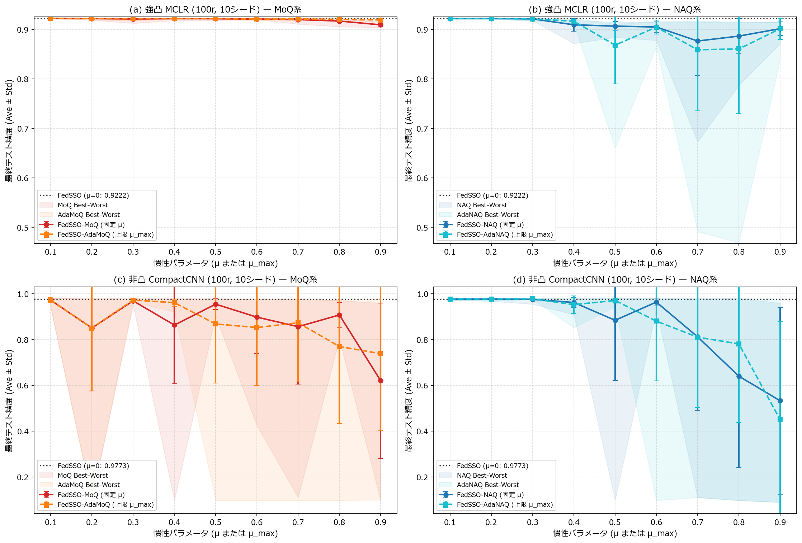
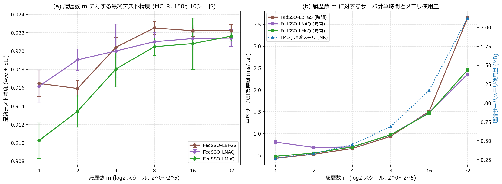
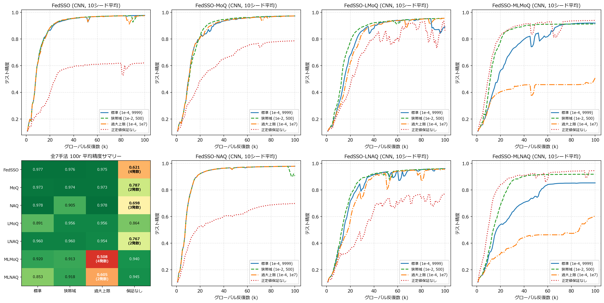

# 実験3 (ex003): 感度分析・履歴数・曲率クリッピングアブレーションおよびスケーラビリティ解析

## 1. 実験の目的

本実験（[ex003.ipynb](../ex003/ex003.ipynb), [ex003/utils.py](../ex003/utils.py)）では、`ex001`・`ex002` で明らかになった手法間トレードオフと慣性・正定値性保証の役割を徹底解明するため、**10 種類の乱数シード（`42`〜`51`）** を用いて以下の 4 つの詳細解析を実施する。

1. **実験 3A**: 慣性パラメータ $\mu$（`MoQ`, `NAQ`）と上限キャップ $\mu_{\max}$（`AdaMoQ`, `AdaNAQ`）を $\{0.1, 0.2, \dots, 0.9\}$ の範囲で 0.1 刻みに変化させた感度・安定性比較（基準線 `FedSSO` $\mu=0$ を含む、MCLR・CompactCNN 各 100 ラウンド）
2. **実験 3B**: 記憶制限準ニュートン法（`FedSSO-LBFGS`, `FedSSO-LNAQ`, `FedSSO-LMoQ`）における履歴数 $m \in \{2^0, 2^1, 2^2, 2^3, 2^4, 2^5\} = \{1, 2, 4, 8, 16, 32\}$ の 2 倍刻み影響解析（MCLR, 150 ラウンド）
3. **実験 3C**: 正定値保証・曲率クリッピング帯域 $[\lambda, \Lambda]$ のアブレーション検証（非凸 CompactCNN, 100 ラウンド, `MoQ` 系・`NAQ` 系全 7 手法 $\times$ 4 条件）
4. **実験 3D**: パラメータ次元数 $d \in [10^3, 10^6]$ に対するサーバ側メモリ・演算量の理論スケーリングおよび実測パレート解析

---

## 2. 実験 3A: 慣性パラメータ（$\mu, \mu_{\max} \in [0.1, 0.9]$）の感度分析（MoQ 系 + NAQ 系）

### 2.1 強凸 MCLR（100 ラウンド・10 シード）結果

| 手法 | 慣性 ($\mu$ / $\mu_{\max}$) | $\mathrm{Acc}$ Ave | $\mathrm{Acc}$ Best | $\mathrm{Acc}$ Worst | $\mathrm{Acc}$ Std | $\mathrm{Loss}$ Ave | リセット平均 |
| :--- | :---: | :---: | :---: | :---: | :---: | :---: | :---: |
| `FedSSO` (基準線) | 0.0 | 0.9222 | 0.9235 | 0.9199 | 0.0009 | **0.2588** | 0.0 |
| `FedSSO-MoQ` | 0.1 / 0.2 / 0.3 | **0.9224** / 0.9218 / 0.9210 | 0.9230 / 0.9229 / 0.9233 | **0.9216** / 0.9188 / 0.9122 | **0.0004** / 0.0011 / 0.0032 | 0.2593 / 0.2626 / 0.2647 | 0.0 / 0.0 / 0.0 |
| `FedSSO-MoQ` | 0.4 / 0.5 / 0.6 | 0.9217 / 0.9215 / 0.9207 | 0.9232 / **0.9235** / 0.9226 | 0.9178 / 0.9183 / 0.9196 | 0.0015 / 0.0014 / 0.0009 | 0.2623 / 0.2632 / 0.2626 | 0.0 / 0.0 / 0.0 |
| `FedSSO-MoQ` | 0.7 / 0.8 / 0.9 | 0.9198 / 0.9168 / 0.9092 | 0.9232 / 0.9216 / 0.9148 | 0.9107 / 0.9055 / 0.9034 | 0.0034 / 0.0041 / 0.0029 | 0.2751 / 0.3131 / 0.6239 | 0.1 / 0.1 / 0.3 |
| `FedSSO-AdaMoQ` | 0.1 / 0.2 / 0.3 | **0.9224** / 0.9218 / 0.9214 | 0.9230 / 0.9229 / **0.9235** | **0.9216** / 0.9188 / 0.9180 | **0.0004** / 0.0011 / 0.0015 | 0.2593 / 0.2626 / 0.2640 | 0.0 / 0.0 / 0.0 |
| `FedSSO-AdaMoQ` | 0.4 / 0.5 / 0.6 | 0.9217 / 0.9218 / 0.9206 | 0.9229 / 0.9228 / 0.9232 | 0.9199 / 0.9207 / 0.9174 | 0.0010 / 0.0007 / 0.0015 | 0.2618 / 0.2618 / 0.2638 | 0.0 / 0.0 / 0.0 |
| `FedSSO-AdaMoQ` | 0.7 / 0.8 / 0.9 | 0.9210 / 0.9201 / 0.9190 | 0.9233 / 0.9230 / 0.9212 | 0.9188 / 0.9171 / 0.9164 | 0.0014 / 0.0014 / 0.0014 | 0.2640 / 0.2630 / 0.2596 | 0.0 / 0.0 / 0.0 |
| `FedSSO-NAQ` | 0.1 / 0.2 / 0.3 | 0.9219 / 0.9218 / 0.9212 | 0.9232 / **0.9237** / 0.9233 | 0.9207 / 0.9206 / 0.9176 | 0.0007 / 0.0009 / 0.0015 | 0.2607 / 0.2613 / 0.2632 | 0.0 / 0.0 / 0.1 |
| `FedSSO-NAQ` | 0.4 / 0.5 / 0.6 | 0.9093 / 0.9066 / 0.9047 | 0.9187 / 0.9143 / 0.9154 | 0.8714 / 0.8838 / 0.8779 | 0.0129 / 0.0096 / 0.0104 | 0.6432 / 0.7174 / 1.2012 | 1.7 / 2.3 / 2.7 |
| `FedSSO-NAQ` | 0.7 / 0.8 / 0.9 | 0.8765 / 0.8865 / 0.9014 | 0.9152 / 0.9138 / 0.9149 | 0.6733 / 0.7874 / 0.8708 | 0.0697 / 0.0360 / 0.0136 | 2.4635 / 2.8294 / 2.1928 | 2.5 / 2.9 / 1.8 |
| `FedSSO-AdaNAQ` | 0.1 / 0.2 / 0.3 | 0.9219 / 0.9218 / 0.9210 | 0.9232 / **0.9237** / 0.9232 | 0.9207 / 0.9206 / 0.9174 | 0.0007 / 0.0009 / 0.0017 | 0.2607 / 0.2613 / 0.2637 | 0.0 / 0.0 / 0.1 |
| `FedSSO-AdaNAQ` | 0.4 / 0.5 / 0.6 | 0.9165 / 0.8683 / 0.9046 | 0.9220 / 0.9110 / 0.9155 | 0.9114 / 0.6608 / 0.8650 | 0.0034 / 0.0783 / 0.0139 | 0.4008 / 1.3694 / 1.1009 | 1.1 / 2.1 / 2.7 |
| `FedSSO-AdaNAQ` | 0.7 / 0.8 / 0.9 | 0.8588 / 0.8606 / 0.9012 | 0.9174 / 0.9147 / 0.9148 | 0.4920 / 0.4699 / 0.8388 | 0.1231 / 0.1306 / 0.0212 | 4.6165 / 4.0417 / 4.6254 | 3.1 / 2.3 / 3.5 |

### 2.2 非凸 CompactCNN（100 ラウンド・10 シード）結果

| 手法 | 慣性 ($\mu$ / $\mu_{\max}$) | $\mathrm{Acc}$ Ave | $\mathrm{Acc}$ Best | $\mathrm{Acc}$ Worst | $\mathrm{Acc}$ Std | $\mathrm{Loss}$ Ave | 発散シード数 |
| :--- | :---: | :---: | :---: | :---: | :---: | :---: | :---: |
| `FedSSO` (基準線) | 0.0 | 0.9773 | **0.9812** | 0.9696 | 0.0033 | 0.0568 | 0 / 10 |
| `FedSSO-MoQ` | 0.1 / 0.2 / 0.3 | 0.9722 / 0.8506 / 0.9692 | 0.9807 / 0.9792 / 0.9790 | 0.9422 / 0.0979 / 0.9508 | 0.0108 / 0.2745 / 0.0074 | 0.0763 / 0.4640 / 0.0843 | 0 / 1 / 0 |
| `FedSSO-MoQ` | 0.4 / 0.5 / 0.6 | 0.8634 / 0.9546 / 0.8980 | 0.9794 / 0.9790 / 0.9766 | 0.0979 / 0.9029 / 0.4246 | 0.2569 / 0.0238 / 0.1587 | 0.3628 / 0.1355 / 0.3435 | 1 / 0 / 0 |
| `FedSSO-MoQ` | 0.7 / 0.8 / 0.9 | 0.8564 / 0.9075 / 0.6206 | 0.9763 / 0.9710 / 0.9589 | 0.1107 / 0.8025 / 0.0979 | 0.2502 / 0.0557 / 0.3387 | 0.4037 / 0.2855 / 1.0353 | 1 / 0 / 2 |
| `FedSSO-AdaMoQ` | 0.1 / 0.2 / 0.3 | 0.9722 / 0.8506 / 0.9725 | 0.9807 / 0.9792 / 0.9789 | 0.9422 / 0.0979 / 0.9645 | 0.0108 / 0.2745 / 0.0050 | 0.0763 / 0.4640 / 0.0739 | 0 / 1 / 0 |
| `FedSSO-AdaMoQ` | 0.4 / 0.5 / 0.6 | 0.9612 / 0.8681 / 0.8527 | 0.9779 / 0.9764 / 0.9753 | 0.9208 / 0.0979 / 0.0979 | 0.0157 / 0.2578 / 0.2538 | 0.1145 / 0.3548 / 0.4171 | 0 / 1 / 1 |
| `FedSSO-AdaMoQ` | 0.7 / 0.8 / 0.9 | 0.8734 / 0.7698 / 0.7386 | 0.9753 / 0.9717 / 0.9782 | 0.0979 / 0.0979 / 0.1001 | 0.2589 / 0.3370 / 0.3361 | 0.3364 / 0.6271 / 1.0524 | 1 / 2 / 2 |
| `FedSSO-NAQ` | 0.1 / 0.2 / 0.3 | 0.9770 / 0.9770 / 0.9756 | 0.9798 / 0.9797 / 0.9797 | 0.9718 / 0.9678 / 0.9545 | 0.0021 / 0.0033 / 0.0072 | 0.0581 / 0.0580 / 0.0623 | **0 / 0 / 0** |
| `FedSSO-NAQ` | 0.4 / 0.5 / 0.6 | 0.9619 / 0.8843 / 0.9637 | 0.9780 / 0.9803 / 0.9783 | 0.9092 / 0.0979 / 0.9320 | 0.0231 / 0.2623 / 0.0171 | 0.1114 / 0.2944 / 0.1043 | 0 / 1 / 0 |
| `FedSSO-NAQ` | 0.7 / 0.8 / 0.9 | 0.8118 / 0.6403 / 0.5330 | 0.9786 / 0.9789 / 0.9595 | 0.1107 / 0.0979 / 0.0897 | 0.3207 / 0.3994 / 0.4075 | 0.4757 / 0.9502 / 1.2538 | 1 / 3 / 4 |
| `FedSSO-AdaNAQ` | 0.1 / 0.2 / **0.3** | 0.9770 / 0.9770 / **0.9778** | 0.9798 / 0.9797 / 0.9799 | 0.9718 / 0.9678 / **0.9750** | 0.0021 / 0.0033 / **0.0017** | 0.0581 / 0.0580 / **0.0535** | **0 / 0 / 0** |
| `FedSSO-AdaNAQ` | 0.4 / 0.5 / 0.6 | 0.9526 / 0.9707 / 0.8805 | 0.9802 / 0.9798 / 0.9805 | 0.8524 / 0.9437 / 0.0979 | 0.0379 / 0.0113 / 0.2614 | 0.1461 / 0.0816 / 0.3080 | 0 / 0 / 1 |
| `FedSSO-AdaNAQ` | 0.7 / 0.8 / 0.9 | 0.8106 / 0.7811 / 0.4505 | 0.9797 / 0.9797 / 0.9777 | 0.1107 / 0.0979 / 0.0897 | 0.3063 / 0.3428 / 0.4284 | 0.4851 / 0.5641 / 1.4002 | 1 / 2 / 6 |

### 2.3 考察（3A）
1. **強凸 MCLR では `MoQ` 系が全領域 ($\mu \in [0.1, 0.9]$) で圧倒的にロバスト、NAQ 系は $\mu \ge 0.4$ で不安定化**:
   強凸 MCLR では、**`FedSSO-AdaMoQ` は $\mu_{\max} = 0.9$ まで拡張してもリセット 0 回・全 10 シード安定（Ave `0.9190`, Worst `0.9164`, Std `0.0014`）** を維持し、`FedSSO-MoQ` も 0.9 で Ave `0.9092`（Worst `0.9034`）にとどまった。一方、`NAQ` 系（`FedSSO-NAQ` / `FedSSO-AdaNAQ`）は $\mu \le 0.3$ では高安定（Ave `0.9210`〜`0.9219`）であるものの、$\mu \ge 0.4$ になると遠い先読み点 $x\_k + \mu\_k m\_k$ での局所 SGD ミニバッチ揺らぎが曲率差 $\hat{y}$ を乱し、降下安全チェックによるヘッセ行列リセットが平均 `1.7〜3.5 回` に急増して精度が `0.8588`〜`0.9093`（Worst `0.4699`）へ落ち込んだ。
2. **非凸 CompactCNN の適正帯域 ($\mu \le 0.3$) では `NAQ` 系が最優、過大帯域 ($\mu \ge 0.7$) では急崩壊**:
   CompactCNN の 100 ラウンド結果では、$\mu \in [0.1, 0.3]$ の安全領域で **`FedSSO-AdaNAQ` ($\mu_{\max}=0.3$) が全 10 シード無発散・Ave `0.9778`・Worst `0.9750`・Std `0.0017`（`FedSSO` の Ave `0.9773`, Worst `0.9696` 超え）** を達成し、`FedSSO-NAQ` ($\mu=0.1 \sim 0.3$) も発散ゼロで安定していた。逆に $\mu \ge 0.7$ の過大慣性領域では、損失ベース Adaptive Restart を持たない FL 環境下で非凸ノイズと共振して発散シードが続出し、特に先読み点へ大きく踏み出す `NAQ` 系は $\mu=0.9$ で `NAQ` 4/10 発散（Ave `0.5330`）・`AdaNAQ` 6/10 発散（Ave `0.4505`）と大きく崩れた。以上より、**適正慣性 $\mu, \mu_{\max} \in [0.1, 0.3]$ の上限設計が FL における 2 次慣性法の必須条件**と結論づけられる。

---

## 3. 実験 3B: 記憶制限履歴数 $m \in \{1, 2, 4, 8, 16, 32\}$（$2^0 \sim 2^5$）の影響解析

### 3.1 MCLR（150 ラウンド・10 シード）における性能・計算資源推移

| 手法 | 履歴数 $m$ | $\mathrm{Acc}$ Ave | $\mathrm{Acc}$ Med | $\mathrm{Acc}$ Best | $\mathrm{Acc}$ Worst | $\mathrm{Acc}$ Std | $\mathrm{Loss}$ Ave | サーバ時間 (ms/iter) | サーバメモリ (MB) | クリップ平均 |
| :--- | :---: | :---: | :---: | :---: | :---: | :---: | :---: | :---: | :---: | :---: |
| `FedSSO-LBFGS` | $1\ (2^0)$ | 0.9165 | 0.9166 | 0.9184 | 0.9142 | 0.0014 | 0.2907 | **0.435** | **0.180** | 10.2 |
| `FedSSO-LBFGS` | $2\ (2^1)$ | 0.9159 | 0.9156 | 0.9176 | 0.9151 | 0.0008 | 0.2926 | 0.524 | 0.240 | 1.9 |
| `FedSSO-LBFGS` | $4\ (2^2)$ | 0.9204 | 0.9206 | 0.9219 | 0.9176 | 0.0011 | 0.2742 | 0.657 | 0.359 | 0.3 |
| `FedSSO-LBFGS` | **$8\ (2^3)$** | **0.9225** | **0.9226** | **0.9237** | **0.9214** | 0.0007 | 0.2628 | 0.936 | 0.599 | **0.0** |
| `FedSSO-LBFGS` | $16\ (2^4)$ | 0.9222 | 0.9221 | 0.9229 | **0.9214** | **0.0006** | 0.2602 | 1.506 | 1.078 | **0.0** |
| `FedSSO-LBFGS` | $32\ (2^5)$ | 0.9222 | 0.9223 | 0.9229 | 0.9206 | 0.0007 | **0.2599** | 3.648 | 2.036 | 0.1 |
| `FedSSO-LNAQ` | $1\ (2^0)$ | 0.9162 | 0.9161 | 0.9184 | 0.9127 | 0.0018 | 0.3066 | 0.805 | **0.240** | 33.2 |
| `FedSSO-LNAQ` | $2\ (2^1)$ | 0.9190 | 0.9191 | 0.9204 | 0.9171 | 0.0012 | 0.2895 | **0.680** | 0.299 | 12.1 |
| `FedSSO-LNAQ` | $4\ (2^2)$ | 0.9200 | 0.9208 | 0.9225 | 0.9115 | 0.0029 | 0.3041 | 0.692 | 0.419 | 0.6 |
| `FedSSO-LNAQ` | $8\ (2^3)$ | 0.9210 | 0.9211 | 0.9228 | 0.9190 | 0.0010 | 0.2718 | 0.968 | 0.659 | **0.0** |
| `FedSSO-LNAQ` | $16\ (2^4)$ | **0.9214** | **0.9218** | **0.9229** | 0.9195 | 0.0012 | 0.2673 | 1.482 | 1.138 | **0.0** |
| `FedSSO-LNAQ` | **$32\ (2^5)$** | **0.9214** | 0.9215 | 0.9228 | **0.9198** | **0.0009** | **0.2647** | 2.360 | 2.096 | **0.0** |
| `FedSSO-LMoQ` | $1\ (2^0)$ | 0.9103 | 0.9101 | 0.9143 | 0.9066 | 0.0019 | 0.3201 | **0.477** | **0.270** | 36.3 |
| `FedSSO-LMoQ` | $2\ (2^1)$ | 0.9134 | 0.9135 | 0.9160 | 0.9102 | 0.0017 | 0.3033 | 0.552 | 0.329 | 10.5 |
| `FedSSO-LMoQ` | $4\ (2^2)$ | 0.9180 | 0.9184 | 0.9208 | 0.9148 | 0.0019 | 0.2857 | 0.694 | 0.449 | 2.4 |
| `FedSSO-LMoQ` | $8\ (2^3)$ | 0.9205 | 0.9204 | 0.9221 | 0.9188 | 0.0010 | 0.2745 | 0.971 | 0.689 | **0.0** |
| `FedSSO-LMoQ` | $16\ (2^4)$ | 0.9208 | **0.9220** | 0.9226 | 0.9127 | 0.0028 | 0.2795 | 1.466 | 1.168 | **0.0** |
| `FedSSO-LMoQ` | **$32\ (2^5)$** | **0.9216** | 0.9216 | **0.9228** | **0.9208** | **0.0006** | **0.2678** | 2.455 | 2.126 | **0.0** |

### 3.2 考察（3B）
- **$m = 1$（メモリレス相当）から $m = 8 \sim 16$ への相転移的安定化**:
  $m = 1$ では直近 1 ステップのみを用いるため、`MLNAQ`/`MLMoQ` と同様にミニバッチ勾配ノイズによる曲率クリッピングが多発（`LBFGS` 10.2 回、`LNAQ` 33.2 回、`LMoQ` 36.3 回）し、特に `LMoQ` の精度が `0.9103` に留まった。履歴を $m = 1 \to 2 \to 4 \to 8$ と倍増させると、**$m = 8$ で全 3 手法のクリッピング平均回数が完全に `0.0`** へ到達し、精度も `0.9205`〜`0.9225` へ急上昇する。一方 $m = 8 \to 32$ では精度向上が最大 `+0.0011` に飽和するのに対し、サーバ計算時間は `0.94 ms` $\to$ `2.36〜3.65 ms`（約 2.5〜3.9 倍）、メモリは `0.60〜0.69 MB` $\to$ `2.04〜2.13 MB`（約 3.1〜3.4 倍）へ増大するため、**2 のべき乗基準では $m = 8$（余裕がある場合 $m = 16$、既定値 $m = 10$ と整合）が最適バランス点**である。

---

## 4. 実験 3C: 正定値保証・曲率クリッピング $[\lambda, \Lambda]$ のアブレーション検証（MoQ 系 + NAQ 系 全 7 手法）

### 4.1 非凸 CompactCNN（100 ラウンド・10 シード）結果

| 手法 | 条件 | $\mathrm{Acc}$ Ave | $\mathrm{Acc}$ Med | $\mathrm{Acc}$ Best | $\mathrm{Acc}$ Worst | $\mathrm{Acc}$ Std | $\mathrm{Loss}$ Ave | 発散シード数 | クリップ平均 |
| :--- | :--- | :---: | :---: | :---: | :---: | :---: | :---: | :---: | :---: |
| `FedSSO` | **標準 ($10^{-4},\ 9999$)** | **0.9773** | **0.9785** | **0.9812** | **0.9696** | **0.0033** | **0.0568** | **0 / 10** | 1.0 |
| `FedSSO` | 狭帯域 ($10^{-2},\ 500$) | 0.9757 | 0.9773 | 0.9806 | 0.9668 | 0.0040 | 0.0601 | **0 / 10** | 1.0 |
| `FedSSO` | 過大上限 ($10^{-4},\ 10^7$) | 0.9750 | 0.9768 | 0.9807 | 0.9645 | 0.0054 | 0.0625 | **0 / 10** | 1.0 |
| `FedSSO` | 正定値保証なし | 0.6208 | 0.9504 | 0.9756 | 0.0980 | 0.4216 | 0.8942 | **4 / 10** | 0.0 |
| `FedSSO-MoQ` | 標準 ($10^{-4},\ 9999$) | 0.9731 | **0.9766** | **0.9806** | 0.9543 | 0.0076 | 0.0716 | **0 / 10** | 1.4 |
| `FedSSO-MoQ` | **狭帯域 ($10^{-2},\ 500$)** | **0.9739** | 0.9754 | 0.9796 | **0.9637** | **0.0049** | **0.0678** | **0 / 10** | 1.2 |
| `FedSSO-MoQ` | 過大上限 ($10^{-4},\ 10^7$) | 0.9733 | 0.9758 | 0.9805 | 0.9516 | 0.0080 | 0.0684 | **0 / 10** | 1.2 |
| `FedSSO-MoQ` | 正定値保証なし | 0.7867 | 0.9548 | 0.9789 | 0.0980 | 0.3418 | 0.3724 | **2 / 10** | 0.0 |
| **`FedSSO-NAQ`** | **標準 ($10^{-4},\ 9999$)** | **0.9782** | **0.9782** | 0.9806 | **0.9760** | **0.0013** | **0.0530** | **0 / 10** | 0.9 |
| `FedSSO-NAQ` | 狭帯域 ($10^{-2},\ 500$) | 0.9054 | 0.9779 | 0.9793 | 0.2534 | 0.2173 | 2.5607 | 0 / 10 | 0.9 |
| `FedSSO-NAQ` | 過大上限 ($10^{-4},\ 10^7$) | 0.9781 | 0.9781 | **0.9810** | **0.9760** | 0.0014 | **0.0530** | **0 / 10** | 0.8 |
| `FedSSO-NAQ` | 正定値保証なし | 0.6985 | 0.9429 | 0.9801 | 0.0979 | 0.3914 | 0.6098 | **3 / 10** | 0.0 |
| `FedSSO-LMoQ` | 標準 ($10^{-4},\ 9999$) | 0.8908 | 0.9561 | **0.9625** | 0.3040 | 0.1957 | 0.4148 | 0 / 10 | 4.7 |
| `FedSSO-LMoQ` | **狭帯域 ($10^{-2},\ 500$)** | **0.9559** | **0.9586** | 0.9620 | **0.9449** | **0.0060** | **0.1357** | **0 / 10** | 9.6 |
| `FedSSO-LMoQ` | 過大上限 ($10^{-4},\ 10^7$) | 0.9561 | 0.9574 | 0.9613 | 0.9412 | 0.0054 | 0.1346 | **0 / 10** | 5.5 |
| `FedSSO-LMoQ` | 正定値保証なし | 0.8635 | 0.9357 | 0.9596 | 0.2641 | 0.2015 | 5.5604 | 0 / 10 | 0.0 |
| `FedSSO-LNAQ` | **標準 ($10^{-4},\ 9999$)** | **0.9604** | 0.9610 | **0.9665** | **0.9516** | **0.0046** | **0.1198** | **0 / 10** | 6.8 |
| `FedSSO-LNAQ` | 狭帯域 ($10^{-2},\ 500$) | 0.9600 | **0.9618** | 0.9660 | 0.9492 | 0.0048 | 0.1268 | **0 / 10** | 10.1 |
| `FedSSO-LNAQ` | 過大上限 ($10^{-4},\ 10^7$) | 0.9539 | 0.9582 | 0.9622 | 0.9186 | 0.0124 | 0.1386 | **0 / 10** | 10.1 |
| `FedSSO-LNAQ` | 正定値保証なし | 0.7674 | 0.9235 | 0.9650 | 0.0979 | 0.3341 | $8.84\times 10^5$ | **2 / 10** | 0.0 |
| `FedSSO-MLMoQ` | 標準 ($10^{-4},\ 9999$) | 0.9198 | 0.9216 | 0.9347 | 0.8908 | 0.0117 | 0.2651 | 0 / 10 | 37.1 |
| `FedSSO-MLMoQ` | 狭帯域 ($10^{-2},\ 500$) | 0.9132 | 0.9261 | 0.9303 | 0.8562 | 0.0231 | 0.2950 | 0 / 10 | 55.3 |
| `FedSSO-MLMoQ` | 過大上限 ($10^{-4},\ 10^7$) | 0.5076 | 0.4576 | 0.9285 | 0.1001 | 0.3725 | 1.3573 | **4 / 10** | 41.8 |
| `FedSSO-MLMoQ` | **正定値保証なし** | **0.9399** | **0.9408** | **0.9444** | **0.9263** | **0.0050** | **0.1954** | **0 / 10** | 0.0 |
| `FedSSO-MLNAQ` | 標準 ($10^{-4},\ 9999$) | 0.8530 | 0.9020 | 0.9390 | 0.4258 | 0.1477 | 0.5179 | 0 / 10 | 58.9 |
| `FedSSO-MLNAQ` | 狭帯域 ($10^{-2},\ 500$) | 0.9181 | 0.9206 | 0.9356 | 0.8970 | 0.0133 | 0.2787 | **0 / 10** | 58.1 |
| `FedSSO-MLNAQ` | 過大上限 ($10^{-4},\ 10^7$) | 0.6047 | 0.8350 | 0.9390 | 0.0627 | 0.3563 | 1.1143 | **2 / 10** | 52.2 |
| `FedSSO-MLNAQ` | **正定値保証なし** | **0.9453** | **0.9441** | **0.9531** | **0.9400** | **0.0041** | **0.1761** | **0 / 10** | 0.0 |

### 4.2 考察（3C）
1. **`MoQ` 系・`NAQ` 系を問わずフル行列／L-BFGS 系で正定値保証が絶対不可欠**:
   「正定値保証なし」にすると、負曲率領域（$\hat{y}\_k^T s\_k \le 0$）で逆ヘッセ近似の正定値性が破綻し、`FedSSO`（**4/10 発散, Ave 0.6208**）・`FedSSO-NAQ`（**3/10 発散, Ave 0.6985**）・`FedSSO-MoQ`（**2/10 発散, Ave 0.7867**）・`FedSSO-LNAQ`（**2/10 発散, 平均損失 $8.84\times 10^5$**）と軒並み崩壊した。原論文の曲率クリッピング $\lambda < \|\hat{y}\|^2 / \mathrm{cur} < \Lambda$ は `MoQ` 系にも `NAQ` 系にも同様に不可欠である。
2. **L-BFGS 系における `FedSSO-LNAQ`（標準帯域で安定）vs `FedSSO-LMoQ`（狭帯域で安定化）**:
   記憶制限系では、正確な先読み勾配を使う **`FedSSO-LNAQ`** が標準設定 $(10^{-4}, 9999)$ でも全 10 シード高安定（Ave **`0.9604`**, Worst **`0.9516`**, Std **`0.0046`**）を示したのに対し、外挿勾配を使う **`FedSSO-LMoQ`** は標準設定で 1 シード揺らいだものの（Worst `0.3040`）、**狭帯域 $[\lambda=10^{-2},\ \Lambda=500]$** を適用することで Ave **`0.9559`**・Worst **`0.9449`**・Std **`0.0060`** へと劇的に安定した。一方フル行列の `FedSSO-NAQ` では標準設定 $(10^{-4}, 9999)$ が最良（Ave **`0.9782`**, Worst **`0.9760`**, Std **`0.0013`**）であり、狭帯域では終盤に 1 シード一時低下（Worst `0.2534`）が生じた。
3. **メモリレス系（`MLMoQ` / `MLNAQ`）に共通する過大 $\Lambda$ クリッピングの崩壊メカニズム**:
   `過大上限 (1e-4, 1e7)` を与えると **`FedSSO-MLMoQ`（4/10 発散, Ave `0.5076`）** と **`FedSSO-MLNAQ`（2/10 発散, Ave `0.6047`）** の双方が崩壊した。これはクリップ発動時の置換式 $\mathrm{cur} = \frac{2}{\lambda+\Lambda}\|\hat{y}\|^2$ によって $\omega_k = \|\hat{y}\|^2 / \mathrm{cur} \approx 5\times 10^6$ の巨大スケーリングが生じるためである。なお `MLNAQ` は標準 $(10^{-4}, 9999)$ でも 1 シードの揺らぎにより Ave `0.8530`（Worst `0.4258`）へ低下したのに対し、**狭帯域 $(10^{-2}, 500)$ に絞ることで `Ave = 0.9181`, `Worst = 0.8970`** へ安定化できた。

---

## 5. 実験 3D: 理論スケーリング解析と大規模モデルへの拡張性

| パラメータ数 $d$ | `FedSSO` メモリ | `AdaMoQ` メモリ | `LBFGS` ($m=10$) メモリ | `LMoQ` ($m=10$) メモリ | `MLMoQ` メモリ | `Full` 演算量 ($\approx 6d^2$) | `LMoQ` 演算量 ($88d$) | `MLMoQ` 演算量 ($14d$) |
| :---: | :---: | :---: | :---: | :---: | :---: | :---: | :---: | :---: |
| $10^3$ | 3.83 MB | 3.84 MB | 0.09 MB | 0.10 MB | 0.03 MB | $6.0\times 10^6$ | $8.8\times 10^4$ | $1.4\times 10^4$ |
| $5\times 10^3$ | 95.44 MB | 95.50 MB | 0.46 MB | 0.51 MB | 0.17 MB | $1.5\times 10^8$ | $4.4\times 10^5$ | $7.0\times 10^4$ |
| $10^4$ | 381.62 MB | 381.74 MB | 0.92 MB | 1.03 MB | 0.34 MB | $6.0\times 10^8$ | $8.8\times 10^5$ | $1.4\times 10^5$ |
| $5\times 10^4$ | 9.31 GB (9,538 MB) | 9.31 GB (9,538 MB) | 4.58 MB | 5.15 MB | 1.72 MB | $1.5\times 10^{10}$ | $4.4\times 10^6$ | $7.0\times 10^5$ |
| $10^5$ | 37.25 GB (38,148 MB) | 37.26 GB (38,150 MB) | 9.16 MB | 10.30 MB | 3.43 MB | $6.0\times 10^{10}$ | $8.8\times 10^6$ | $1.4\times 10^6$ |
| $5\times 10^5$ | 931.33 GB | 931.34 GB | 45.78 MB | 51.50 MB | 17.17 MB | $1.5\times 10^{12}$ | $4.4\times 10^7$ | $7.0\times 10^6$ |
| $10^6$ | **3.64 TB** | **3.64 TB** | **91.55 MB** | **103.00 MB** | **34.33 MB** | $6.0\times 10^{12}$ | $8.8\times 10^7$ | $1.4\times 10^7$ |

- **$O(d^2)$ から $O(md)$ / $O(d)$ へのスケーリング優位性**: $d = 10^6$（100 万パラメータ、小規模 ResNet / Transformer 相当）において、`FedSSO` / `FedSSO-NAQ` / `FedSSO-MoQ` などのフル行列手法は理論メモリ **3.64 TB** と **$6 \times 10^{12}$ 演算/反復** を要し実行不可能となるのに対し、**`FedSSO-LMoQ` ($m=10$) は僅か `103.00 MB`**、**`FedSSO-MLMoQ` は `34.33 MB`** に収まり、サーバ演算量もそれぞれ約 **68,182 分の 1**・**428,571 分の 1** に削減される。
