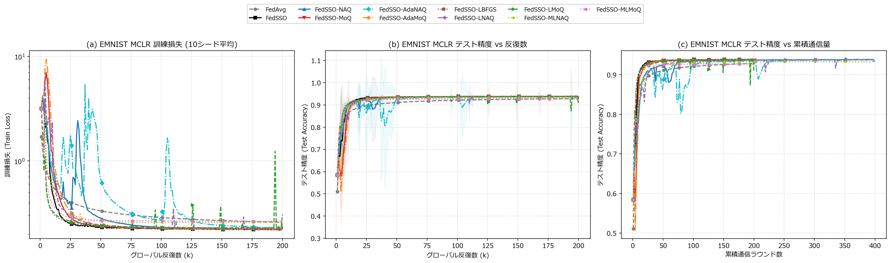
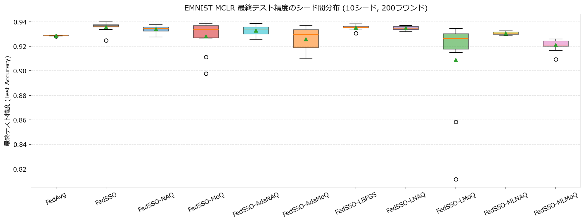

# 実験4 (ex004): EMNIST MCLR（強凸モデル）における FedSSO × MoQ ファミリー 10 シード比較実験

## 1. 実験の目的

本実験（[ex004.ipynb](../ex004/ex004.ipynb)）では、論文 *"FedSSO: A Federated Server-Side Second-Order Optimization Algorithm"* (Ma et al., 2022) の Table 1（上段右: `EMNIST FOR MCLR`）・Figure 4(b) の設定に準拠し、強凸多項ロジスティック回帰（MCLR, [ex004/model.py](../ex004/model.py), 総パラメータ数 $d = 7,850$）を用いて、EMNIST Digits データセット（10 クラス, 280,000 サンプル）上の Non-IID 連合学習において原論文 `FedSSO` および慣性付準ニュートン法ファミリー（`NAQ`, `MoQ`, `AdaNAQ`, `AdaMoQ`, `LNAQ`, `LMoQ`, `MLNAQ`, `MLMoQ`）・`FedSSO-LBFGS`・`FedAvg` の全 11 手法を **10 種類の乱数シード（`42`〜`51`）** で比較評価する。

---

## 2. 実験設定と実装詳細

### 2.1 データセット・Non-IID 分割・モデル構造
- **データセット・Non-IID 分割**: EMNIST Digits（訓練 240,000 枚 + テスト 40,000 枚 = 全 280,000 サンプル, $28 \times 28$ 画像, 10 クラス）を正規化・784 次元化し、[ex004/utils.py](../ex004/utils.py) にてクライアント数 $N = 20$ にクラス別 Dirichlet 分布 $\mathrm{Dir}(\beta = 0.1)$ で分割した。各クライアント内で訓練 $75\%$・テスト $25\%$ に分割し、非パディング連結 GPU テンソルで保持した。
- **モデル（`MCLR`）**: $784 \to 10$ の $L\_2$ 正則化付き（$\mu\_{\mathrm{reg}} = 10^{-4}$）多項ロジスティック回帰モデル（$d = 7,850$、1 通信ラウンドあたりの基準通信量 $n\_c = 7,850 \times 8 = 62,800\,\mathrm{B}$）。

### 2.2 比較アルゴリズム（全 11 手法）と共通ハイパーパラメータ
- **共通連合学習設定**: 局所更新ステップ数 $\tau = 5$、ミニバッチサイズ $\mathrm{BS} = 100$、グローバル反復数 $K = 200$、乱数シード 10 種類（`42`〜`51`）。
- **FedSSO 系統一設定（論文 Table 1 上右準拠）**: 局所学習率 $\alpha = 0.003$、グローバルステップ長 $\eta = 1.0$、正定値保証用曲率クリッピング $\lambda = 10^{-4},\ \Lambda = 9,999$、周期リセット $R = 200$、`max_step_norm = 20.0`。
- **MoQ ファミリー適用パラメータ**:
  - 固定慣性系（`FedSSO-NAQ`, `FedSSO-MoQ`）: $\mu = 0.30$
  - 適応慣性系（`FedSSO-AdaNAQ`, `FedSSO-AdaMoQ`, `FedSSO-LNAQ`, `FedSSO-LMoQ`, `FedSSO-MLNAQ`, `FedSSO-MLMoQ`）: $\theta\_1 = 1,\ \gamma = 10^{-5}$ ＋ 上限キャップ $\mu\_{\max} = 0.40$
  - 記憶制限履歴数（`FedSSO-LBFGS`, `FedSSO-LNAQ`, `FedSSO-LMoQ`）: $m = 10$
- **1 次ベースライン（`FedAvg`）**: 論文 Table 1 準拠の最適設定 $\alpha = 0.03$。

### 2.3 GPU 並列局所 SGD と省メモリ Rank-2 BFGS 更新
[ex004/model.py](../ex004/model.py) の `batched_mclr_local_sgd`（非パディング `offsets` + `torch.bmm`）は、同一ミニバッチ系列における逐次クライアントループに対して最大絶対誤差 **`7.451e-09`** で一致した。またサーバ側フル逆ヘッセ行列更新は `H.addmm_(U, V)` による完全 in-place 更新を適用した。

---

## 3. 10 シード比較実験結果

### 3.1 200 ラウンド時点のテスト精度・訓練損失（Ave / Med / Best / Worst / Std）

| 手法 | $\mathrm{Acc}$ Ave | $\mathrm{Acc}$ Med | $\mathrm{Acc}$ Best | $\mathrm{Acc}$ Worst | $\mathrm{Acc}$ Std | $\mathrm{MaxAcc}$ Ave (Best) | $\mathrm{Loss}$ Ave | $\mathrm{Loss}$ Best | $\mathrm{Loss}$ Worst | クリップ / リセット平均 |
| :--- | :---: | :---: | :---: | :---: | :---: | :---: | :---: | :---: | :---: | :---: |
| `FedAvg` ($\alpha=0.03$) | 0.9286 | 0.9287 | 0.9290 | 0.9281 | **0.0002** | 0.9287 (0.9290) | 0.2584 | 0.2578 | 0.2590 | 0.0 / 0.0 |
| **`FedSSO`** | **0.9357** | **0.9363** | **0.9400** | 0.9248 | 0.0041 | **0.9403** (**0.9407**) | **0.2283** | **0.2184** | 0.2486 | 0.0 / 1.0 |
| `FedSSO-NAQ` | 0.9340 | 0.9345 | 0.9375 | 0.9276 | 0.0027 | 0.9396 (0.9402) | 0.2329 | 0.2231 | 0.2540 | 0.0 / 1.1 |
| `FedSSO-MoQ` | 0.9281 | 0.9337 | 0.9388 | 0.8977 | 0.0128 | 0.9402 (0.9405) | 0.2503 | 0.2212 | 0.3172 | 0.0 / 1.0 |
| `FedSSO-AdaNAQ` | 0.9328 | 0.9341 | 0.9386 | 0.9258 | 0.0042 | 0.9390 (0.9403) | 0.2393 | 0.2251 | 0.2604 | 0.0 / 1.6 |
| `FedSSO-AdaMoQ` | 0.9258 | 0.9296 | 0.9371 | 0.9098 | 0.0097 | 0.9400 (0.9404) | 0.2562 | 0.2252 | 0.2946 | 0.0 / 1.0 |
| **`FedSSO-LBFGS`** ($m=10$) | 0.9353 | 0.9354 | 0.9382 | 0.9307 | 0.0019 | 0.9391 (0.9395) | 0.2323 | 0.2246 | **0.2387** | 0.2 / 1.0 |
| **`FedSSO-LNAQ`** ($m=10$) | 0.9347 | 0.9348 | 0.9369 | **0.9320** | 0.0017 | 0.9382 (0.9394) | 0.2353 | 0.2270 | 0.2437 | 0.0 / 1.1 |
| `FedSSO-LMoQ` ($m=10$) | 0.9089 | 0.9263 | 0.9345 | 0.8117 | 0.0387 | 0.9376 (0.9381) | 0.3065 | 0.2403 | 0.5915 | 0.4 / 1.0 |
| `FedSSO-MLNAQ` | 0.9305 | 0.9307 | 0.9325 | 0.9285 | **0.0013** | 0.9329 (0.9345) | 0.2627 | 0.2499 | 0.2783 | 87.1 / 1.0 |
| `FedSSO-MLMoQ` | 0.9209 | 0.9209 | 0.9260 | 0.9094 | 0.0047 | 0.9273 (0.9308) | 0.2822 | 0.2605 | 0.3080 | 68.6 / 1.0 |

### 3.2 通信コスト・目標精度到達速度・サーバ計算資源（10 シード平均）

| 手法 | 通信/反復 | $\mathrm{Acc}\ge 0.80$ 反復 / 通信 | $\mathrm{Acc}\ge 0.83$ 反復 / 通信 | $83\%$ 総通信量 (B) | $\mathrm{Acc}\ge 0.84$ 反復 (到達率) | サーバ時間 (ms/iter) | サーバメモリ (MB) |
| :--- | :---: | :---: | :---: | :---: | :---: | :---: | :---: |
| `FedAvg` ($\alpha=0.03$) | $1.00\,n_c$ | 4.3 / 4.3 | 6.0 / 6.0 | 376,800 | 7.0 (10/10) | 0.007 | 0.030 |
| `FedSSO` | $1.00\,n_c$ | 5.8 / 5.8 | 6.1 / 6.1 | 383,080 | 6.6 (10/10) | 2.058 | 235.191 |
| `FedSSO-NAQ` | $1.995\,n_c$ | 5.7 / 10.4 | 6.1 / 11.2 | 703,360 | 6.3 (10/10) | 2.019 | 235.251 |
| `FedSSO-MoQ` | $1.00\,n_c$ | 7.9 / 7.9 | 8.2 / 8.2 | 514,960 | 8.7 (10/10) | 2.054 | 235.281 |
| `FedSSO-AdaNAQ` | $1.995\,n_c$ | 5.6 / 10.2 | 6.2 / 11.4 | 715,920 | 6.5 (10/10) | 2.059 | 235.251 |
| `FedSSO-AdaMoQ` | $1.00\,n_c$ | 8.9 / 8.9 | 9.2 / 9.2 | 577,760 | 9.3 (10/10) | 2.009 | 235.281 |
| **`FedSSO-LBFGS`** ($m=10$) | $1.00\,n_c$ | 3.5 / 3.5 | **4.0** / **4.0** | **251,200** | **4.3** (10/10) | 1.200 | 0.719 |
| `FedSSO-LNAQ` ($m=10$) | $1.995\,n_c$ | 4.5 / 8.0 | 4.9 / 8.8 | 552,640 | 5.5 (10/10) | 1.773 | 0.779 |
| **`FedSSO-LMoQ`** ($m=10$) | $1.00\,n_c$ | 3.5 / 3.5 | **4.0** / **4.0** | **251,200** | 4.4 (10/10) | 1.484 | 0.809 |
| `FedSSO-MLNAQ` | $1.995\,n_c$ | 4.1 / 7.2 | 4.4 / 7.8 | 489,840 | 5.0 (10/10) | **0.620** | **0.240** |
| **`FedSSO-MLMoQ`** | $1.00\,n_c$ | **3.4** / **3.4** | **4.0** / **4.0** | **251,200** | 4.4 (10/10) | 0.778 | **0.270** |

---

## 4. 実験結果の考察

1. **強凸 EMNIST MCLR における `FedSSO` および記憶制限系（`LBFGS`・`LNAQ`）の優位性**:
   データ規模が MNIST の 4 倍（280,000 サンプル）と大きい EMNIST Digits の強凸 MCLR では、**`FedSSO`** が 200 ラウンド平均精度 **0.9357**（最良 **0.9400**, 平均損失 **0.2283**）で全 11 手法中の最高平均精度を達成した。注目すべきことに、MNIST（`ex001`）でシード外れ値崩壊を起こした **`FedSSO-LBFGS`** も EMNIST では 1クライアントあたりサンプル数増加による勾配推定分散低下の恩恵を受けて **`Acc_Ave = 0.9353`・Worst `0.9307`・Std `0.0019`** と極めて安定化し、さらに精度 $83\%$・$84\%$ 到達ではわずか **4.0〜4.3 反復（`Bytes@0.83 = 251,200 B`, `FedSSO` 比 34% 削減）** で最速到達した。
2. **NAQ 系と MoQ 系の明確な対比（強凸終盤収束 vs 初期加速・省通信）**:
   強凸目的関数上では先読み点で実勾配を再評価する **`NAQ` 系統**（`FedSSO-NAQ`: 0.9340、`FedSSO-AdaNAQ`: 0.9328、`FedSSO-LNAQ`: 0.9347、`FedSSO-MLNAQ`: 0.9305）が、対応する `MoQ` 系統（`MoQ`: 0.9281、`AdaMoQ`: 0.9258、`LMoQ`: 0.9089、`MLMoQ`: 0.9209）をすべての実装カテゴリで上回り、特に **`FedSSO-LNAQ`** は全 2 次最適化手法中で最良の最悪ケース精度（**Worst `0.9320`**, `Std = 0.0017`）とほぼ無クリップ（0.0 回）を達成した。一方、`MoQ` 系統は `LMoQ` でシード `48` 等での終盤振動（Worst `0.8117`）が出やすい反面、立ち上がりの $83\%$ 到達総通信量（`LMoQ`/`MLMoQ`: `251,200 B`）では `NAQ` 系統（`489,840〜552,640 B`）の約半分に抑えられた。
3. **シード間ばらつきの小さい `FedSSO-MLNAQ` の省メモリ特性**:
   $O(d)$ 最小メモリ（`0.240 MB`）で 2 次手法最速サーバ計算（`0.620 ms/iter`）の **`FedSSO-MLNAQ`** は、強凸問題上で全 10 シード平均 **0.9305**・**`Acc_Std = 0.0013`** と全 2 次手法中で最小の分散を達成し、大規模データでの軽量・安定解として実用性が高いことを示した。
