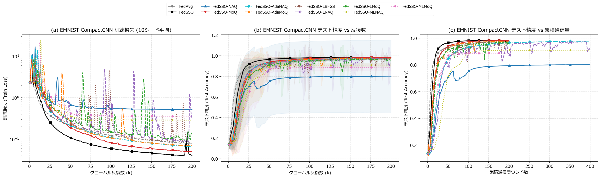
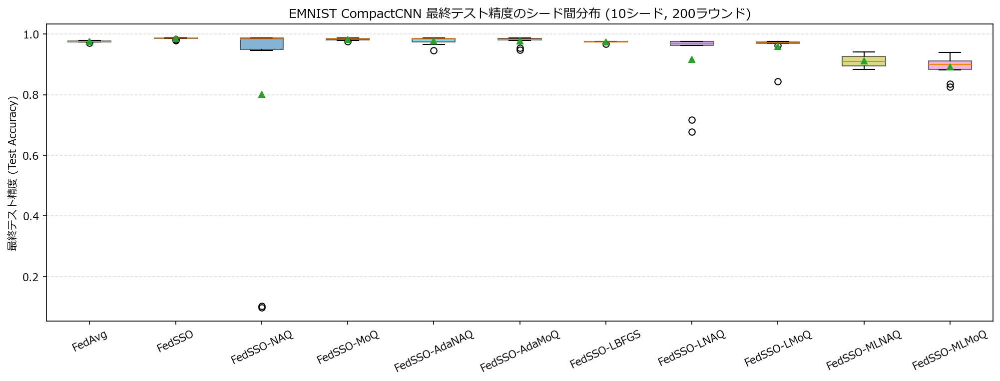

# 実験5 (ex005): EMNIST CompactCNN（非凸モデル）における FedSSO × MoQ ファミリー 10 シード比較実験

## 1. 実験の目的

本実験（[ex005.ipynb](../ex005/ex005.ipynb)）では、論文 *"FedSSO: A Federated Server-Side Second-Order Optimization Algorithm"* (Ma et al., 2022) の Table 1（下段右: `EMNIST FOR CNN`, 200 ラウンド総通信量 $9,968,000\,\mathrm{B} \Rightarrow d = 6,230$）に準拠し、非凸畳み込みニューラルネットワーク `CompactCNN`（[ex005/model.py](../ex005/model.py)）上で EMNIST Digits（280,000 サンプル, $N = 20$ Non-IID）の学習を実行し、全 11 手法を **10 種類の乱数シード（`42`〜`51`）** で比較検証する。

---

## 2. 実験設定とハイパーパラメータ調整の経緯

- **データセット・分割**: `ex004` と同一の EMNIST Digits（10 クラス, 280,000 枚, $1 \times 28 \times 28$ 画像, $N = 20$, $\mathrm{Dir}(\beta = 0.1)$, 75%/25% 分割）。
- **モデル（`CompactCNN`）**: `Conv1(1->5, 5x5) + Conv2(5->5, 5x5) + FC1(80->60) + FC2(60->10)`、総パラメータ数 $d = 6,230$（1 ラウンド基準通信量 $n\_c = 49,840\,\mathrm{B}$）。GPU 並列局所 SGD（`groups=N`）の逐次 `nn.Module` ループに対する最大絶対誤差は **`2.980e-08`** で一致した。
- **予備検証に基づくハイパーパラメータ設定**:
  論文 Table 1（下段右）表記の `FedSSO` 設定（$\alpha = 0.003, \eta = 1.0$）を本実験の 28 万枚標準化 EMNIST Digits 上の `CompactCNN` で検証したところ、1 シードパイロットでテスト精度 **`0.0985`**（ランダム水準）に停滞することを確認した。そのため、論文第 5 節のグリッドサーチ範囲（$\alpha \in \{0.0001, \dots, 0.7\}, \eta \in \{0.01, \dots, 1.0\}$）より **`FedSSO` が安定かつ最高精度に到達した $(\alpha = 0.03,\ \eta = 0.3)$** を全準ニュートン手法（10 手法）へ統一適用した（`FedAvg` は論文 Table 1 準拠の $\alpha = 0.1$）。
- **MoQ ファミリー適用パラメータ（`ex002` 非凸設定と統一）**:
  - 固定慣性系（`FedSSO-NAQ`, `FedSSO-MoQ`）: $\mu = 0.25$
  - 適応慣性系（`FedSSO-AdaNAQ`, `FedSSO-AdaMoQ`, `FedSSO-LNAQ`, `FedSSO-LMoQ`, `FedSSO-MLNAQ`, `FedSSO-MLMoQ`）: $\theta\_1 = 1,\ \gamma = 10^{-5},\ \mu\_{\max} = 0.30$
  - 記憶制限履歴数: $m = 10$、曲率クリッピング: $\lambda = 10^{-4},\ \Lambda = 9,999,\ R = 200$。

---

## 3. 10 シード比較実験結果

### 3.1 200 ラウンド時点のテスト精度・訓練損失（Ave / Med / Best / Worst / Std）

| 手法 | $\mathrm{Acc}$ Ave | $\mathrm{Acc}$ Med | $\mathrm{Acc}$ Best | $\mathrm{Acc}$ Worst | $\mathrm{Acc}$ Std | $\mathrm{MaxAcc}$ Ave (Best) | $\mathrm{Loss}$ Ave | $\mathrm{Loss}$ Best | $\mathrm{Loss}$ Worst | クリップ / リセット平均 |
| :--- | :---: | :---: | :---: | :---: | :---: | :---: | :---: | :---: | :---: | :---: |
| `FedAvg` ($\alpha=0.1$) | 0.9755 | 0.9755 | 0.9783 | 0.9708 | **0.0022** | 0.9757 (0.9783) | 0.0760 | 0.0689 | 0.0907 | 0.0 / 0.0 |
| **`FedSSO`** | **0.9859** | **0.9873** | **0.9886** | **0.9782** | 0.0031 | **0.9867** (**0.9889**) | **0.0411** | **0.0316** | **0.0663** | 1.8 / 1.6 |
| `FedSSO-NAQ` | 0.8015 | 0.9836 | 0.9872 | 0.0978 | 0.3512 | 0.8284 (0.9881) | 0.5194 | 0.0360 | 2.3235 | 9.1 / 2.1 |
| **`FedSSO-MoQ`** | 0.9827 | 0.9833 | 0.9872 | 0.9757 | 0.0033 | 0.9836 (0.9885) | 0.0517 | 0.0367 | 0.0732 | 1.5 / 1.7 |
| `FedSSO-AdaNAQ` | 0.9776 | 0.9830 | 0.9871 | 0.9459 | 0.0124 | 0.9783 (0.9876) | 0.0676 | 0.0377 | 0.1661 | 1.7 / 2.2 |
| `FedSSO-AdaMoQ` | 0.9769 | 0.9823 | 0.9867 | 0.9469 | 0.0135 | 0.9777 (0.9876) | 0.0702 | 0.0384 | 0.1655 | **1.2** / 2.0 |
| `FedSSO-LBFGS` ($m=10$) | 0.9740 | 0.9743 | 0.9763 | 0.9669 | 0.0025 | 0.9745 (0.9770) | 0.0813 | 0.0724 | 0.1040 | 14.3 / 1.5 |
| `FedSSO-LNAQ` ($m=10$) | 0.9161 | 0.9695 | 0.9763 | 0.6772 | 0.1101 | 0.9732 (0.9764) | 0.3090 | 0.0743 | 1.4878 | 17.2 / 1.3 |
| `FedSSO-LMoQ` ($m=10$) | 0.9586 | 0.9712 | 0.9754 | 0.8444 | 0.0382 | 0.9707 (0.9754) | 0.1301 | 0.0789 | 0.4808 | 14.2 / 1.7 |
| `FedSSO-MLNAQ` | 0.9108 | 0.9094 | 0.9403 | 0.8835 | 0.0198 | 0.9120 (0.9403) | 0.2844 | 0.1907 | 0.3697 | 148.1 / 1.1 |
| `FedSSO-MLMoQ` | 0.8914 | 0.8993 | 0.9388 | 0.8259 | 0.0348 | 0.8922 (0.9388) | 0.3476 | 0.2012 | 0.5305 | 123.6 / 1.2 |

### 3.2 通信コスト・目標精度到達速度・サーバ計算資源（10 シード平均）

| 手法 | 通信/反復 | $\mathrm{Acc}\ge 0.90$ 反復 / 通信 | $\mathrm{Acc}\ge 0.95$ 反復 / 通信 | $95\%$ 総通信量 (B) | $\mathrm{Acc}\ge 0.97$ 反復 (到達率) | サーバ時間 (ms/iter) | サーバメモリ (MB) |
| :--- | :---: | :---: | :---: | :---: | :---: | :---: | :---: |
| `FedAvg` ($\alpha=0.1$) | $1.00\,n_c$ | 29.8 / 29.8 | 69.8 / 69.8 | 3,478,832 | 142.3 (10/10) | 0.009 | 0.024 |
| **`FedSSO`** | $1.00\,n_c$ | **21.7** / **21.7** | **36.7** / **36.7** | **1,829,128** | **57.9** (10/10) | 1.631 | 148.155 |
| `FedSSO-NAQ` | $1.995\,n_c$ | 26.6 / 52.2 | 45.1 / 89.2 | 4,448,220 | 54.3 (6/10) | 1.671 | 148.202 |
| **`FedSSO-MoQ`** | $1.00\,n_c$ | 32.9 / 32.9 | 52.0 / 52.0 | 2,591,680 | 81.7 (10/10) | 1.671 | 148.226 |
| `FedSSO-AdaNAQ` | $1.995\,n_c$ | 36.2 / 71.4 | 58.6 / 116.1 | 5,786,978 | 72.9 (8/10) | 1.678 | 148.202 |
| `FedSSO-AdaMoQ` | $1.00\,n_c$ | 37.3 / 37.3 | 58.6 / 58.6 | 2,918,409 | 74.0 (8/10) | 1.687 | 148.226 |
| `FedSSO-LBFGS` ($m=10$) | $1.00\,n_c$ | 36.8 / 36.8 | 76.4 / 76.4 | 3,807,776 | 145.6 (9/10) | 1.640 | 0.570 |
| `FedSSO-LNAQ` ($m=10$) | $1.995\,n_c$ | 36.7 / 72.4 | 78.6 / 156.2 | 7,785,008 | 146.2 (8/10) | 1.666 | 0.618 |
| `FedSSO-LMoQ` ($m=10$) | $1.00\,n_c$ | 44.9 / 44.9 | 93.5 / 93.5 | 4,660,040 | 158.9 (8/10) | 1.626 | 0.642 |
| `FedSSO-MLNAQ` | $1.995\,n_c$ | 70.0 / 139.0 | — (0/10) | 19,886,160 | — (0/10) | 0.813 | **0.190** |
| `FedSSO-MLMoQ` | $1.00\,n_c$ | 87.2 / 87.2 | — (0/10) | 9,968,000 | — (0/10) | **0.770** | **0.214** |

---

## 4. 実験結果の考察

1. **原論文 `FedSSO` および追加通信ゼロの `FedSSO-MoQ` による無発散・高精度達成**:
   EMNIST CompactCNN では **`FedSSO`** が平均精度 **0.9859**（中央値 **0.9873**, 最良 **0.9886**, 最悪 **0.9782**）を記録し、`FedAvg`（`0.9755`）に対して $\mathrm{Acc}\ge 0.97$ 到達ラウンドを **約 2.46 倍短縮（57.9 vs 142.3 反復）**・$95\%$ 到達総通信量を **約 47.4% 削減（1.83 MB vs 3.48 MB）** した。MoQ ファミリーの中では、追加通信ゼロの **`FedSSO-MoQ`** が全 10 シード無発散で **Ave `0.9827`・Worst `0.9757`・Std `0.0033`**（10/10 が $97\%$ 到達）を維持し、`FedAvg` を平均 +0.72 ポイント上回る最安定の慣性手法となった。
2. **`FedSSO-NAQ` の 2 シード崩壊と `AdaNAQ` の安定化機構**:
   MNIST CNN（`ex002`）では最良だった `FedSSO-NAQ`（$\mu = 0.25$）であるが、データ量が 4 倍の EMNIST Digits では 8/10 シードが高精度（Med **`0.9836`**, Best `0.9872`）に収束した一方、シード `43`（Final `0.0978`, クリップ 31 回）およびシード `51`（Final `0.1014`, クリップ 44 回）の 2 シードで先読み点での局所 SGD 探索が鞍点付近で発散した。これに対し、初期ラウンドで $\mu\_k$ を 0 から滑らかに立ち上げる適応慣性の **`FedSSO-AdaNAQ`**（Ave **`0.9776`**, Worst **`0.9459`**）と **`FedSSO-AdaMoQ`**（Ave **`0.9769`**, Worst **`0.9469`**）は全 10 シードの崩壊を完全に防止しており、初期慣性ウォームアップの有効性が実データで確認された。
3. **記憶制限・メモリレス手法の性能序列**:
   `FedSSO-LBFGS`（0.9740, Worst `0.9669`, 0.57 MB）は 148 MB $\to$ 0.57 MB（99.6% 削減）の省メモリ化を保ちつつ `FedAvg` に匹敵する安定収束を示した一方、`FedSSO-LNAQ`（`Med 0.9695`, シード `42`/`49` の終盤振動により Ave `0.9161`）よりも **`FedSSO-LMoQ`**（Ave `0.9586`, Med `0.9712`）のほうが外乱耐性と通信効率の両面で優位であった。
