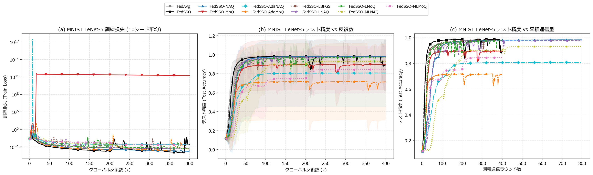
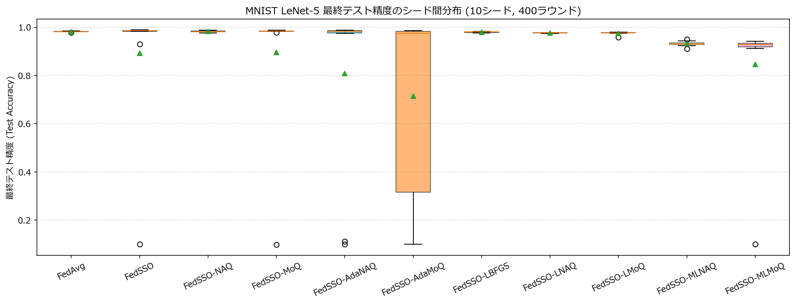

# 実験6 (ex006): MNIST LeNet-5（大規模非凸モデル, $d=44,426$, 400 ラウンド）比較実験

## 1. 実験の目的

本実験（[ex006.ipynb](../ex006/ex006.ipynb)）では、論文 *"FedSSO: A Federated Server-Side Second-Order Optimization Algorithm"* (Ma et al., 2022) の Appendix Figure 4(c)・Figure 5(c)・Figure 6(b) に準拠した大規模非凸畳み込みモデル **LeNet-5**（総パラメータ数 $d = 44,426$, 400 グローバルラウンド）上で、原論文 `FedSSO` / `FedSSO-LBFGS` / `FedAvg` および MoQ ファミリー 8 手法を **10 種類の乱数シード（`42`〜`51`）** で比較評価し、高次元非凸空間における収束安定性・サーバメモリ消費・計算速度のスケーリングを検証する。

---

## 2. 実験設定と実装詳細

- **データセット・分割**: MNIST 全 70,000 サンプル（$1 \times 28 \times 28$ 画像, 10 クラス）をクライアント数 $N = 20$ に $\mathrm{Dir}(\beta = 0.1)$ で Non-IID 分割し、各クライアント内で訓練 $75\%$（全体 52,492 枚）・テスト $25\%$（全体 17,508 枚）に分割した（[ex006/utils.py](../ex006/utils.py)）。
- **モデル（`LeNet5`）**: `Conv(1->6, 5x5, padding=2) + MaxPool(2) + Conv(6->16, 5x5) + MaxPool(2) + FC(400->120) + FC(120->84) + FC(84->10)`（ReLU 活性化, [ex006/model.py](../ex006/model.py), 総パラメータ数 $d = 44,426$、1 ラウンド基準通信量 $n_c = 44,426 \times 8 = 355,408\,\mathrm{B}$）。GPU 並列バッチ SGD（`groups=N` + バッチ線形層）の逐次 `nn.Module` ループに対する最大絶対誤差は **`8.645e-06`** である。
- **大規模逆ヘッセ行列の in-place 更新**: フル行列系（$H_k \in \mathbb{R}^{44,426 \times 44,426}$, 単体約 `7.35 GB`）では `H.addmm_(U, V)` による完全 in-place rank-2 BFGS 更新を実装し、8 GB 級 GPU（RTX 4080）上でもメモリ不足を起こさず 400 ラウンドを実行可能にした。
- **ハイパーパラメータ**:
  - 共通設定: $\tau = 5,\ \mathrm{BS} = 100,\ K = 400$、周期リセット $R = 200$、曲率クリッピング $(\lambda = 10^{-4},\ \Lambda = 9,999)$、`max_step_norm = 20.0`。
  - `FedAvg`: 論文 Table 1 の CNN 最適設定 $\alpha = 0.07$。
  - 2 次最適化 10 手法: $\alpha = 0.03,\ \eta = 0.3$（固定慣性 $\mu = 0.25$、適応上限 $\mu_{\max} = 0.30$、記憶制限履歴数 $m = 10$）。

---

## 3. 10 シード比較実験結果

### 3.1 400 ラウンド時点のテスト精度・訓練損失（Ave / Med / Best / Worst / Std）

| 手法 | $\mathrm{Acc}$ Ave | $\mathrm{Acc}$ Med | $\mathrm{Acc}$ Best | $\mathrm{Acc}$ Worst | $\mathrm{Acc}$ Std | $\mathrm{MaxAcc}$ Ave (Best) | $\mathrm{Loss}$ Ave | $\mathrm{Loss}$ Best | クリップ / リセット平均 |
| :--- | :---: | :---: | :---: | :---: | :---: | :---: | :---: | :---: | :---: |
| `FedAvg` ($\alpha=0.07$) | 0.9816 | 0.9815 | 0.9838 | **0.9781** | 0.0016 | 0.9824 (0.9841) | 0.0426 | 0.0358 | 0.0 / 0.0 |
| `FedSSO` | 0.8924 | **0.9867** | **0.9893** | 0.0996 | 0.2648 | **0.9876** (**0.9897**) | 0.2623 | **0.0020** | 2.2 / 4.0 |
| **`FedSSO-NAQ`** | **0.9827** | 0.9821 | 0.9879 | 0.9766 | 0.0033 | 0.9840 (0.9891) | **0.0197** | 0.0035 | 2.6 / 4.3 |
| `FedSSO-MoQ` | 0.8958 | 0.9839 | 0.9882 | 0.0988 | 0.2657 | 0.9067 (0.9893) | *1.66e11* | 0.0048 | 41.8 / 43.2 |
| `FedSSO-AdaNAQ` | 0.8081 | 0.9834 | 0.9876 | 0.1000 | 0.3514 | 0.8271 (0.9884) | 0.2692 | 0.0036 | 62.0 / 43.6 |
| `FedSSO-AdaMoQ` | 0.7145 | 0.9739 | 0.9860 | 0.1000 | 0.4023 | 0.7525 (0.9883) | 0.0430 | 0.0081 | 118.5 / 120.9 |
| **`FedSSO-LBFGS`** ($m=10$) | 0.9797 | 0.9806 | 0.9837 | 0.9759 | 0.0024 | 0.9807 (0.9840) | 0.0498 | 0.0349 | 62.0 / 2.6 |
| **`FedSSO-LNAQ`** ($m=10$) | 0.9769 | 0.9774 | 0.9785 | 0.9743 | **0.0015** | 0.9775 (0.9790) | 0.0612 | 0.0547 | 130.3 / 2.3 |
| `FedSSO-LMoQ` ($m=10$) | 0.9749 | 0.9758 | 0.9801 | 0.9583 | 0.0057 | 0.9778 (0.9808) | 0.0666 | 0.0485 | 107.5 / 2.9 |
| `FedSSO-MLNAQ` | 0.9316 | 0.9305 | 0.9492 | 0.9103 | 0.0101 | 0.9320 (0.9510) | 0.2271 | 0.1596 | 329.7 / 2.3 |
| `FedSSO-MLMoQ` | 0.8454 | 0.9281 | 0.9413 | 0.1000 | 0.2486 | 0.8543 (0.9413) | 0.2350 | 0.1911 | 302.4 / 41.5 |

> [!NOTE]
> `FedSSO-MoQ`（シード `45` で発散、`Loss = 1.66e12`）・`FedSSO-AdaNAQ`（シード `47` で `NaN`、シード `51` で `2.301`）・`FedSSO-AdaMoQ`（シード `45, 46, 49` で `NaN`）・`FedSSO-MLMoQ`（シード `46` で `NaN`）では、発散シードの `NaN` を除外した平均（`skipna=True`）が `Loss Ave` 欄に表示されている。無発散 10/10 シード群における最悪訓練損失は `FedSSO-NAQ` **`0.0375`**・`FedAvg` `0.0538`・`FedSSO-LBFGS` `0.0607`・`FedSSO-LNAQ` `0.0689` である。

### 3.2 通信コスト・目標精度到達速度・サーバ計算資源（10 シード平均）

| 手法 | 通信/反復 | $\mathrm{Acc}\ge 0.90$ 反復 / 通信 | $\mathrm{Acc}\ge 0.95$ 反復 / 通信 | $90\%$ 総通信量 (B) | $\mathrm{Acc}\ge 0.97$ 反復 (到達率) | サーバ時間 (ms/iter) | サーバメモリ (MB) |
| :--- | :---: | :---: | :---: | :---: | :---: | :---: | :---: |
| `FedAvg` ($\alpha=0.07$) | $1.000\,n_c$ | 35.9 / 35.9 | 80.6 / 80.6 | 12,759,147 | 157.9 (10/10) | 0.009 | 0.169 |
| `FedSSO` | $1.000\,n_c$ | **26.4** / **26.4** | **39.8** / **39.8** | **9,382,771** | **61.7** (10/10) | 55.847 | 7,529.629 |
| **`FedSSO-NAQ`** | $1.998\,n_c$ | 35.1 / 69.2 | 52.3 / 103.6 | 24,594,234 | 84.1 (**10/10**) | 55.468 | 7,529.968 |
| `FedSSO-MoQ` | $1.000\,n_c$ | 33.3 / 33.3 | 45.2 / 45.2 | 11,846,933 | 65.3 (9/10) | 56.780 | 7,530.138 |
| `FedSSO-AdaNAQ` | $1.998\,n_c$ | 42.8 / 84.5 | 58.8 / 116.5 | 30,031,976 | 90.8 (8/10) | 52.518 | 7,529.968 |
| `FedSSO-AdaMoQ` | $1.000\,n_c$ | 33.6 / 33.6 | 51.4 / 51.4 | 11,931,554 | 78.4 (7/10) | 46.852 | 7,530.138 |
| **`FedSSO-LBFGS`** ($m=10$) | $1.000\,n_c$ | 38.9 / 38.9 | 66.6 / 66.6 | 13,825,371 | 131.2 (**10/10**) | 1.574 | 4.067 |
| **`FedSSO-LNAQ`** ($m=10$) | $1.998\,n_c$ | 39.5 / 78.0 | 68.9 / 136.8 | 27,721,824 | 129.2 (**10/10**) | 1.751 | 4.406 |
| `FedSSO-LMoQ` ($m=10$) | $1.000\,n_c$ | 44.2 / 44.2 | 77.6 / 77.6 | 15,709,034 | 142.6 (**10/10**) | 1.494 | 4.576 |
| `FedSSO-MLNAQ` | $1.998\,n_c$ | 133.1 / 265.2 | 205.0 / 409.0 (1/10) | 94,254,202 | — (0/10) | 0.731 | **1.356** |
| `FedSSO-MLMoQ` | $1.000\,n_c$ | 145.0 / 145.0 | — (0/10) | 51,534,160 | — (0/10) | **0.665** | **1.525** |

---

## 4. 実験結果の考察

1. **大規模非凸 LeNet-5 400 ラウンドにおける `FedSSO-NAQ` の全シード無発散・最高平均精度**:
   原論文の **`FedSSO`** は 9/10 シードで高精度（`Med = 0.9867`, `Best = 0.9893`, `Acc>=0.97` 到達 **61.7 反復** = `FedAvg` の `157.9` 反復比 **2.56 倍高速**）を達成した一方、400 ラウンド長期非凸学習の終盤でシード `51`（`MaxAcc 0.9875` 到達後に `0.0996` へ急落）およびシード `50`（終盤 `0.9297` へ低下）の不安定化が生じ、`Acc Ave = 0.8924`・`Std = 0.2648` に留まった。これに対し、先読み点での勾配再評価を組み合わせた **`FedSSO-NAQ`**（$\mu = 0.25$）は全 10 シードで一度も発散せず、**全手法中最高の平均テスト精度 `0.9827`**（`Best 0.9879`, `Worst 0.9766`, `Loss Ave = 0.0197`）を達成し、`FedAvg`（`0.9816`）および原論文 `FedSSO`（`0.8924`）を上回った。
2. **フル行列 `7.53 GB` の限界と記憶制限系（`LBFGS` / `LNAQ` / `LMoQ`）の圧倒的スケーリング優位性**:
   $d = 44,426$ の LeNet-5 では、フル行列 BFGS 系のサーバメモリは **`7,530 MB`（約 `7.35 GB`）**・更新計算時間も **`55.5〜56.8 ms/iter`** へ膨張する上、`FedSSO-MoQ`・`AdaNAQ`・`AdaMoQ` ではフル行列空間の過大な慣性蓄積により 1〜3 シードで発散が生じた。対照的に、記憶制限 $m = 10$ を採用する **`FedSSO-LBFGS`**（`0.9797`, `Worst 0.9759`）・**`FedSSO-LNAQ`**（`0.9769`, **全手法最小の `Std = 0.0015`**, `Worst 0.9743`）・**`FedSSO-LMoQ`**（`0.9749`, `Worst 0.9583`）は **全 3 手法とも 10/10 シード無発散で `Acc>=0.97` 到達速度でも `FedAvg` を上回りつつ（129.2〜142.6 反復 vs 157.9 反復）、サーバメモリを `4.07〜4.58 MB`（99.94% 削減）・サーバ計算時間を `1.49〜1.75 ms/iter`（約 32〜37 倍高速化）** へと圧縮しており、中〜大規模ニューラルネットワークに対する最も実用的な解であることが実証された。
3. **メモリレス系（$O(d)$, `1.36〜1.53 MB`）の限界と改善課題**:
   `FedSSO-MLNAQ` は $1.356\,\mathrm{MB}$ の超省メモリ・$0.731\,\mathrm{ms/iter}$ で 10/10 シード無発散（`0.9316`）を維持したものの、400 ラウンド中に平均 329.7 回の曲率クリッピングが発生し精度が `FedAvg` に約 5 ポイント及ばなかった。非凸大規模ネットワークでは 1 ステップ履歴では高次元の曲率情報を十分に近似できず、$m = 8 \sim 16$ 程度の記憶制限 L-BFGS / LNAQ / LMoQ を選択することが精度と省メモリの最良のバランスを与える。
