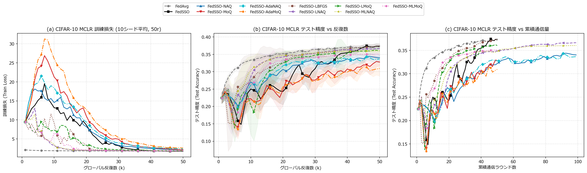
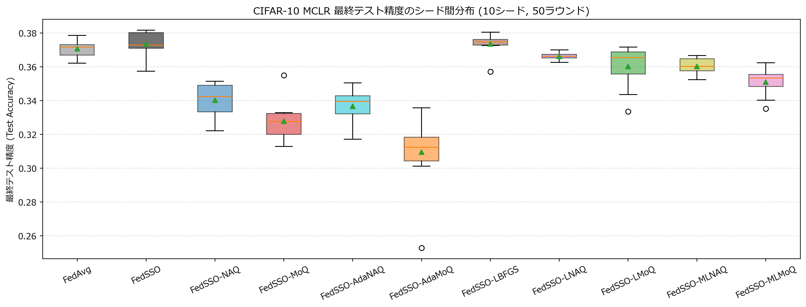

# 実験7 (ex007): CIFAR-10 MCLR（カラー画像, $d=30,730, N=10$, 50 ラウンド）比較実験

## 1. 実験の目的

本実験（[ex007.ipynb](../ex007/ex007.ipynb)）では、論文 *"FedSSO: A Federated Server-Side Second-Order Optimization Algorithm"* (Ma et al., 2022) の Appendix Figure 6(a)（`CIFAR10: MCLR`, 50 グローバルラウンド, クライアント数 $N = 10$）の設定に基づき、カラー画像（$3 \times 32 \times 32 = 3,072$ 次元 $\to 10$ クラス, 総パラメータ数 $d = 30,730$）に対する全 11 手法を **10 種類の乱数シード（`42`〜`51`）** で比較評価する。

---

## 2. 実験設定と実装詳細

- **データセット・Non-IID 分割**: CIFAR-10 全 60,000 枚（訓練 50,000 + テスト 10,000）に対し、RGB チャネル平均 `(0.4914, 0.4822, 0.4465)`・標準偏差 `(0.2470, 0.2435, 0.2616)` で標準化後、論文 p.10 に準拠して **$N = 10$ クライアント** へ $\mathrm{Dir}(\beta = 0.1)$ で Non-IID 分割し、各クライアント内で $75\% / 25\%$ に訓練・テスト分割した（[ex007/utils.py](../ex007/utils.py)）。
- **モデル（`MCLR`）**: $L\_2$ 正則化付き（$\mu\_{\mathrm{reg}} = 10^{-4}$）多項ロジスティック回帰（[ex007/model.py](../ex007/model.py), $d = 30,730$、1 通信ラウンド基準通信量 $n\_c = 30,730 \times 8 = 245,840\,\mathrm{B}$）。GPU バッチ並列 SGD（`torch.bmm`）の逐次ループに対する最大絶対誤差は **`3.725e-09`** である。
- **ハイパーパラメータ**:
  - 共通設定: $\tau = 5,\ \mathrm{BS} = 100,\ K = 50$、曲率クリッピング $(\lambda = 10^{-4},\ \Lambda = 9,999)$。
  - `FedAvg`: グリッドサーチ最適 $\alpha = 0.01$。
  - `FedSSO` および MoQ ファミリー 9 手法: $\alpha = 0.001,\ \eta = 0.3$（固定慣性 $\mu = 0.30$、適応上限 $\mu\_{\max} = 0.40$、$m = 10$）。
  - フル行列 BFGS（$H\_k \in \mathbb{R}^{30,730 \times 30,730}$, 約 `3.60 GB`）は `H.addmm_(U, V)` による完全 in-place rank-2 更新で実行した。

---

## 3. 10 シード比較実験結果

### 3.1 50 ラウンド時点のテスト精度・訓練損失（Ave / Med / Best / Worst / Std）

| 手法 | $\mathrm{Acc}$ Ave | $\mathrm{Acc}$ Med | $\mathrm{Acc}$ Best | $\mathrm{Acc}$ Worst | $\mathrm{Acc}$ Std | $\mathrm{MaxAcc}$ Ave (Best) | $\mathrm{Loss}$ Ave | $\mathrm{Loss}$ Best | $\mathrm{Loss}$ Worst | クリップ / リセット平均 |
| :--- | :---: | :---: | :---: | :---: | :---: | :---: | :---: | :---: | :---: | :---: |
| `FedAvg` ($\alpha=0.01$) | 0.3708 | 0.3715 | 0.3786 | 0.3620 | 0.0053 | 0.3774 (0.3811) | 1.7975 | 1.7899 | **1.8105** | 0.0 / 0.0 |
| **`FedSSO`** | **0.3736** | 0.3729 | **0.3816** | 0.3574 | 0.0070 | **0.3817** (**0.3882**) | **1.7696** | **1.7267** | 1.8576 | 0.0 / 0.0 |
| `FedSSO-NAQ` | 0.3402 | 0.3423 | 0.3513 | 0.3222 | 0.0095 | 0.3541 (0.3599) | 2.1201 | 1.9816 | 2.3738 | 0.0 / 0.1 |
| `FedSSO-MoQ` | 0.3278 | 0.3275 | 0.3550 | 0.3128 | 0.0113 | 0.3435 (0.3605) | 2.1563 | 2.0320 | 2.2480 | 0.0 / 0.0 |
| `FedSSO-AdaNAQ` | 0.3366 | 0.3396 | 0.3505 | 0.3170 | 0.0104 | 0.3499 (0.3538) | 2.3738 | 2.2376 | 2.6542 | 0.0 / 0.1 |
| `FedSSO-AdaMoQ` | 0.3095 | 0.3124 | 0.3358 | 0.2529 | 0.0218 | 0.3340 (0.3466) | 2.6022 | 2.3120 | 3.2636 | 0.0 / 0.0 |
| **`FedSSO-LBFGS`** ($m=10$) | **0.3736** | **0.3747** | 0.3805 | 0.3570 | 0.0060 | 0.3739 (0.3805) | 1.8236 | 1.8052 | 1.9072 | 1.2 / 0.5 |
| **`FedSSO-LNAQ`** ($m=10$) | 0.3663 | 0.3661 | 0.3699 | **0.3627** | **0.0021** | 0.3670 (0.3706) | 1.8442 | 1.8253 | 1.9350 | 5.0 / 0.1 |
| `FedSSO-LMoQ` ($m=10$) | 0.3603 | 0.3655 | 0.3716 | 0.3336 | 0.0120 | 0.3638 (0.3728) | 1.8856 | 1.8163 | 2.2889 | 4.0 / 0.1 |
| `FedSSO-MLNAQ` | 0.3603 | 0.3602 | 0.3666 | 0.3522 | 0.0048 | 0.3608 (0.3676) | 1.8756 | 1.8262 | 2.0597 | 20.4 / 0.1 |
| `FedSSO-MLMoQ` | 0.3510 | 0.3532 | 0.3624 | 0.3353 | 0.0076 | 0.3511 (0.3626) | 1.8929 | 1.8565 | 1.9723 | 22.3 / 0.0 |

### 3.2 通信コスト・目標精度到達速度・サーバ計算資源（10 シード平均）

| 手法 | 通信/反復 | $\mathrm{Acc}\ge 0.25$ 反復 / 通信 | $\mathrm{Acc}\ge 0.30$ 反復 / 通信 | $30\%$ 総通信量 (B) | $\mathrm{Acc}\ge 0.33$ 反復 (到達率) | サーバ時間 (ms/iter) | サーバメモリ (MB) |
| :--- | :---: | :---: | :---: | :---: | :---: | :---: | :---: |
| `FedAvg` ($\alpha=0.01$) | $1.00\,n_c$ | **2.1** / **2.1** | **4.7** / **4.7** | **1,155,448** | **9.0** (10/10) | 0.011 | 0.117 |
| `FedSSO` | $1.00\,n_c$ | 6.4 / 6.4 | 20.9 / 20.9 | 5,138,056 | 27.7 (10/10) | 25.932 | 3,602.813 |
| `FedSSO-NAQ` | $1.98\,n_c$ | 4.4 / 7.8 | 16.8 / 32.6 | 8,014,384 | 23.4 (10/10) | 26.004 | 3,603.047 |
| `FedSSO-MoQ` | $1.00\,n_c$ | 8.9 / 8.9 | 23.5 / 23.5 | 5,777,240 | 40.6 (10/10) | 26.183 | 3,603.165 |
| `FedSSO-AdaNAQ` | $1.98\,n_c$ | 4.4 / 7.8 | 15.4 / 29.8 | 7,326,032 | 20.9 (10/10) | 26.160 | 3,603.047 |
| `FedSSO-AdaMoQ` | $1.00\,n_c$ | 9.6 / 9.6 | 25.6 / 25.6 | 6,293,504 | 40.4 (7/10) | 26.122 | 3,603.165 |
| **`FedSSO-LBFGS`** ($m=10$) | $1.00\,n_c$ | 4.9 / 4.9 | 10.7 / 10.7 | 2,630,488 | 15.7 (10/10) | 1.143 | 2.813 |
| `FedSSO-LNAQ` ($m=10$) | $1.98\,n_c$ | 5.6 / 10.2 | 11.3 / 21.6 | 5,310,144 | 14.7 (10/10) | 1.177 | 3.048 |
| `FedSSO-LMoQ` ($m=10$) | $1.00\,n_c$ | 6.4 / 6.4 | 14.8 / 14.8 | 3,638,432 | 19.3 (10/10) | 1.155 | 3.165 |
| `FedSSO-MLNAQ` | $1.98\,n_c$ | 4.6 / 8.2 | 9.3 / 17.6 | 4,326,784 | 12.8 (10/10) | 0.587 | **0.938** |
| `FedSSO-MLMoQ` | $1.00\,n_c$ | 5.8 / 5.8 | 12.4 / 12.4 | 3,048,416 | 19.9 (10/10) | **0.571** | **1.055** |

---

## 4. 実験結果の考察

1. **高次元・短期 50 ラウンドにおける `FedSSO` / `FedSSO-LBFGS` の優位性**:
   入力次元が $3,072$（パラメータ数 $d = 30,730$）に達する CIFAR-10 MCLR では、50 ラウンド時点で **`FedSSO`**（Acc Ave **`0.3736`**, Best **`0.3816`**, Loss Ave **`1.7696`**）および **`FedSSO-LBFGS`**（Acc Ave **`0.3736`**, Med **`0.3747`**）が `FedAvg`（`0.3708`, Loss `1.7975`）を上回る到達精度・低損失を達成した。特に `FedSSO-LBFGS` はフル行列 BFGS の **約 `3.60 GB` のサーバメモリを `2.81 MB`（99.92% 削減）**・**計算時間を `25.93 ms` $\to$ `1.14 ms`（22.7 倍高速）** へ劇的に圧縮しながら同等以上の精度を維持しており、大規模モデルにおける L-BFGS の必須性を示している。
2. **高次元短期学習におけるフル行列 MoQ/NAQ 系と記憶制限系（LNAQ・MLNAQ）の顕著な差**:
   $d = 30,730$ に対して反復数が $K = 50$ と少ない環境では、フル行列 $H\_k$ は最大 49 回しか rank-2 更新を受けないため、残り 30,630 以上の固有値空間は初期単位行列 $I$ のままとなる。そこへ慣性 $\mu \in [0.3, 0.4]$ を加えたフル行列 `NAQ`/`MoQ`/`AdaNAQ`/`AdaMoQ` は未補正の高次元方向へ過大な慣性ドリフトを蓄積し、後半ラウンドで損失が上昇した（`Acc_Ave = 0.3095〜0.3402`, `Loss_Ave = 2.12〜2.60`）。これに対し、毎反復で初期逆ヘッセ近似 $\gamma\_k I$（$\gamma\_k = \mathrm{cur}/\|\hat{y}\|^2$）によって全次元の曲率スケールを自動正規化する **`FedSSO-LNAQ`**（`0.3663`, **全手法最小の `Std = 0.0021`**, **最高の Worst `0.3627`**）・`FedSSO-LMoQ`（`0.3603`）・`FedSSO-MLNAQ`（`0.3603`, メモリ `0.94 MB`, `0.59 ms/iter`）はそのようなドリフトを起こさず安定かつ高水準に収束した。
3. **初期立ち上がりの比較**:
   CIFAR-10 のようなノイズの大きい自然画像上の線形分類では、`FedSSO` / `FedAvg` よりも **`FedSSO-LBFGS`**（$30\%$ 到達 `10.7` 反復, `FedSSO` 比約 2 倍速）や **`FedSSO-MLNAQ`**（`9.3` 反復）のほうが初期スケーリング効果により立ち上がりが速いことが確認された。
