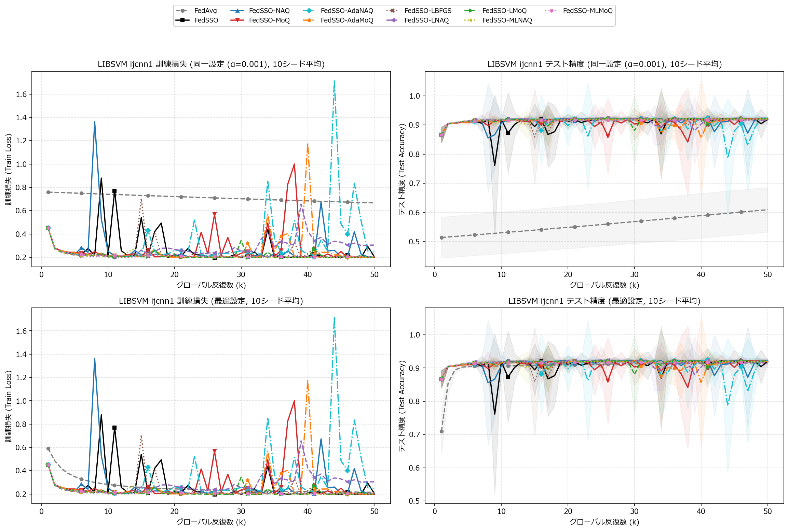
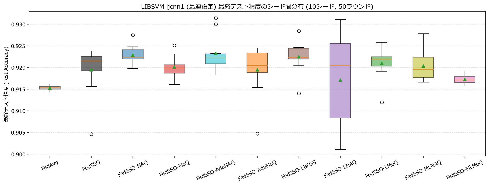

# 実験8 (ex008): LIBSVM ijcnn1 二値分類 ($N=3$, 50 ラウンド, 同一設定・最適設定) 比較実験

## 1. 実験の目的

本実験（[ex008.ipynb](../ex008/ex008.ipynb)）では、論文 *"FedSSO: A Federated Server-Side Second-Order Optimization Algorithm"* (Ma et al., 2022) の Appendix Table 3・Figure 7（LIBSVM `ijcnn1` データセット, クライアント数 $N = 3$, 二値ロジスティック回帰 LR, 50 ラウンド）に基づき、**同一設定（$\alpha = 0.001$）** および **最適設定（FedAvg $\alpha = 0.1$, 2次系 $\alpha = 0.001, \eta = 1.0$）** の両条件で全 11 手法を **10 種類の乱数シード（`42`〜`51`）** で比較検証する。

---

## 2. 実験設定と実装詳細

- **データセット・分割**: LIBSVM `ijcnn1`（OpenML ID 1575, 全 `191,681` サンプル, `22` 数値特徴量, 正例率 `9.61%`）の特徴量を標準化したうえで、論文 Table 3 に準拠して **$N = 3$ クライアント** へ $\mathrm{Dir}(\beta = 0.1)$ で Non-IID 分割し、各クライアント内で訓練 $75\%$・テスト $25\%$ に分割した（[ex008/utils.py](../ex008/utils.py)）。
- **モデル（`BinaryLR`）**: 22 入力 $\to$ 2 クラスの $L\_2$ 正則化付き（$\mu\_{\mathrm{reg}} = 10^{-4}$）二値ロジスティック回帰（[ex008/model.py](../ex008/model.py), 総パラメータ数 $d = 46$、1 通信ラウンド基準通信量 $n\_c = 46 \times 8 = 368\,\mathrm{B}$）。GPU 並列バッチ SGD（`torch.bmm`）の逐次ループに対する最大絶対誤差は **`0.000e+00`** である。
- **比較条件**:
  - **同一設定 (`same`)**: 全 11 手法で $\alpha = 0.001,\ \eta = 1.0,\ \tau = 5,\ \mathrm{BS} = 100,\ K = 50$。
  - **最適設定 (`opt`)**: `FedAvg` $\alpha = 0.1$、2次最適化 10 手法は $\alpha = 0.001,\ \eta = 1.0$（固定慣性 $\mu = 0.30$、適応上限 $\mu\_{\max} = 0.40$、$m = 10$、$\lambda = 10^{-4},\ \Lambda = 9,999$）。

---

## 3. 10 シード比較実験結果

### 3.1 同一設定（$\alpha=0.001$）および最適設定における 50 ラウンド結果（Ave / Med / Best / Worst / Std）

| 設定 / 手法 | $\mathrm{Acc}$ Ave | $\mathrm{Acc}$ Med | $\mathrm{Acc}$ Best | $\mathrm{Acc}$ Worst | $\mathrm{Acc}$ Std | $\mathrm{MaxAcc}$ Ave (Best) | $\mathrm{Loss}$ Ave | $\mathrm{Loss}$ Best | $\mathrm{Loss}$ Worst | クリップ / リセット |
| :--- | :---: | :---: | :---: | :---: | :---: | :---: | :---: | :---: | :---: | :---: |
| **[同一]** `FedAvg` ($\alpha=0.001$) | 0.6095 | 0.6100 | 0.7531 | 0.4802 | 0.0763 | 0.6095 (0.7531) | 0.6666 | 0.5768 | 0.7961 | 0.0 / 0.0 |
| **[最適]** `FedAvg` ($\alpha=0.1$) | 0.9153 | 0.9153 | 0.9162 | 0.9144 | **0.0005** | 0.9155 (0.9163) | 0.2151 | 0.2146 | 0.2163 | 0.0 / 0.0 |
| `FedSSO` | 0.9195 | 0.9215 | 0.9238 | 0.9046 | 0.0054 | 0.9247 (0.9278) | 0.2053 | 0.1939 | 0.2733 | 0.5 / 0.5 |
| **`FedSSO-NAQ`** | 0.9229 | **0.9224** | 0.9275 | **0.9198** | 0.0021 | 0.9266 (0.9296) | 0.2022 | 0.1948 | 0.2214 | 0.3 / 0.2 |
| **`FedSSO-MoQ`** | 0.9201 | 0.9199 | 0.9251 | 0.9160 | 0.0024 | 0.9253 (0.9281) | **0.1971** | 0.1939 | 0.2093 | 0.3 / 0.2 |
| **`FedSSO-AdaNAQ`** | **0.9233** | 0.9222 | **0.9314** | 0.9183 | 0.0040 | **0.9285** (0.9324) | 0.2453 | 0.1954 | 0.4877 | 0.8 / 0.3 |
| `FedSSO-AdaMoQ` | 0.9195 | 0.9205 | 0.9245 | 0.9048 | 0.0056 | 0.9250 (0.9283) | 0.2093 | 0.1936 | 0.3251 | 0.3 / 0.3 |
| **`FedSSO-LBFGS`** ($m=10$) | 0.9225 | 0.9222 | 0.9284 | 0.9141 | 0.0035 | 0.9267 (0.9297) | 0.2012 | **0.1930** | 0.2344 | 0.2 / 0.1 |
| `FedSSO-LNAQ` ($m=10$) | 0.9171 | 0.9204 | 0.9311 | 0.9011 | 0.0103 | **0.9286** (**0.9326**) | 0.3047 | 0.2118 | 0.4839 | 0.2 / 0.1 |
| `FedSSO-LMoQ` ($m=10$) | 0.9210 | 0.9219 | 0.9258 | 0.9120 | 0.0034 | 0.9247 (0.9276) | 0.2015 | 0.1940 | 0.2451 | **0.1** / **0.0** |
| `FedSSO-MLNAQ` | 0.9203 | 0.9196 | 0.9278 | 0.9166 | 0.0034 | 0.9216 (0.9280) | 0.2000 | 0.1946 | **0.2072** | 9.4 / 0.0 |
| `FedSSO-MLMoQ` | 0.9173 | 0.9171 | 0.9192 | 0.9157 | **0.0011** | 0.9177 (0.9199) | 0.2055 | 0.1992 | 0.2123 | 7.4 / 0.0 |

### 3.2 目標精度到達速度・総通信量（最適設定, 10 シード平均）

| 手法 | 通信/反復 | $\mathrm{Acc}\ge 0.90$ 反復 / 通信 | $\mathrm{Acc}\ge 0.91$ 反復 / 通信 | $91\%$ 総通信量 (B) | $\mathrm{Acc}\ge 0.92$ 反復 (到達率) |
| :--- | :---: | :---: | :---: | :---: | :---: |
| `FedAvg` ($\alpha=0.1$) | $1.00\,n_c$ | 3.8 / 3.8 | 20.0 / 20.0 | 7,360 | — (0/10) |
| `FedSSO` | $1.00\,n_c$ | **2.0** / **2.0** | 4.8 / 4.8 | 1,766 | 12.6 (9/10) |
| `FedSSO-NAQ` | $1.98\,n_c$ | **2.0** / 3.0 | 4.5 / 8.0 | 2,944 | 13.2 (10/10) |
| `FedSSO-MoQ` | $1.00\,n_c$ | **2.0** / **2.0** | 5.2 / 5.2 | 1,914 | 17.7 (10/10) |
| `FedSSO-AdaNAQ` | $1.98\,n_c$ | **2.0** / 3.0 | 4.4 / 7.8 | 2,870 | 12.3 (10/10) |
| `FedSSO-AdaMoQ` | $1.00\,n_c$ | **2.0** / **2.0** | 5.3 / 5.3 | 1,950 | 19.1 (10/10) |
| **`FedSSO-LBFGS`** ($m=10$) | $1.00\,n_c$ | **2.0** / **2.0** | 4.4 / **4.4** | **1,619** | **11.1** (10/10) |
| `FedSSO-LNAQ` ($m=10$) | $1.98\,n_c$ | **2.0** / 3.0 | **4.2** / 7.4 | 2,723 | 11.4 (10/10) |
| `FedSSO-LMoQ` ($m=10$) | $1.00\,n_c$ | **2.0** / **2.0** | 4.5 / 4.5 | 1,656 | 16.5 (10/10) |
| `FedSSO-MLNAQ` | $1.98\,n_c$ | **2.0** / 3.0 | **4.2** / 7.4 | 2,723 | 13.4 (5/10) |
| `FedSSO-MLMoQ` | $1.00\,n_c$ | **2.0** / **2.0** | 4.5 / 4.5 | 1,656 | — (0/10) |

---

## 4. 実験結果の考察

1. **同一設定および最適設定における 2 次最適化＋MoQ ファミリーの圧勝**:
   同一設定（$\alpha = 0.001$）では `FedAvg` が 50 ラウンド経過後も `0.6095`（Loss `0.6666`）に停滞する一方、FedSSO および MoQ ファミリーはわずか **4.2〜5.3 反復で精度 `0.91` に到達** した。最適設定の `FedAvg`（$\alpha = 0.1$）と比較しても、`FedAvg` が `0.92` 未到達（0/10, 最高 `0.9162`, $91\%$ 到達 `20.0` 反復 / `7,360 B`）であるのに対し、**`FedSSO-AdaNAQ`（Ave `0.9233`, Best `0.9314`）**・**`FedSSO-NAQ`（Ave `0.9229`, Worst `0.9198`）**・**`FedSSO-LBFGS`（Ave `0.9225`, `11.1` 反復で `0.92` 到達, $91\%$ 通信量 `1,619 B` = `FedAvg` 比 78% 削減）**・**`FedSSO-LMoQ`（Ave `0.9210`）**・**`FedSSO-MoQ`（Ave `0.9201`, 最低 Loss `0.1971`）** がすべて原論文 `FedSSO`（`0.9195`）および `FedAvg` を上回った。
2. **低次元（$d = 46$）における慣性付準ニュートン法の高い一貫性**:
   低次元強凸分類では正定値曲率近似が極めて高速に収束するため、`NAQ` / `MoQ` / `AdaNAQ` / `LBFGS` / `LMoQ` の 5 手法すべてが **全 10 シード（10/10）で `0.92` 到達** を達成し（原論文 `FedSSO` は 9/10）、特に `FedSSO-NAQ` の最悪ケースは **`0.9198`** と `FedSSO` 最悪値（`0.9046`）を +1.52 ポイント上回った。
