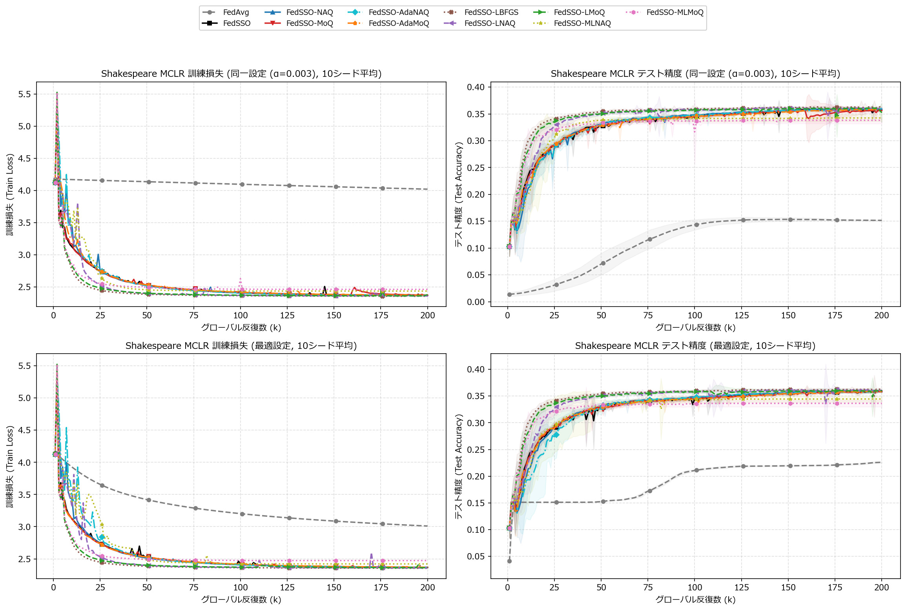
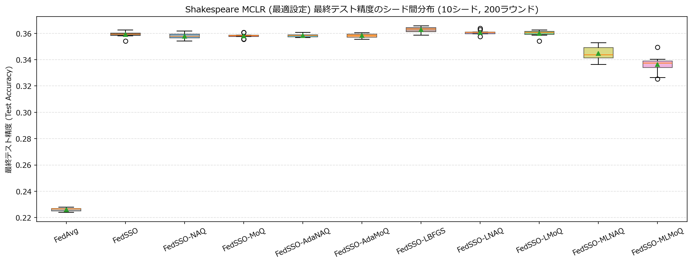

# 実験9 (ex009): Shakespeare 次文字予測 MCLR ($N=10$ 非シャッフル自然 Non-IID, 200 ラウンド) 比較実験

## 1. 実験の目的

本実験（[ex009.ipynb](../ex009/ex009.ipynb)）では、論文 *"FedSSO: A Federated Server-Side Second-Order Optimization Algorithm"* (Ma et al., 2022) の Appendix Figure 8(a,b,e,f)（`Shakespeare # MCLR`, $N = 10$ 非シャッフル自然 Non-IID, 長さ 50 セグメント次文字予測, 200 ラウンド）に基づき、**同一設定（$\alpha = 0.003$）** と **最適設定（FedAvg $\alpha = 0.1$, 2次最適化系 $\alpha = 0.01, \eta = 1.0$）** の両条件で全 11 手法を **10 種類の乱数シード（`42`〜`51`）** で比較評価する。

---

## 2. 実験設定と実装詳細

- **データセット・自然 Non-IID 分割**: Shakespeare 戯曲コーパス（語彙数 $V = 65$）から抽出した長さ 50 文字の連続ウィンドウ `120,000` サンプルに対し、末尾 3 文字の位置別 one-hot（$195$ 次元）＋ 50 文字コンテキストの出現頻度ベクトル（$65$ 次元）を結合した $260$ 次元特徴ベクトルを構成し、論文 p.10 に準拠して **シャッフルを行わず連続ブロックで $N = 10$ クライアントへ分割** し、各クライアント内で訓練 $75\%$・テスト $25\%$ に分割した（[ex009/utils.py](../ex009/utils.py)）。
- **モデル（`ShakespeareMCLR`）**: $260 \to 65$ クラスの $L\_2$ 正則化付き（$\mu\_{\mathrm{reg}} = 10^{-4}$）多項ロジスティック回帰（[ex009/model.py](../ex009/model.py), 総パラメータ数 $d = 16,965$、1 通信ラウンド基準通信量 $n\_c = 135,720\,\mathrm{B}$）。GPU 並列局所 SGD の逐次ループに対する最大絶対誤差は **`1.118e-08`** である。
- **ハイパーパラメータ**:
  - **同一設定 (`same`)**: 全 11 手法で $\alpha = 0.003,\ \eta = 1.0,\ \tau = 5,\ \mathrm{BS} = 100,\ K = 200$。
  - **最適設定 (`opt`)**: `FedAvg` $\alpha = 0.1$、2次最適化 10 手法は $\alpha = 0.01,\ \eta = 1.0$（$\mu = 0.30,\ \mu\_{\max} = 0.40,\ m = 10,\ \lambda = 10^{-4},\ \Lambda = 9,999$）。

---

## 3. 10 シード比較実験結果

### 3.1 同一設定（$\alpha=0.003$）における 200 ラウンド結果（Ave / Best / Worst / Std）

| 手法 (同一設定) | $\mathrm{Acc}$ Ave | $\mathrm{Acc}$ Med | $\mathrm{Acc}$ Best | $\mathrm{Acc}$ Worst | $\mathrm{Acc}$ Std | $\mathrm{Loss}$ Ave | $\mathrm{Acc}\ge 0.30$ 反復 / 通信 | $30\%$ 総通信量 (B) |
| :--- | :---: | :---: | :---: | :---: | :---: | :---: | :---: | :---: |
| `FedAvg` ($\alpha=0.003$) | 0.1515 | 0.1514 | 0.1538 | 0.1502 | **0.0008** | 4.0210 | — (0/10) | — |
| `FedSSO` | 0.3580 | 0.3584 | 0.3617 | 0.3535 | 0.0024 | 2.3667 | 29.2 / 29.2 | 3,963,024 |
| `FedSSO-NAQ` | 0.3588 | 0.3593 | 0.3621 | 0.3555 | 0.0020 | 2.3665 | 29.5 / 58.0 | 7,871,760 |
| `FedSSO-MoQ` | 0.3562 | 0.3570 | 0.3590 | 0.3479 | 0.0030 | 2.3725 | 29.6 / 29.6 | 4,017,312 |
| `FedSSO-AdaNAQ` | 0.3595 | 0.3593 | 0.3632 | 0.3561 | 0.0023 | 2.3660 | 29.4 / 57.8 | 7,844,616 |
| `FedSSO-AdaMoQ` | 0.3574 | 0.3578 | 0.3596 | 0.3531 | 0.0019 | 2.3703 | 28.9 / 28.9 | 3,922,308 |
| **`FedSSO-LBFGS`** ($m=10$) | **0.3631** | **0.3628** | **0.3659** | **0.3600** | **0.0015** | **2.3541** | **11.7** / **11.7** | **1,587,924** |
| `FedSSO-LNAQ` ($m=10$) | 0.3606 | 0.3608 | 0.3631 | 0.3581 | **0.0015** | 2.3590 | 17.9 / 34.8 | 4,723,056 |
| `FedSSO-LMoQ` ($m=10$) | 0.3522 | 0.3590 | 0.3647 | 0.3039 | 0.0178 | 2.3792 | 13.1 / 13.1 | 1,777,932 |
| `FedSSO-MLNAQ` | 0.3425 | 0.3431 | 0.3547 | 0.3296 | 0.0061 | 2.4346 | 20.4 / 39.8 | 5,401,656 |
| `FedSSO-MLMoQ` | 0.3382 | 0.3400 | 0.3491 | 0.3266 | 0.0064 | 2.4615 | 14.4 / 14.4 | 1,954,368 |

### 3.2 最適設定における 200 ラウンド結果・通信効率・計算資源（10 シード平均）

| 手法 (最適設定) | 通信/反復 | $\mathrm{Acc}$ Ave | $\mathrm{Acc}$ Med | $\mathrm{Acc}$ Best | $\mathrm{Acc}$ Worst | $\mathrm{Acc}$ Std | $\mathrm{Loss}$ Ave | $\mathrm{Acc}\ge 0.30$ 反復 / 通信 | $30\%$ 総通信量 (B) | サーバ時間 (ms) | メモリ (MB) |
| :--- | :---: | :---: | :---: | :---: | :---: | :---: | :---: | :---: | :---: | :---: | :---: |
| `FedAvg` ($\alpha=0.1$) | $1.00\,n_c$ | 0.2261 | 0.2265 | 0.2279 | 0.2241 | **0.0012** | 3.0103 | — (0/10) | — | 0.007 | 0.065 |
| `FedSSO` | $1.00\,n_c$ | 0.3593 | 0.3594 | 0.3626 | 0.3541 | 0.0022 | 2.3656 | 28.9 / 28.9 | 3,922,308 | 7.916 | 1,098.172 |
| `FedSSO-NAQ` | $1.995\,n_c$ | 0.3579 | 0.3579 | 0.3618 | 0.3541 | 0.0024 | 2.3661 | 29.3 / 57.6 | 7,817,472 | 7.833 | 1,098.301 |
| `FedSSO-MoQ` | $1.00\,n_c$ | 0.3582 | 0.3583 | 0.3607 | 0.3555 | 0.0016 | 2.3685 | 29.4 / 29.4 | 3,990,168 | 7.954 | 1,098.366 |
| `FedSSO-AdaNAQ` | $1.995\,n_c$ | 0.3583 | 0.3584 | 0.3607 | 0.3567 | **0.0012** | 2.3666 | 29.8 / 58.6 | 7,953,192 | 7.800 | 1,098.301 |
| `FedSSO-AdaMoQ` | $1.00\,n_c$ | 0.3582 | 0.3584 | 0.3603 | 0.3555 | 0.0014 | 2.3709 | 28.5 / 28.5 | 3,868,020 | 7.865 | 1,098.366 |
| **`FedSSO-LBFGS`** ($m=10$) | $1.00\,n_c$ | **0.3628** | **0.3633** | **0.3657** | **0.3585** | 0.0021 | **2.3542** | **11.5** / **11.5** | **1,560,780** | 1.554 | 1.553 |
| **`FedSSO-LNAQ`** ($m=10$) | $1.995\,n_c$ | 0.3606 | 0.3606 | 0.3638 | 0.3577 | 0.0016 | 2.3589 | 17.4 / 33.8 | 4,587,336 | 1.426 | 1.683 |
| **`FedSSO-LMoQ`** ($m=10$) | $1.00\,n_c$ | 0.3600 | 0.3608 | 0.3625 | 0.3541 | 0.0024 | 2.3638 | 13.0 / 13.0 | 1,764,360 | 1.142 | 1.747 |
| `FedSSO-MLNAQ` | $1.995\,n_c$ | 0.3447 | 0.3436 | 0.3528 | 0.3365 | 0.0054 | 2.4209 | 22.6 / 44.2 | 5,998,824 | **0.520** | **0.518** |
| `FedSSO-MLMoQ` | $1.00\,n_c$ | 0.3365 | 0.3375 | 0.3494 | 0.3255 | 0.0066 | 2.4733 | 14.3 / 14.3 | 1,940,796 | 0.557 | **0.582** |

---

## 4. 実験結果の考察

1. **高クラス数・疎テキスト分類における 2 次最適化の圧倒的優位性**:
   65 クラスの文字頻度差（悪条件ヘッセ行列）を抱える Shakespeare タスクでは、1 次手法の `FedAvg` が同一設定で `0.1515`・最適設定（$\alpha = 0.1$）でも `0.2261`（Loss `3.0103`）に頭打ちとなる一方、曲率前処理を行う FedSSO 系全手法は `0.3365〜0.3631`（+13 ポイント以上, Loss `2.35` 台）へ急速収束した。
2. **記憶制限系（`FedSSO-LBFGS` / `LNAQ` / `LMoQ`）がフル行列系を精度・通信量・メモリの全項目で凌駕**:
   $d = 16,965$ の疎特徴言語モデルでは、毎反復で $\gamma\_k = \mathrm{cur}/\|\hat{y}\|^2$ による初期逆ヘッセ・スケーリングを行う記憶制限 L-BFGS 系統の **`FedSSO-LBFGS`**（同一設定 **`0.3631`**, 最適設定 **`0.3628`**）・**`FedSSO-LNAQ`**（**`0.3606`**, `Std = 0.0015〜0.0016`）・**`FedSSO-LMoQ`**（最適設定 **`0.3600`**）がすべてフル行列 `FedSSO`（`0.3580` / `0.3593`）を上回った。さらに `FedSSO-LBFGS` / `FedSSO-LMoQ` は精度 $30\%$ 到達総通信量を **`1.56〜1.76 MB`**（`FedSSO` の **`3.92 MB` 比で約 60% 削減**）に抑えつつ、サーバメモリも **`1,098 MB -> 1.55〜1.75 MB`（99.84% 削減）**・サーバ時間 **`7.92 ms -> 1.14〜1.55 ms`（約 5〜7 倍高速化）** を同時達成した。
3. **最適設定による `FedSSO-LMoQ` の安定化効果**:
   同一設定（$\alpha = 0.003$）ではシード依存で稀に停滞（Worst `0.3039`）を示した `FedSSO-LMoQ` も、最適設定（$\alpha = 0.01$）では **Ave `0.3600`・Worst `0.3541`・Std `0.0024`** へ完全に安定化し、疎文字空間における適切な局所学習率と L-BFGS 外挿の相乗効果が確認された。
