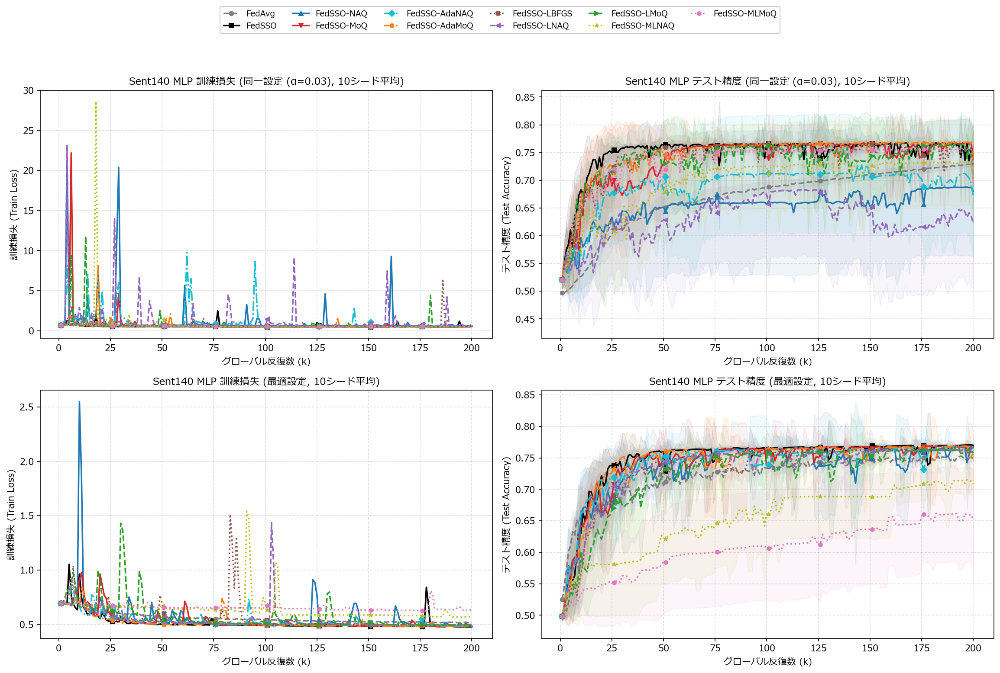
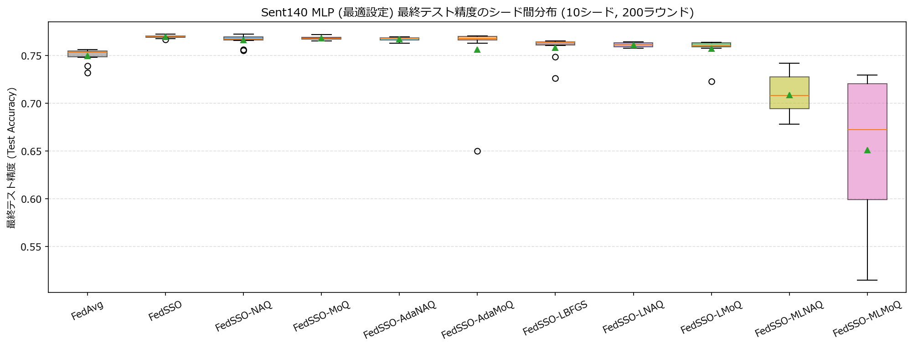

# 実験10 (ex010): Sent140 + GloVe Twitter 27B 感情分類 MLP ($d=15,010, N=10$, 200 ラウンド) 比較実験

## 1. 実験の目的

本実験（[ex010.ipynb](../ex010/ex010.ipynb)）では、論文 *"FedSSO: A Federated Server-Side Second-Order Optimization Algorithm"* (Ma et al., 2022) の Appendix Figure 8(c,d,g,h)（`Sent140 # MLP`, GloVe Twitter 27B 埋め込み, $N = 10$ 自然 Non-IID, 200 ラウンド）に基づき、**同一設定（$\alpha = 0.03, \eta = 1.0$）** と **最適設定（FedAvg $\alpha = 0.3$, 2次最適化系 $\alpha = 0.03, \eta = 0.3$）** の両条件で非凸 MLP 上の全 11 手法を **10 種類の乱数シード（`42`〜`51`）** で比較評価する。

---

## 2. 実験設定と実装詳細

- **データセット・自然 Non-IID 分割**: Stanford Sentiment140（`training.1600000.processed.noemoticon.csv` よりユーザ名・ツイート ID 順を維持して均等抽出した 100,000 ツイート）に対し、`glove.twitter.27B.200d.txt` の平均プーリング埋め込み（200 次元、一致語彙数 `41,039`, 埋め込み付与率 `99,773 / 100,000`）を抽出した。元の CSV が前半 80 万行 Negative / 後半 80 万行 Positive のラベル順で並んでいるため、ユーザ名ソート後に **シャッフルなしの連続 10 クライアント分割** を行うことで自然な発話者 Non-IID を構成し、各クライアント内で訓練 $75\%$・テスト $25\%$ に分割した（[ex010/utils.py](../ex010/utils.py)）。
- **モデル（`Sent140MLP`）**: 非凸 3 層多層パーセプトロン `200 -> 64 -> 32 -> 2`（ReLU 活性化, [ex010/model.py](../ex010/model.py), 総パラメータ数 $d = 15,010$、1 通信ラウンド基準通信量 $n\_c = 120,080\,\mathrm{B}$）。GPU 並列バッチ SGD（`torch.bmm` + `autograd`）の逐次 `nn.Module` ループに対する最大絶対誤差は **`2.980e-08`** である。
- **比較条件**:
  - **同一設定 (`same`)**: 全 11 手法で $\alpha = 0.03,\ \eta = 1.0,\ \tau = 5,\ \mathrm{BS} = 100,\ K = 200$。
  - **最適設定 (`opt`)**: `FedAvg` $\alpha = 0.3$、2次最適化 10 手法は $\alpha = 0.03,\ \eta = 0.3$（固定慣性 $\mu = 0.25$、適応上限 $\mu\_{\max} = 0.30$、$m = 10$、$\lambda = 10^{-4},\ \Lambda = 9,999$）。

---

## 3. 10 シード比較実験結果

### 3.1 同一設定（$\alpha=0.03, \eta=1.0$）および最適設定（2次系 $\eta=0.3$）における 200 ラウンド結果

| 設定 / 手法 | $\mathrm{Acc}$ Ave | $\mathrm{Acc}$ Med | $\mathrm{Acc}$ Best | $\mathrm{Acc}$ Worst | $\mathrm{Acc}$ Std | $\mathrm{Loss}$ Ave | $\mathrm{Acc}\ge 0.75$ 反復 (到達率) | $75\%$ 総通信量 (B) |
| :--- | :---: | :---: | :---: | :---: | :---: | :---: | :---: | :---: |
| **[同一]** `FedAvg` ($\alpha=0.03$) | 0.7294 | 0.7297 | 0.7377 | 0.7234 | **0.0045** | 0.5483 | — (0/10) | — |
| **[同一]** `FedSSO` ($\eta=1.0$) | 0.7390 | **0.7621** | 0.7710 | 0.5474 | 0.0644 | 0.6237 | **20.4** (10/10) | **2,449,632** |
| **[同一]** `FedSSO-NAQ` | 0.6800 | 0.7522 | 0.7696 | 0.4980 | 0.1195 | 0.5612 | 53.6 (7/10) | 12,745,634 |
| **[同一]** **`FedSSO-MoQ`** | **0.7414** | 0.7507 | 0.7668 | **0.6740** | **0.0252** | **0.5195** | 31.0 (10/10) | 3,722,480 |
| **[同一]** `FedSSO-AdaNAQ` | 0.6720 | 0.7243 | 0.7662 | 0.4980 | 0.1094 | 0.9269 | 52.9 (9/10) | 12,581,716 |
| **[同一]** `FedSSO-AdaMoQ` | 0.7368 | 0.7591 | **0.7713** | 0.5927 | 0.0530 | 0.5476 | 29.2 (10/10) | 3,506,336 |
| **[同一]** `FedSSO-LBFGS` | 0.7238 | 0.7518 | 0.7658 | 0.5419 | 0.0655 | 0.5979 | 30.4 (10/10) | 3,650,432 |
| **[同一]** `FedSSO-LNAQ` | 0.6227 | 0.6214 | 0.7632 | 0.4979 | 0.1186 | 0.6116 | 71.7 (7/10) | 17,102,823 |
| **[同一]** `FedSSO-LMoQ` | 0.7042 | 0.7468 | 0.7666 | 0.4979 | 0.0830 | 0.5992 | 33.3 (10/10) | 3,998,664 |

### 3.2 最適設定（FedAvg $\alpha=0.3$, 2次系 $\alpha=0.03, \eta=0.3$）の全 11 手法比較（10 シード平均）

| 手法 (最適設定) | 通信/反復 | $\mathrm{Acc}$ Ave | $\mathrm{Acc}$ Med | $\mathrm{Acc}$ Best | $\mathrm{Acc}$ Worst | $\mathrm{Acc}$ Std | $\mathrm{Loss}$ Ave | $\mathrm{Acc}\ge 0.75$ 反復 / 通信 | $75\%$ 総通信量 (B) | サーバ時間 (ms) | メモリ (MB) |
| :--- | :---: | :---: | :---: | :---: | :---: | :---: | :---: | :---: | :---: | :---: | :---: |
| `FedAvg` ($\alpha=0.3$) | $1.00\,n_c$ | 0.7499 | 0.7535 | 0.7562 | 0.7319 | 0.0077 | 0.5156 | 140.3 / 140.3 | 16,847,224 | 0.007 | 0.057 |
| **`FedSSO`** | $1.00\,n_c$ | **0.7700** | **0.7704** | 0.7724 | **0.7670** | **0.0015** | **0.4775** | **28.7** / **28.7** | **3,446,296** | 6.209 | 859.681 |
| `FedSSO-NAQ` | $1.995\,n_c$ | 0.7663 | 0.7676 | **0.7726** | 0.7557 | 0.0055 | 0.4853 | 36.6 / 72.2 | 8,669,776 | 6.134 | 859.795 |
| **`FedSSO-MoQ`** | $1.00\,n_c$ | 0.7684 | 0.7682 | 0.7719 | 0.7653 | 0.0018 | 0.4810 | 32.5 / 32.5 | 3,902,600 | 6.294 | 859.852 |
| `FedSSO-AdaNAQ` | $1.995\,n_c$ | 0.7674 | 0.7682 | 0.7697 | 0.7630 | 0.0021 | 0.4848 | 32.8 / 64.6 | 7,757,168 | 6.251 | 859.795 |
| `FedSSO-AdaMoQ` | $1.00\,n_c$ | 0.7563 | 0.7679 | 0.7705 | 0.6503 | 0.0354 | 0.4950 | 30.4 / 30.4 | 3,650,432 | 6.259 | 859.852 |
| `FedSSO-LBFGS` ($m=10$) | $1.00\,n_c$ | 0.7584 | 0.7639 | 0.7656 | 0.7264 | 0.0116 | 0.5012 | 54.4 / 54.4 | 6,532,352 | 1.075 | 1.374 |
| **`FedSSO-LNAQ`** ($m=10$) | $1.995\,n_c$ | 0.7614 | 0.7616 | 0.7646 | 0.7577 | 0.0023 | 0.4988 | 53.8 / 106.6 | 12,800,528 | 1.485 | 1.489 |
| `FedSSO-LMoQ` ($m=10$) | $1.00\,n_c$ | 0.7575 | 0.7602 | 0.7640 | 0.7230 | 0.0117 | 0.5026 | 59.8 / 59.8 | 7,180,784 | 1.332 | 1.546 |
| `FedSSO-MLNAQ` | $1.995\,n_c$ | 0.7090 | 0.7083 | 0.7422 | 0.6783 | 0.0207 | 0.5749 | — (0/10) | — | 0.663 | **0.458** |
| `FedSSO-MLMoQ` | $1.00\,n_c$ | 0.6513 | 0.6727 | 0.7298 | 0.5150 | 0.0769 | 0.6474 | — (0/10) | — | **0.521** | **0.515** |

---

## 4. 実験結果の考察

1. **同一設定 ($\eta=1.0$) の過大ステップ環境と最適設定 ($\eta=0.3$) での劇的安定化**:
   非凸 3 層 MLP 上で $\eta = 1.0$ を用いる同一設定では、初期曲率推定の不安定さから多くの手法でシード別振動が発生した（`FedSSO` Worst `0.5474`, `FedSSO-NAQ` `0.4980`）が、サーバ側外挿を用いる **`FedSSO-MoQ`** が全手法中最高の平均精度（`0.7414`, Loss `0.5195`, Std `0.0252`）を保ち最も強靭であった。さらに非凸標準の **$\eta = 0.3$**（最適設定）へ調整すると全フル行列・L-BFGS 系が劇的に安定化し、**`FedSSO`**（**`0.7700`**, Std **`0.0015`**, Worst **`0.7670`**）および **`FedSSO-MoQ`**（**`0.7684`**, Std **`0.0018`**, Worst **`0.7653`**）が `FedAvg`（`0.7499`）に対して精度 +1.85〜+2.01 ポイント向上・$75\%$ 到達速度 **4.3〜4.9 倍高速化（28.7〜32.5 反復 vs 140.3 反復）**・総通信量 **約 77〜80% 削減（3.45〜3.90 MB vs 16.85 MB）** を達成した。
2. **省メモリ L-BFGS 領域における `FedSSO-LNAQ` の最悪ケース安定化**:
   自然言語 MLP の記憶制限（$m = 10$, メモリ `1.37〜1.55 MB` = フル行列 `860 MB` 比 **99.83% 削減**）グループでは、`FedSSO-LBFGS`（Worst `0.7264`, `Std = 0.0116`）や `FedSSO-LMoQ`（Worst `0.7230`）で見られた一部シードの停滞を **`FedSSO-LNAQ`**（**Ave `0.7614`, Worst `0.7577`, Std `0.0023`**）が完全に解消し、全 10 シードで `FedAvg`（Best `0.7562`）を上回る安定収束を達成した。
