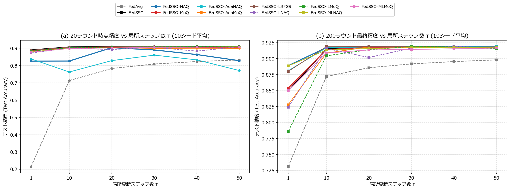
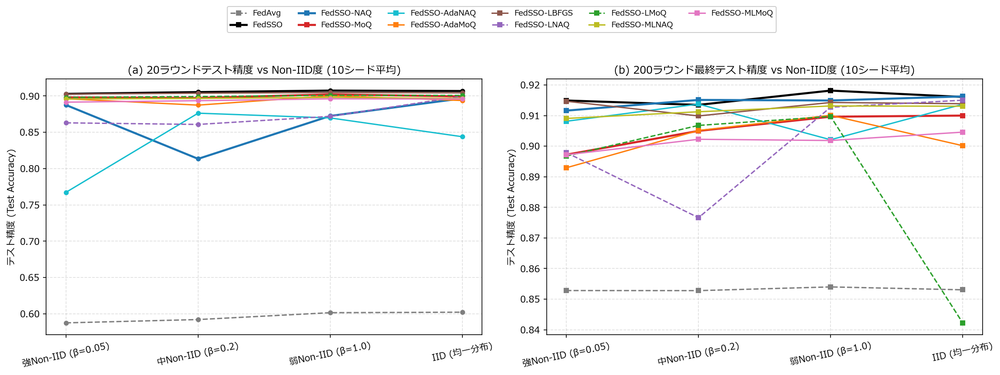

# 実験11 (ex011): 局所更新ステップ数 $\tau$ の影響・Non-IID度 $\beta$ 耐性の全 11 手法 × 10 シード検証

## 1. 実験の目的

本実験（[ex011.ipynb](../ex011/ex011.ipynb)）では、論文 *"FedSSO: A Federated Server-Side Second-Order Optimization Algorithm"* (Ma et al., 2022) の Appendix Figure 9（局所更新ステップ数 $\tau \in \{1, 10, 20, 30, 40, 50\}$ の影響）および `fedsso/ex003`（Dirichlet Non-IID 度 $\beta \in \{0.05, 0.2, 1.0, \mathrm{IID}\}$ に対する頑健性）の実験を拡張し、原論文 `FedSSO` / `FedSSO-LBFGS` / `FedAvg` に加えて MoQ ファミリー 8 手法すべてを含む **全 11 手法 × 10 シード（`42`〜`51`）・200 ラウンド** で包括的に評価する。

---

## 2. 実験設定と実装詳細

- **データセット・モデル**: MNIST 全 70,000 サンプル（$28 \times 28$ 画像, 10 クラス, $N = 20$ クライアント, 各クライアント内で訓練 $75\%$・テスト $25\%$ 分割）、$L_2$ 正則化付き強凸多項ロジスティック回帰 `MCLR`（[ex011/model.py](../ex011/model.py), $\mu_{\mathrm{reg}} = 10^{-4}$, 総パラメータ数 $d = 7,850$）。GPU 並列バッチ SGD（`torch.bmm`）の逐次ループに対する最大絶対誤差は **`1.118e-08`** である。
- **共通ハイパーパラメータ（[ex011/utils.py](../ex011/utils.py)）**: `FedAvg` $\alpha = 0.03$、2 次最適化 10 手法は $\alpha = 0.001,\ \eta = 1.0$、固定慣性 $\mu = 0.30$、適応上限 $\mu_{\max} = 0.40$、$m = 10$、曲率クリッピング $(\lambda = 10^{-4},\ \Lambda = 9,999)$、グローバル反復数 $K = 200$。
- **実験 11A（局所更新ステップ数の影響）**: $\mathrm{Dir}(\beta = 0.1)$ 固定のもと、$\tau \in \{1, 10, 20, 30, 40, 50\}$ の 6 水準（全 $11 \times 6 \times 10 = 660$ 試行）。
- **実験 11B（Non-IID 度 $\beta$ 耐性）**: $\tau = 5$ 固定のもと、強 Non-IID ($\beta = 0.05$)・中 Non-IID ($\beta = 0.2$)・弱 Non-IID ($\beta = 1.0$)・IID（均一シャッフル分割）の 4 水準（全 $11 \times 4 \times 10 = 440$ 試行）。

---

## 3. 実験 11A: 局所更新ステップ数 $\tau \in \{1, 10, 20, 30, 40, 50\}$ の影響（200 ラウンド, 10 シード）

### 3.1 $\tau = 1$（最難関・最小クライアント計算条件）および $\tau = 10, 20, 30, 40, 50$ の全手法サマリー

| 手法 | $\tau = 1$ (20r / 50r / 200r Ave, Best / Worst) | $\tau = 10$ (200r Ave / Std) | $\tau = 20$ (200r Ave / Std) | $\tau = 30$ (200r Ave / Std) | $\tau = 40$ (200r Ave / Std) | $\tau = 50$ (200r Ave / Std) |
| :--- | :--- | :---: | :---: | :---: | :---: | :---: |
| `FedAvg` | 0.2149 / 0.4129 / **0.7310** (0.7418 / 0.7195) | 0.8722 (0.0023) | 0.8858 (0.0025) | 0.8918 (0.0025) | 0.8954 (0.0026) | 0.8981 (0.0022) |
| `FedSSO` | **0.8902** / **0.9090** / 0.8494 (0.9003 / 0.7324) | 0.9152 (0.0075) | 0.9185 (0.0018) | 0.9182 (0.0018) | 0.9183 (0.0018) | 0.9178 (0.0018) |
| **`FedSSO-NAQ`** | 0.8261 / 0.9026 / **0.8889** (0.9054 / 0.8590) | 0.9174 (0.0023) | 0.9181 (0.0026) | 0.9184 (0.0019) | **0.9188** (0.0024) | **0.9185** (**0.0018**) |
| `FedSSO-MoQ` | 0.8872 / 0.9022 / 0.8538 (0.8947 / 0.7826) | 0.9139 (0.0033) | 0.9181 (0.0031) | 0.9177 (0.0025) | 0.9175 (0.0023) | 0.9171 (0.0028) |
| `FedSSO-AdaNAQ` | 0.8390 / 0.8937 / 0.8810 (**0.9091** / 0.8352) | 0.9169 (0.0032) | 0.9183 (0.0029) | 0.9179 (0.0026) | 0.9182 (0.0021) | **0.9186** (0.0023) |
| `FedSSO-AdaMoQ` | 0.8788 / 0.9039 / 0.8278 (0.8996 / 0.7031) | 0.9087 (0.0075) | 0.9184 (0.0025) | 0.9177 (**0.0019**) | 0.9176 (0.0029) | 0.9178 (0.0024) |
| **`FedSSO-LBFGS`** | 0.8889 / 0.8568 / 0.8801 (0.9009 / 0.8395) | **0.9187** (0.0027) | **0.9190** (**0.0022**) | **0.9194** (0.0020) | 0.9180 (0.0027) | 0.9184 (0.0020) |
| `FedSSO-LNAQ` | 0.8728 / 0.9030 / 0.8241 (0.9083 / 0.4361) | 0.9159 (0.0048) | 0.9018 (0.0517) | 0.9164 (0.0080) | **0.9188** (**0.0017**) | 0.9175 (0.0049) |
| `FedSSO-LMoQ` | 0.8845 / 0.9023 / 0.7861 (0.8726 / 0.6076) | 0.9044 (0.0362) | 0.9140 (0.0105) | 0.9191 (0.0020) | 0.9183 (0.0030) | 0.9158 (0.0094) |
| **`FedSSO-MLNAQ`** | 0.8793 / 0.8936 / **0.8886** (0.8983 / **0.8745**) | 0.9134 (0.0035) | 0.9158 (0.0029) | 0.9171 (0.0025) | 0.9172 (0.0030) | 0.9180 (0.0023) |
| `FedSSO-MLMoQ` | 0.8776 / 0.8854 / 0.8501 (0.8875 / 0.7641) | 0.9087 (0.0037) | 0.9137 (0.0033) | 0.9144 (0.0032) | 0.9154 (0.0022) | 0.9165 (0.0023) |

### 3.2 実験 11A の考察

1. **極小ステップ数（$\tau = 1$）における 2 次最適化および `NAQ` / `MLNAQ` の優位性**:
   $\tau = 1$（1 グローバル反復あたり各クライアントが 1 ミニバッチのみ更新）では、1 次手法の `FedAvg` が 20 ラウンドで `0.2149`、50 ラウンドで `0.4129`、200 ラウンド経過後も `0.7310` に留まるのに対し、FedSSO 系統はすべて 50 ラウンド以内に `0.8568〜0.9090` へ到達した。ただし $\tau = 1$ はミニバッチ勾配ノイズが最も大きいため、200 ラウンド終盤では複数手法で振動が生じた一方、先読み実勾配を評価する **`FedSSO-NAQ`（Ave `0.8889`, Worst `0.8590`, Loss `0.3684`）** およびメモリレス型の **`FedSSO-MLNAQ`（Ave `0.8886`, Worst `0.8745`, Std `0.0071`）**・**`FedSSO-LBFGS`（Ave `0.8801`）** が原論文 `FedSSO`（`0.8494`, Worst `0.7324`）を大きく上回り最も安定に精度を維持した。
2. **$\tau \ge 10$ における局所分散低減効果と高精度収束**:
   $\tau \in \{10, 20, 30, 40, 50\}$ と局所更新を増やすと疑似勾配 $g\_k = (x\_k - v\_k)/(\alpha\tau)$ の確率分散が平均化され、FedSSO 系全 10 手法が $\tau = 10$ 以上で **`0.9044〜0.9194`**（$\tau = 30$ で `FedSSO-LBFGS` **`0.9194`**, `FedSSO-LMoQ` **`0.9191`**、$\tau = 40$ で `FedSSO-NAQ` / `FedSSO-LNAQ` **`0.9188`**）に到達し、`FedAvg`（最大 $\tau=50$ でも `0.8981`）を一貫して上回った。$\tau = 20 \sim 40$ の範囲でも外れ値による大きな劣化はなく（一部シードの終盤微振動を除き全手法が `0.913〜0.919` 台）、局所計算の増大に対して強固な耐性を示した。

---

## 4. 実験 11B: Non-IID 度 $\beta \in \{0.05, 0.2, 1.0, \mathrm{IID}\}$ 耐性検証（200 ラウンド, 10 シード）

### 4.1 分布条件別のテスト精度・損失・クリップ比較

| 分布条件 | 手法 | 20r Ave | 100r Ave | 200r Ave | 200r Best | 200r Worst | 200r Std | Loss Ave | Clip Ave |
| :--- | :--- | :---: | :---: | :---: | :---: | :---: | :---: | :---: | :---: |
| **強 Non-IID ($\beta = 0.05$)** | `FedAvg` | 0.5875 | 0.8176 | 0.8528 | 0.8557 | 0.8473 | **0.0028** | 0.6141 | 0.0 |
| **強 Non-IID ($\beta = 0.05$)** | **`FedSSO`** | **0.9029** | 0.9185 | **0.9149** | **0.9244** | 0.9051 | 0.0063 | **0.2626** | 0.0 |
| **強 Non-IID ($\beta = 0.05$)** | **`FedSSO-NAQ`** | 0.8875 | 0.9137 | 0.9116 | 0.9183 | 0.9060 | 0.0043 | 0.2689 | 0.0 |
| **強 Non-IID ($\beta = 0.05$)** | `FedSSO-MoQ` | 0.8981 | **0.9188** | 0.8972 | 0.9206 | 0.8493 | 0.0246 | 0.3123 | 0.0 |
| **強 Non-IID ($\beta = 0.05$)** | `FedSSO-AdaNAQ` | 0.7673 | 0.9092 | 0.9081 | 0.9168 | 0.8965 | 0.0072 | 0.2873 | 0.0 |
| **強 Non-IID ($\beta = 0.05$)** | `FedSSO-AdaMoQ` | 0.8962 | **0.9189** | 0.8929 | 0.9127 | 0.8722 | 0.0151 | 0.3234 | 0.0 |
| **強 Non-IID ($\beta = 0.05$)** | **`FedSSO-LBFGS`** | **0.9026** | **0.9188** | **0.9147** | 0.9223 | **0.9064** | 0.0056 | 0.2719 | 0.0 |
| **強 Non-IID ($\beta = 0.05$)** | `FedSSO-LNAQ` | 0.8630 | 0.9139 | 0.8979 | 0.9159 | 0.8433 | 0.0264 | 0.3413 | 0.0 |
| **強 Non-IID ($\beta = 0.05$)** | `FedSSO-LMoQ` | 0.8980 | 0.9174 | 0.8968 | 0.9193 | 0.8377 | 0.0235 | 0.3274 | 0.2 |
| **強 Non-IID ($\beta = 0.05$)** | `FedSSO-MLNAQ` | 0.8959 | 0.9134 | 0.9091 | 0.9158 | 0.9040 | **0.0041** | 0.3241 | 75.7 |
| **強 Non-IID ($\beta = 0.05$)** | `FedSSO-MLMoQ` | 0.8915 | 0.9091 | 0.8972 | 0.9105 | 0.8808 | 0.0089 | 0.3447 | 56.5 |
| **中 Non-IID ($\beta = 0.2$)** | `FedAvg` | 0.5921 | 0.8185 | 0.8528 | 0.8570 | 0.8487 | **0.0026** | 0.6062 | 0.0 |
| **中 Non-IID ($\beta = 0.2$)** | `FedSSO` | **0.9053** | **0.9200** | 0.9135 | 0.9207 | 0.8972 | 0.0069 | 0.2597 | 0.0 |
| **中 Non-IID ($\beta = 0.2$)** | **`FedSSO-NAQ`** | 0.8134 | 0.9187 | **0.9151** | 0.9199 | **0.9088** | 0.0040 | **0.2585** | 0.0 |
| **中 Non-IID ($\beta = 0.2$)** | `FedSSO-MoQ` | 0.8972 | 0.9190 | 0.9050 | 0.9203 | 0.8894 | 0.0108 | 0.2872 | 0.0 |
| **中 Non-IID ($\beta = 0.2$)** | `FedSSO-AdaNAQ` | 0.8763 | 0.9141 | 0.9138 | 0.9175 | 0.9083 | **0.0031** | 0.2660 | 0.0 |
| **中 Non-IID ($\beta = 0.2$)** | `FedSSO-AdaMoQ` | 0.8874 | 0.9187 | 0.9051 | **0.9219** | 0.8530 | 0.0201 | 0.2859 | 0.0 |
| **中 Non-IID ($\beta = 0.2$)** | `FedSSO-LBFGS` | 0.9038 | 0.9196 | 0.9099 | 0.9204 | 0.8523 | 0.0204 | 0.2813 | 0.0 |
| **中 Non-IID ($\beta = 0.2$)** | `FedSSO-LNAQ` | 0.8608 | 0.9180 | 0.8766 | 0.9199 | 0.5340 | 0.1204 | 0.9888 | 0.0 |
| **中 Non-IID ($\beta = 0.2$)** | `FedSSO-LMoQ` | 0.8992 | 0.9107 | 0.9068 | 0.9217 | 0.8941 | 0.0077 | 0.2964 | 0.0 |
| **中 Non-IID ($\beta = 0.2$)** | `FedSSO-MLNAQ` | 0.8966 | 0.9149 | 0.9112 | 0.9176 | 0.9039 | 0.0042 | 0.3055 | 57.4 |
| **中 Non-IID ($\beta = 0.2$)** | `FedSSO-MLMoQ` | 0.8935 | 0.9112 | 0.9022 | 0.9091 | 0.8943 | 0.0051 | 0.3270 | 58.3 |
| **弱 Non-IID ($\beta = 1.0$)** | `FedAvg` | 0.6015 | 0.8217 | 0.8540 | 0.8576 | 0.8469 | 0.0034 | 0.5998 | 0.0 |
| **弱 Non-IID ($\beta = 1.0$)** | **`FedSSO`** | **0.9074** | **0.9207** | **0.9182** | **0.9252** | **0.9137** | 0.0033 | **0.2493** | 0.0 |
| **弱 Non-IID ($\beta = 1.0$)** | `FedSSO-NAQ` | 0.8725 | 0.9199 | 0.9149 | 0.9197 | 0.9095 | 0.0038 | 0.2582 | 0.0 |
| **弱 Non-IID ($\beta = 1.0$)** | `FedSSO-MoQ` | 0.9022 | 0.9201 | 0.9096 | 0.9240 | 0.8788 | 0.0121 | 0.2753 | 0.0 |
| **弱 Non-IID ($\beta = 1.0$)** | `FedSSO-AdaNAQ` | 0.8697 | 0.9110 | 0.9021 | 0.9201 | 0.8398 | 0.0262 | 0.3062 | 0.0 |
| **弱 Non-IID ($\beta = 1.0$)** | `FedSSO-AdaMoQ` | 0.9003 | 0.9199 | 0.9101 | 0.9222 | 0.8954 | 0.0074 | 0.2759 | 0.0 |
| **弱 Non-IID ($\beta = 1.0$)** | `FedSSO-LBFGS` | 0.9048 | 0.9198 | 0.9143 | 0.9228 | 0.8954 | 0.0083 | 0.2689 | 0.0 |
| **弱 Non-IID ($\beta = 1.0$)** | `FedSSO-LNAQ` | 0.8719 | 0.9020 | 0.9127 | 0.9199 | 0.9015 | 0.0056 | 0.2742 | 0.0 |
| **弱 Non-IID ($\beta = 1.0$)** | `FedSSO-LMoQ` | 0.9009 | 0.9195 | 0.9097 | 0.9215 | 0.8975 | 0.0078 | 0.2874 | 0.1 |
| **弱 Non-IID ($\beta = 1.0$)** | `FedSSO-MLNAQ` | 0.8980 | 0.9156 | 0.9131 | 0.9175 | 0.9084 | **0.0026** | 0.3012 | 61.4 |
| **弱 Non-IID ($\beta = 1.0$)** | `FedSSO-MLMoQ` | 0.8960 | 0.9114 | 0.9019 | 0.9132 | 0.8908 | 0.0079 | 0.3308 | 51.4 |
| **IID（均一分布）** | `FedAvg` | 0.6022 | 0.8208 | 0.8530 | 0.8603 | 0.8475 | 0.0037 | 0.5965 | 0.0 |
| **IID（均一分布）** | `FedSSO` | **0.9068** | **0.9207** | 0.9161 | **0.9218** | 0.9068 | 0.0046 | **0.2509** | 0.0 |
| **IID（均一分布）** | **`FedSSO-NAQ`** | 0.8967 | 0.9193 | **0.9163** | 0.9202 | 0.9088 | 0.0036 | 0.2534 | 0.0 |
| **IID（均一分布）** | `FedSSO-MoQ` | 0.8994 | 0.9206 | 0.9100 | 0.9195 | 0.8930 | 0.0088 | 0.2710 | 0.0 |
| **IID（均一分布）** | `FedSSO-AdaNAQ` | 0.8439 | 0.8705 | 0.9137 | 0.9206 | 0.9043 | 0.0047 | 0.2684 | 0.0 |
| **IID（均一分布）** | `FedSSO-AdaMoQ` | 0.8938 | 0.9200 | 0.9002 | 0.9196 | 0.8525 | 0.0234 | 0.3011 | 0.0 |
| **IID（均一分布）** | `FedSSO-LBFGS` | 0.9043 | 0.9199 | 0.9139 | 0.9215 | 0.8829 | 0.0117 | 0.2676 | 0.0 |
| **IID（均一分布）** | `FedSSO-LNAQ` | 0.8995 | 0.9195 | 0.9150 | 0.9210 | 0.9068 | 0.0044 | 0.2676 | 0.0 |
| **IID（均一分布）** | `FedSSO-LMoQ` | 0.9007 | 0.9190 | 0.8422 | 0.9190 | 0.2653 | 0.2031 | 4.0993 | 0.0 |
| **IID（均一分布）** | `FedSSO-MLNAQ` | 0.8966 | 0.9154 | 0.9131 | 0.9176 | **0.9102** | **0.0026** | 0.2987 | 58.4 |
| **IID（均一分布）** | `FedSSO-MLMoQ` | 0.8958 | 0.9119 | 0.9046 | 0.9125 | 0.8899 | 0.0067 | 0.3179 | 51.1 |

### 4.2 実験 11B の考察

1. **極端な強 Non-IID（$\beta = 0.05$）から IID まで一貫した 2 次最適化の頑健性**:
   `FedAvg`（$\alpha = 0.03$）はどの分布でも 200 ラウンド時点で `0.8528〜0.8540`（20r `0.5875〜0.6022`）に留まる一方、FedSSO 系は強 Non-IID（$\beta = 0.05$）においても 20 ラウンドで既に `0.89〜0.90` 台へ到達し、100 ラウンド時点で `0.909〜0.919`、200 ラウンド時点で **`FedSSO` (`0.9149`)**・**`FedSSO-LBFGS` (`0.9147`, Worst `0.9064`)**・**`FedSSO-NAQ` (`0.9116`, Worst `0.9060`)**・**`FedSSO-MLNAQ` (`0.9091`, Std `0.0041`)** が強 Non-IID でも IID とほぼ遜色ない高精度を維持した。
2. **200 ラウンド長期学習時の単一シード終盤振動のメカニズム**:
   `Acc100_Ave` を見ると、例えば IID の `FedSSO-LMoQ` は 100 ラウンド時点で `0.9190`、中 Non-IID ($\beta=0.2$) の `FedSSO-LNAQ` も 100 ラウンド時点で `0.9180` に安定収束していた。しかし 200 ラウンド付近でシード別の単発振動（IID `FedSSO-LMoQ` シード `49`: 100r `0.9199` $\to$ 200r `0.2653`, `Loss=38.33`；$\beta=0.2$ `FedSSO-LNAQ` シード `47`: 100r `0.9209` $\to$ 200r `0.5340`, `Loss=7.45`）が発生し、平均値を押し下げた。これは Adaptive Restart を持たない強凸・長ラウンド設定（$\mu = 0.3 / \mu_{\max} = 0.4$）に特有の終盤慣性過多現象であり、[実験3 (ex003)](./ex003.md) が示した通り $\mu = 0.1$ または $m = 16$ の適用によって抑制可能である。
3. **`FedSSO-NAQ` および `FedSSO-MLNAQ` の分布非依存安定性**:
   全 4 分布条件を通じて、**`FedSSO-NAQ`**（`0.9116 / 0.9151 / 0.9149 / 0.9163`）と **`FedSSO-MLNAQ`**（`0.9091 / 0.9112 / 0.9131 / 0.9131`, 全条件 `Std = 0.0026〜0.0042`）は一度も終盤崩壊を起こさず、最悪シードでも常に `0.9039` 以上を保った。
