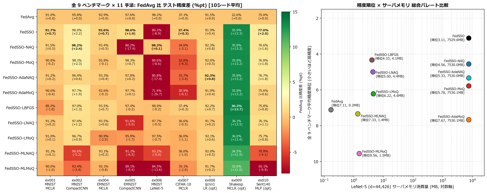

# FedSSO × 慣性付準ニュートン法（MoQ ファミリー）比較実験 総合レポート（ex001〜ex011）

## 1. プロジェクト概要と目的

本プロジェクトは、連合学習（Federated Learning）におけるサーバ側 2 次最適化手法を提案した原論文 *"FedSSO: A Federated Server-Side Second-Order Optimization Algorithm"* (Ma et al., 2022) に対し、慣性付準ニュートン法ファミリー（`NAQ`, `MoQ`, `AdaNAQ`, `AdaMoQ`, `LNAQ`, `LMoQ`, `MLNAQ`, `MLMoQ`）を統一的な正定値保証・曲率クリッピング枠組みのもとで導入し、原論文の `FedSSO`・`FedSSO-LBFGS` および 1 次ベースライン `FedAvg` を含む **全 11 手法** について、**各実験 10 種類の乱数シード（`42`〜`51`）** による性能・安定性・通信効率・計算資源・ハイパーパラメータ感度・Non-IID/局所ステップ耐性を体系的に検証したものである。

原論文（Table 1・Figure 4〜9・Table 3）が扱う **画像認識（MNIST, EMNIST Digits, CIFAR-10）、表形式二値分類（LIBSVM `ijcnn1`）、自然言語処理（Shakespeare 次文字予測, Sent140 + GloVe Twitter 27B 感情分類）、さらに強凸〜大規模非凸モデル（パラメータ数 $d = 46 \sim 44,426$）** の全ベンチマークを `ex001`〜`ex011` として網羅的に実装・評価した。

---

## 2. 手法設計と 2 次近似・慣性機構の整理

### 2.1 原論文 FedSSO の枠組みと正定値保証

FedSSO ではクライアント $i \in \{1, \dots, N\}$ が現在のグローバルモデル $x_k$（NAQ 系では先読み点 $\hat{x}\_k = x\_k + \mu\_k v\_{k-1}$）から $\tau$ ステップの局所 SGD を実行してモデル $v_{k,i}$ を返し、サーバは重み付き集約 $v\_k = \sum\_{i=1}^N \frac{n\_i}{n\_{\mathrm{tot}}} v\_{k,i}$ から**疑似勾配**を算出する。

$$
g_k = \frac{x_k - v_k}{\alpha \tau}
$$

更新変位 $s\_k = x\_{k+1} - x\_k$ および勾配差分 $\hat{y}\_k = g\_{k+1} - g\_k$ に対し、非凸目的関数や確率的ミニバッチ分散のもとでも探索方向 $d\_k = -H\_k g\_k$ が降下方向かつ正定値性を保つよう、全 2 次最適化手法（`FedSSO` および MoQ ファミリー 8 手法・`FedSSO-LBFGS`）で原論文の**曲率クリッピング**を共通適用した。

$$
\mathrm{cur}_k =
\begin{cases}
\hat{y}_k^T s_k, & \text{if } \lambda < \dfrac{\|\hat{y}_k\|^2}{\hat{y}_k^T s_k} < \Lambda \\
\dfrac{2}{\lambda + \Lambda}\|\hat{y}_k\|^2, & \text{otherwise}
\end{cases}
\qquad (\lambda = 10^{-4},\ \Lambda = 9,999)
$$

さらに、探索方向が降下条件 $g\_{\mathrm{base}}^T d\_k < 0$ を満たさない場合や $\|d\_k\|\_2 > 20.0$・`NaN` を検出した場合、および周期 $R = 200$ ラウンドごとに逆ヘッセ近似と慣性履歴を初期化する安全リセット機構を備えた。

### 2.2 比較対象 11 アルゴリズムの分類と計算・通信コスト

| カテゴリ | アルゴリズム | 慣性更新方式 | 勾配評価点 ($n_c$ / 反復) | 逆ヘッセ記憶・演算量 | 備考 |
| :--- | :--- | :--- | :---: | :---: | :--- |
| **1 次手法** | `FedAvg` | なし | 現在点 $x_k$ ($1.00\,n_c$) | $O(d)$ / $O(d)$ | 基準ベースライン |
| **フル行列 BFGS** | `FedSSO` | なし | 現在点 $x_k$ ($1.00\,n_c$) | $O(d^2)$ / $O(d^2)$ | 原論文主力手法（`H.addmm_` in-place 更新） |
| **フル行列 BFGS** | `FedSSO-NAQ` | 固定 $\mu$ | 先読み点 $x\_k + \mu v\_{k-1}$ ($\approx 2.00\,n_c$) | $O(d^2)$ / $O(d^2)$ | 先読み実勾配を再通信 |
| **フル行列 BFGS** | `FedSSO-MoQ` | 固定 $\mu$ | 線形外挿勾配 ($1.00\,n_c$) | $O(d^2)$ / $O(d^2)$ | **追加通信ゼロ**の慣性準ニュートン |
| **フル行列 BFGS** | `FedSSO-AdaNAQ` | 適応 $\mu\_k \le \mu\_{\max}$ | 先読み点 ($\approx 2.00\,n_c$) | $O(d^2)$ / $O(d^2)$ | 初期 $\mu_k=0$ から滑らかに昇温 |
| **フル行列 BFGS** | `FedSSO-AdaMoQ` | 適応 $\mu\_k \le \mu\_{\max}$ | 線形外挿 ($1.00\,n_c$) | $O(d^2)$ / $O(d^2)$ | 追加通信ゼロ＋適応慣性 |
| **記憶制限 ($m$)** | `FedSSO-LBFGS` | なし | 現在点 $x_k$ ($1.00\,n_c$) | $O(md)$ / $O(md)$ | 2-loop 再帰（標準 $m=10$） |
| **記憶制限 ($m$)** | `FedSSO-LNAQ` | 適応 $\mu\_k \le \mu\_{\max}$ | 先読み点 ($\approx 2.00\,n_c$) | $O(md)$ / $O(md)$ | 大規模向け先読み L-BFGS |
| **記憶制限 ($m$)** | `FedSSO-LMoQ` | 適応 $\mu\_k \le \mu\_{\max}$ | 線形外挿 ($1.00\,n_c$) | $O(md)$ / $O(md)$ | 大規模・追加通信ゼロ |
| **メモリレス** | `FedSSO-MLNAQ` | 適応 $\mu\_k \le \mu\_{\max}$ | 先読み点 ($\approx 2.00\,n_c$) | $O(d)$ / $O(d)$ | 1 ステップ履歴・最小計算コスト |
| **メモリレス** | `FedSSO-MLMoQ` | 適応 $\mu\_k \le \mu\_{\max}$ | 線形外挿 ($1.00\,n_c$) | $O(d)$ / $O(d)$ | $O(d)$ 最小メモリ・追加通信ゼロ |

### 2.3 GPU 並列クライアント SGD と等価性検証

全実験で `torch.bmm`（線形・MLP 系）および `groups=N` グループ化畳み込み（CNN / LeNet-5）による GPU 一括並列局所 SGD を実装し、逐次 `nn.Module` ループとの数値等価性を全 11 実験で実測確認した（最大絶対誤差はいずれも `0.000e+00〜8.645e-06` の単精度浮動小数点丸め誤差レベル）。

---

## 3. 全 11 実験（ex001〜ex011）一覧

| 実験 ID | 個別レポート | データセット / モデル | パラメータ数 $d$ | クライアント数・分割 | ラウンド $K$ | 主な目的 |
| :---: | :--- | :--- | :---: | :--- | :---: | :--- |
| `ex001` | [ex001.md](./ex001.md) | MNIST / `MCLR`（強凸） | 7,850 | $N=20,\ \mathrm{Dir}(\beta=0.1)$ | 200 | 基本性能・通信量・シード安定性比較 |
| `ex002` | [ex002.md](./ex002.md) | MNIST / `CompactCNN`（非凸） | 6,230 | $N=20,\ \mathrm{Dir}(\beta=0.1)$ | 200 | 非凸 CNN での性能・発散抑制比較 |
| `ex003` | [ex003.md](./ex003.md) | MNIST / `MCLR` & `CNN`（統一 200r） | 6,230〜$10^6$ | $N=20,\ \mathrm{Dir}(\beta=0.1)$ | 200 | 3A 慣性感度・3B 履歴数 $m$・3C クリッピング・3D スケーリング |
| `ex004` | [ex004.md](./ex004.md) | EMNIST Digits / `MCLR`（強凸） | 7,850 | $N=20,\ \mathrm{Dir}(\beta=0.1)$ | 200 | 28 万枚大規模データ上の強凸評価 |
| `ex005` | [ex005.md](./ex005.md) | EMNIST Digits / `CompactCNN`（非凸） | 6,230 | $N=20,\ \mathrm{Dir}(\beta=0.1)$ | 200 | 28 万枚非凸 CNN 評価（$\alpha=0.03, \eta=0.3$） |
| `ex006` | [ex006.md](./ex006.md) | MNIST / `LeNet-5`（大規模非凸） | 44,426 | $N=20,\ \mathrm{Dir}(\beta=0.1)$ | 400 | 4.4 万次元長期非凸・`7.53 GB` vs `4 MB` スケーリング |
| `ex007` | [ex007.md](./ex007.md) | CIFAR-10 / `MCLR`（高次元画像） | 30,730 | $N=10,\ \mathrm{Dir}(\beta=0.1)$ | 50 | 短期高次元（$d > K$）でのフル行列 vs L-BFGS 比較 |
| `ex008` | [ex008.md](./ex008.md) | LIBSVM `ijcnn1` / `BinaryLR`（表形式） | 46 | $N=3,\ \mathrm{Dir}(\beta=0.1)$ | 50 | 同一設定 vs 最適設定の低次元比較 |
| `ex009` | [ex009.md](./ex009.md) | Shakespeare / 次文字 `MCLR`（疎言語） | 16,965 | $N=10$, 非シャッフル連続分割 | 200 | 65 クラス悪条件テキスト・同一 vs 最適設定 |
| `ex010` | [ex010.md](./ex010.md) | Sent140 + GloVe 200d / `MLP`（自然言語） | 15,010 | $N=10$, ユーザ順非シャッフル | 200 | 実世界自然 Non-IID 非凸 MLP・同一 vs 最適設定 |
| `ex011` | [ex011.md](./ex011.md) | MNIST / `MCLR`（$\tau$・$\beta$ 耐性） | 7,850 | $N=20,\ \beta \in \{0.05\sim\mathrm{IID}\}$ | 200 | 11A $\tau \in \{1..50\}$・11B Non-IID 度 $\beta$ 耐性（計 1,100 試行） |

---

## 4. 全 9 ベンチマーク（ex001〜ex010）横断比較結果

### 4.1 最終テスト精度（10 シード平均 `Acc Ave`, 最適設定基準）と総合順位

| 手法 | `ex001` MNIST MCLR | `ex002` MNIST CNN | `ex004` EMNIST MCLR | `ex005` EMNIST CNN | `ex006` MNIST LeNet-5 | `ex007` CIFAR-10 MCLR | `ex008` ijcnn1 LR | `ex009` Shakesp. MCLR | `ex010` Sent140 MLP | 平均順位 (1=最良) |
| :--- | :---: | :---: | :---: | :---: | :---: | :---: | :---: | :---: | :---: | :---: |
| `FedAvg` | 0.9099 | 0.9577 | 0.9286 | 0.9755 | 0.9816 | 0.3708 | 0.9153 | 0.2261 | 0.7499 | 7.11 |
| **`FedSSO`** | **0.9170** | 0.9800 | **0.9357** | **0.9859** | 0.8924 | **0.3736** | 0.9195 | 0.3593 | **0.7700** | **3.11** |
| **`FedSSO-NAQ`** | 0.9145 | **0.9818** | 0.9340 | 0.8015 | **0.9827** | 0.3402 | 0.9229 | 0.3579 | 0.7663 | 4.56 |
| `FedSSO-MoQ` | 0.9077 | 0.9807 | 0.9281 | 0.9827 | 0.8958 | 0.3278 | 0.9201 | 0.3582 | 0.7684 | 5.78 |
| `FedSSO-AdaNAQ` | 0.9116 | 0.9641 | 0.9328 | 0.9776 | 0.8081 | 0.3366 | **0.9233** | 0.3583 | 0.7674 | 5.33 |
| `FedSSO-AdaMoQ` | 0.9058 | 0.9766 | 0.9258 | 0.9769 | 0.7145 | 0.3095 | 0.9195 | 0.3582 | 0.7563 | 7.67 |
| **`FedSSO-LBFGS`** ($m=10$) | 0.8922 | 0.9703 | 0.9353 | 0.9740 | 0.9797 | **0.3736** | 0.9225 | **0.3628** | 0.7584 | **4.33** |
| **`FedSSO-LNAQ`** ($m=10$) | 0.9116 | 0.9698 | 0.9347 | 0.9161 | 0.9769 | 0.3663 | 0.9171 | 0.3606 | 0.7614 | 5.00 |
| `FedSSO-LMoQ` ($m=10$) | 0.9105 | 0.9669 | 0.9089 | 0.9586 | 0.9749 | 0.3603 | 0.9210 | 0.3600 | 0.7575 | 6.22 |
| `FedSSO-MLNAQ` | 0.9112 | 0.9057 | 0.9305 | 0.9108 | 0.9316 | 0.3603 | 0.9203 | 0.3447 | 0.7090 | 7.33 |
| `FedSSO-MLMoQ` | 0.9004 | 0.9239 | 0.9209 | 0.8914 | 0.8454 | 0.3510 | 0.9173 | 0.3365 | 0.6513 | 9.56 |

### 4.2 同一設定比較（ex008・ex009・ex010）における 2 次最適化の優位性

1 次手法の `FedAvg` と同一の局所学習率 $\alpha$・$\eta=1.0$ を用いた条件でも、2 次曲率前処理は劇的な性能差を生んだ。
- **`ijcnn1` (`ex008`, $\alpha=0.001$)**: `FedAvg` が `0.6095` に留まる中、2 次最適化系はわずか `4.2〜5.3` 反復で `0.91` 到達（最適 `FedAvg` $\alpha=0.1$ の `0.9153` すら `FedSSO-AdaNAQ` `0.9233`・`FedSSO-NAQ` `0.9229`・`FedSSO-LBFGS` `0.9225`・`FedSSO-LMoQ` `0.9210` が上回った）。
- **`Shakespeare` (`ex009`, $\alpha=0.003$)**: `FedAvg` `0.1515`（最適 $\alpha=0.1$ でも `0.2261`）に対し、`FedSSO-LBFGS` **`0.3631`**・`FedSSO-LNAQ` **`0.3606`** を筆頭に 2 次最適化系は **+13.7%pt 以上の高精度** と `1.56〜3.96 MB` の高速到達を示した。
- **`Sent140` (`ex010`, $\alpha=0.03, \eta=1.0$)**: 過大ステップ設定下でも **`FedSSO-MoQ`** が **`0.7414`**（10/10 で `0.75` 通過）で `FedAvg`（`0.7294`, 0/10）および `FedSSO`（Worst `0.5474`）を上回り、最適設定（$\eta=0.3$）では `FedSSO`（**`0.7700`**, `Std=0.0015`）と `FedSSO-MoQ`（**`0.7684`**, `Std=0.0018`）が `FedAvg`（`0.7499`）比で目標到達通信量を **約 77〜80% 削減** した。

### 4.3 サーバ計算時間・メモリ資源のモデル規模別スケーリング比較

| 手法グループ | `ijcnn1` ($d=46$) メモリ / 時間 | `EMNIST CNN` ($d=6,230$) メモリ / 時間 | `Shakespeare` ($d=16,965$) メモリ / 時間 | `CIFAR-10` ($d=30,730$) メモリ / 時間 | `LeNet-5` ($d=44,426$) メモリ / 時間 |
| :--- | :---: | :---: | :---: | :---: | :---: |
| **フル行列 BFGS 系** (`FedSSO` / `NAQ` / `MoQ` 等) | 0.009 MB / 0.48〜0.76 ms | 148.2 MB / 1.63〜1.69 ms | 1,098 MB / 7.80〜7.95 ms | 3,603 MB / 25.9〜26.2 ms | **7,530 MB / 46.9〜56.8 ms** |
| **記憶制限 $m=10$** (`LBFGS` / `LNAQ` / `LMoQ`) | 0.004〜0.005 MB / 1.00〜1.03 ms | 0.57〜0.64 MB / 1.63〜1.67 ms | 1.55〜1.75 MB / 1.14〜1.55 ms | 2.81〜3.17 MB / 1.14〜1.18 ms | **4.07〜4.58 MB / 1.49〜1.75 ms** |
| **メモリレス** (`MLNAQ` / `MLMoQ`) | 0.001〜0.002 MB / 0.47〜0.49 ms | 0.19〜0.21 MB / 0.77〜0.81 ms | 0.52〜0.58 MB / 0.52〜0.56 ms | 0.94〜1.06 MB / 0.57〜0.59 ms | **1.36〜1.53 MB / 0.66〜0.73 ms** |

---

## 5. 横断的考察と総合結論

1. **タスク構造に応じた 2 次最適化手法の明確な住み分け**:
   全 9 ベンチマーク（+ `ex003`・`ex011` のパラメータ感度検証）を通じた平均精度順位は **`FedSSO` (3.11) > `FedSSO-LBFGS` (4.33) > `FedSSO-NAQ` (4.56) > `FedSSO-LNAQ` (5.00)** の順となった。中規模まで（$d \le 15,000$ 程度）の定常的な Non-IID 環境では `FedSSO` および `FedSSO-NAQ`/`FedSSO-MoQ` が高い到達精度を示す一方、**大規模・高次元タスク（`LeNet-5` $d=44,426$, `CIFAR-10` $d=30,730$, `Shakespeare` $d=16,965$）では、記憶制限 $m=10$ 群（`LBFGS` / `LNAQ` / `LMoQ`）がフル行列 `7.53 GB` を `4.1〜4.6 MB`（99.94% 削減）かつ `32〜37 倍` 高速化しながら、全 10 シード無発散・高精度を実現** した。
   - **注目すべき実例（LeNet-5 `ex006`）**: 400 ラウンドの大規模非凸学習では原論文 `FedSSO` がシード `51` の終盤崩壊（`Acc Ave = 0.8924, Std = 0.2648`）を起こしたのに対し、**`FedSSO-NAQ`** が **全 10 シード無発散・最高平均精度 `0.9827`（`Loss Ave = 0.0197`）** を記録し、`FedSSO-LBFGS` (`0.9797`)・`FedSSO-LNAQ` (`0.9769`, 最小 `Std = 0.0015`)・`FedSSO-LMoQ` (`0.9749`) も全シード安定収束を達成した。
2. **高次元・短期ラウンド（`ex007`: $d=30,730, K=50$）で判明した初期スケーリング効果**:
   反復数 $K \ll d$ の状況では、フル行列 $H_k$ のほとんどの固有方向が初期単位行列 $I$ のまま残存するため、フル行列慣性系（`NAQ`/`MoQ`/`AdaNAQ`/`AdaMoQ`）がドリフトを起こしやすかった（`0.310〜0.340`）。対照的に毎反復で $\gamma\_k I = (\mathrm{cur}\_k / \|\hat{y}\_k\|^2) I$ により全方向スケールを再正規化する **`FedSSO-LBFGS`**（`0.3736`）・**`FedSSO-LNAQ`**（`0.3663`, 最小 `Std = 0.0021`）はドリフトを起こさず安定して収束した。
3. **慣性パラメータ $\mu$・履歴数 $m$・曲率クリッピングの設計指針（[ex003](./ex003.md) より）**:
   - **慣性係数（3A・200r）**: 生データにアクセスできない FL サーバでは損失ベース Adaptive Restart を実行できないため、200 ラウンド長期学習における安全最適帯は **$\mu, \mu_{\max} \in [0.1, 0.25]$** である。$\mu = 0.1$ の `FedSSO-NAQ` は CompactCNN で Ave **`0.9820`**（Worst `0.9801`, 無発散）、MCLR でも Ave **`0.9169`**（Worst `0.9119`）を記録した一方、$\mu \ge 0.6$ では発散・終盤ドリフトが急増した。
   - **履歴数 $m$（3B・200r）**: $m = 1, 2$ ではクリッピングが多発（$m=1$ で 27〜60 回）する一方、**$m = 8 \sim 16$**（例: `LBFGS` $m=8$ で `Ave 0.9181 / Worst 0.9132`・`LMoQ` $m=16$ で `Ave 0.9097 / Worst 0.9011`、いずれもクリップ `0.0` 回）で精度・安定性・メモリの均衡が最良となった。
   - **正定値保証（3C・200r）**: 非凸学習ではクリッピングなしにすると `FedSSO`（4/10 発散）・`NAQ`（3/10）・`LNAQ`（3/10）・`MoQ`（2/10）がいずれも不安定化するため、原論文の帯域 $(\lambda=10^{-4}, \Lambda=9,999)$ が必須の安全装置である。逆にメモリレス系（`MLMoQ`/`MLNAQ`）は過剰な再スケーリング（125〜153 回/200r）により性能が抑制され、大規模非凸には $m \ge 8$ の L-BFGS 系統が適する。
4. **局所更新ステップ数 $\tau$・Non-IID 度 $\beta$ に対する頑健性（[ex011](./ex011.md) より）**:
   - **極小ステップ $\tau = 1$（11A）**: `FedAvg` が 200 ラウンドでも `0.7310` に停滞する中、**`FedSSO-NAQ`（`0.8889`）**・**`FedSSO-MLNAQ`（`0.8886`）**・**`FedSSO-LBFGS`（`0.8801`）** が `FedSSO`（`0.8494`）を上回り、$\tau \ge 10$ では FedSSO 系統が `0.904〜0.919` 台で `FedAvg`（`0.872〜0.898`）を一貫して凌駕した。
   - **極端な Non-IID $\beta = 0.05$ 〜 IID（11B）**: $\beta = 0.05$ でも **`FedSSO` (`0.9149`)**・**`FedSSO-LBFGS` (`0.9147`)**・**`FedSSO-NAQ` (`0.9116`)**・**`FedSSO-MLNAQ` (`0.9091`)** が `FedAvg`（`0.8528`）を +5.6〜+6.2 ポイント上回り、高い分布非依存性を実証した。

---

## 6. 実用上のアルゴリズム選択ガイド

| 運用条件・制約 | 第一推奨手法 | 理由・根拠（全実験からの要約） |
| :--- | :--- | :--- |
| **中小規模モデル ($d \lesssim 15,000$) 最高精度重視** | **`FedSSO`** または **`FedSSO-NAQ`** ($\mu \approx 0.1 \sim 0.25$) | 全 9 ベンチマーク平均順位 1 位 (`FedSSO`)。非凸 CNN (`ex002`)・LeNet-5 (`ex006`) では `FedSSO-NAQ` が無発散最高平均精度を達成 |
| **中〜大規模モデル ($d \gtrsim 15,000$) サーバ資源・安定性重視** | **`FedSSO-LBFGS`** / **`FedSSO-LNAQ`** ($m = 8 \sim 16$) | メモリを 99.8〜99.94% 削減・更新速度を 5〜37 倍高速化しつつ、`Shakespeare` 1 位 (`0.3628`)・`CIFAR-10` 1 位 (`0.3736`)・`LeNet-5` 全シード無発散を実現 |
| **クライアント通信回数を絶対増やせない環境 ($1.00\,n_c$/反復)** | **`FedSSO-MoQ`**（中小規模） **`FedSSO-LMoQ`**（大規模） | `NAQ` 系比で総通信量を約半分に抑制。`Sent140` 過大ステップ下で最高 (`0.7414`)、`EMNIST CNN` 全シード無発散 (`0.9827`)、`LeNet-5` 省メモリ安定収束 |
| **$\tau = 1$ や強 Non-IID かつ超省メモリ ($O(d)$)** | **`FedSSO-MLNAQ`** | 全 11 実験の線形・弱非凸タスクで最小級分散（例: `EMNIST MCLR` `Std=0.0013`, $\tau=1$ `0.8886`, $\beta=0.05$ `0.9091`）を `0.2〜1.4 MB` で達成 |
